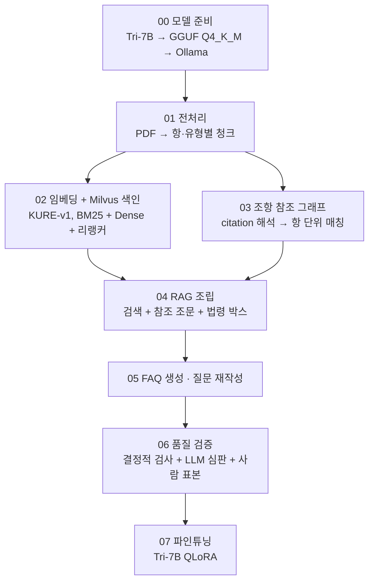
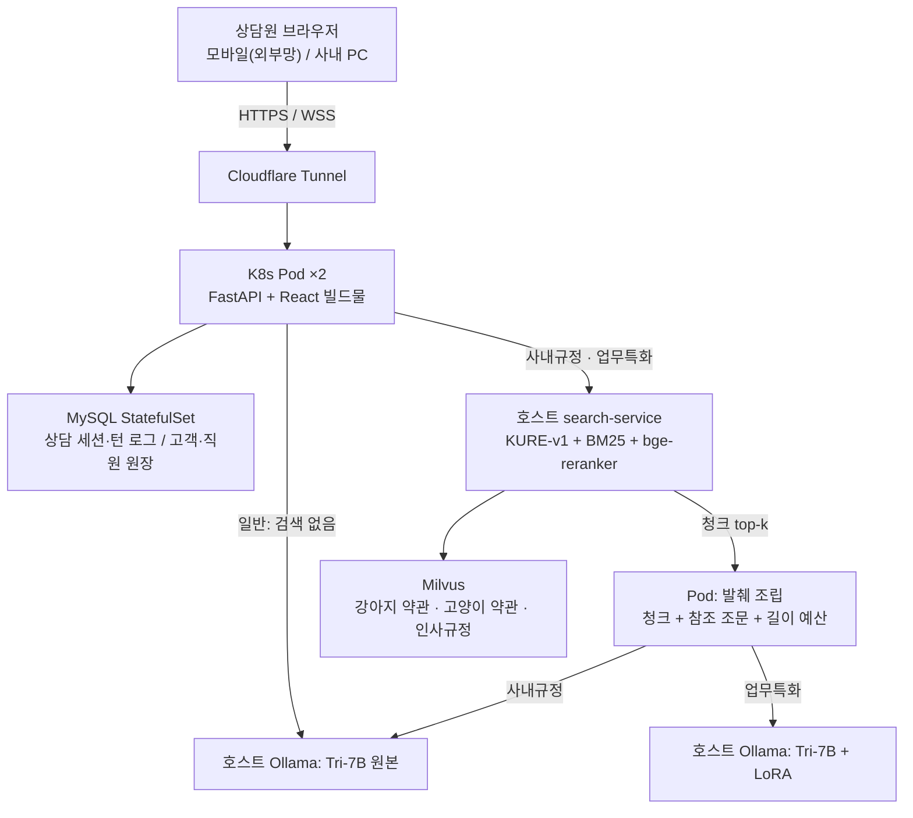

# 펫퍼민트 RAG 챗봇

반려동물 보험 약관을 묻고 답하는 상담원용 RAG 챗봇이다. 보험사 상담원은 고객 전화를 받으면서 약관 PDF를 뒤져야 한다. 이 챗봇에 물으면 근거 조항과 함께 그 고객에게 맞는 답을 바로 받는다. 데이터는 메리츠화재 홈페이지에 공개된 '펫퍼민트' 반려동물 보험 약관(강아지·고양이)과 가상 인사규정이다. 직원 원장도 가상이다.

보험에서는 "보장된다"고 잘못 안내하면 실제 지급 분쟁이 생긴다. 그래서 모델의 생성 능력에 기대지 않고, 데이터를 정밀하게 구조화해 모델이 틀릴 여지를 줄였다. 약관은 조·항 단위로 나누고, 등급·유형은 메타데이터로 밝히고, 조항끼리의 참조는 그래프로 만들었다. 답의 근거 조항은 모델이 쓰지 않고 코드가 조립한다. 계산과 조회로 답이 정해지는 질문(지급액, 가입 나이, 부담보 등)은 모델 대신 코드가 답한다. 모델 성능 검증에서 그치지 않고, 화면·세션 격리·Kubernetes 배포까지 실제 서비스 형태로 만드는 것이 목표다.

> 모델·데이터·GPU 서버는 모두 사내(로컬)에 두고, 외부 LLM API는 부르지 않는다.

## 세 가지 모드

같은 베이스 모델(Tri-7B) 하나로 탭마다 파인튜닝과 RAG를 다르게 조합한다.

| 모드 | 모델 | 검색 | 하는 일 |
|---|---|---|---|
| 일반 | Tri-7B 원본 | 없음 | 사내에 직접 띄운 범용 LLM 채팅 |
| 사내규정 | Tri-7B 원본 | 인사규정 RAG | 사내 규정에 답한다. 로그인한 직원 본인의 연차·급여 같은 질문은 인사 원장을 보고 코드가 답한다 |
| 업무특화 | Tri-7B + LoRA(QLoRA 파인튜닝) | 약관 RAG | 고객과 반려동물을 고르면 그 종·가입 특약·등급으로 검색 범위를 고정하고, 근거와 함께 답한다 |

반려동물의 종(강아지/고양이)은 고객 조회 단계에서 정해진다. 검색은 처음부터 그 종의 약관만 본다. 강아지와 고양이 약관은 내용이 서로 달라서(배상책임 특약은 강아지에만 있다), 모델이 질문만 보고 종을 추론하게 두지 않는다.

## 구조

### 데이터 구축 (00~07)



- **전처리**: 약관은 조 → 항 → 호 계층이고, 같은 이름의 특약이 Ⅰ·Ⅱ·Ⅲ 유형으로 따로 있다. 항 단위로 나누고 `type` 필드로 유형을 밝혀, 비슷한 이름의 다른 조항이 섞이지 않게 했다. 청크는 강아지 928 · 고양이 850개이고, 서빙 판(v3)은 1,065 · 976개다. 인사규정은 49개다.
- **참조 그래프**: "제15조 제6항" 같은 인용이 실제로 어느 문서의 어느 조를 가리키는지 해석해 JSON 그래프로 만들었다. 강아지 인용 966건 중 못 찾은 것은 0건이다. 처음에는 Neo4j로 저장했다가 JSON으로 옮겼다.
- **FAQ와 학습 데이터**: 약관 원문에서 질문-답변을 생성하고, 결정적 검사와 LLM 심판(gemma4:12b), 사람 표본 검수로 거른다. 학습 샘플은 모델이 서비스에서 받는 것과 같은 모양의 발췌를 넣어 만든다. 학습시키는 것은 "주어진 발췌를 읽고 상담원 말투로 답하기"다. 약관 내용 자체는 학습시키지 않는다 — 사실 근거는 매번 RAG가 공급한다.

### 서비스



1. **질문** — 화면은 WebSocket으로 질문을 보내고, 답을 스트리밍으로 받는다.
2. **코드 답 규칙** — 계산·조회로 답이 정해지는 질문은 모델 대신 코드 규칙이 답한다. 규칙은 정해진 순서로 보고, 먼저 맞는 규칙이 답한다(16번 문서).
3. **검색** — search-service가 BM25와 Dense(KURE-v1)로 후보를 모으고 bge-reranker-v2-m3로 다시 정렬한다. 고객의 종·가입 특약·등급은 Milvus 필터로 건다.
4. **발췌 조립** — Pod가 참조 그래프를 따라 참조 조문을 붙이고, 길이 예산에 맞게 자른다. 그래프는 모델이 아니라 이 조립 코드가 쓴다.
5. **생성** — 모드에 맞는 모델이 발췌만 보고 답한다. 근거 조항은 코드가 붙인다.
6. **기록** — 턴마다 질문·답·검색 결과·모델·지연 시간을 MySQL에 남겨, 그때 무엇을 보고 어떻게 답했는지 재현할 수 있게 한다.

GPU를 쓰는 것(Ollama, 검색 모델)은 모두 호스트에 둔다. Pod는 이것들을 HTTP로 부른다. 그래서 앱을 롤링 배포해도 모델을 다시 올리지 않는다.

## 쓴 기술

| 영역 | 무엇 |
|---|---|
| 생성 모델 | Tri-7B(Apache 2.0) — GGUF 변환·Q4_K_M 양자화 뒤 Ollama로 서빙. GPU 한 장(RTX 5070 Ti 16GB)으로 추론과 파인튜닝을 모두 한다 |
| 파인튜닝 | QLoRA. loss는 답변 토큰에만 걸고, 동적 패딩, `unit_id` 단위로 train/val을 나눈다. 체크포인트는 평가 220 보이는 세트로 고른다 |
| 임베딩 · 리랭커 | KURE-v1, bge-reranker-v2-m3 |
| 검색 | Milvus(메타데이터 필터) + BM25(rank-bm25) 하이브리드 → 리랭커 |
| 평가 | 검색 회귀 hit@k·MRR, 답변 평가 세트(판정 모델로 자동 판정), Ragas(파일럿 단계) |
| 백엔드 · 프론트 | FastAPI + WebSocket, React + TypeScript(Vite) |
| 저장 | MySQL — 상담 세션·턴 로그(petmint), 가상 고객·직원 원장(insurance_core) |
| 배포 | Docker 멀티스테이지 이미지 → Jenkins → Harbor → ArgoCD(GitOps) → Kubernetes Deployment(replicas 2, 롤링 업데이트) |
| 외부 노출 · 인증 | Cloudflare Tunnel, 앱 자체 로그인(사번·비밀번호) |
| 모니터링 | Prometheus + Grafana — 매니페스트만 작성했고, 클러스터에는 아직 적용하지 않았다 |

**CI/CD 흐름**: main에 push하면 Jenkins가 받는다(GitHub 웹훅, 놓쳤을 때는 15분 폴링). Jenkins는 이미지를 빌드해 Harbor에 올리고, 인프라 저장소(ronanlab-infra)의 이미지 태그를 바꿔 push한다. 바뀐 파일이 문서뿐이면 빌드를 건너뛴다. 클러스터 반영은 ArgoCD Sync로 한다. 지금은 수동 Sync다. 약관·고객 데이터는 이미지에 넣지 않고, 읽기 전용 NFS 볼륨으로 붙인다.

## 성능

수치는 모두 `docs/`에 적힌 측정에서 가져왔다. 측정 날짜를 함께 적는다.

**검색** — 약관 검색 회귀 세트 103문항, 분모 97(2026-10-24, 1차 후보 깊이 50)

| 상위 1 | 상위 3 | 상위 5 | MRR |
|---|---|---|---|
| 80 / 97 | 97 / 97 | 97 / 97 | 0.897 |

같은 세트로 2026-10-13에 잰 값은 상위 5 안 88/97, MRR 0.745였다. 그 뒤 청크 v3와 질의 확장, 후보 깊이 조정으로 지금 값이 됐다.

**답변(업무특화)** — 평가 220 보이는 세트를 3회 돌린 평균(2026-10-23, 운영 모델 rebuild4에 보장 질문 코드 답을 켠 상태). 정확·틀림은 모델이 답해 판정 대상이 된 턴에 대한 비율이다.

| 판정 정확 | 판정 틀림 | 답이 없는 질문(N축) 거절 |
|---|---|---|
| 53.5% | 12.1% | 16 / 16 |

이 날 뒤에도 코드 답 규칙을 더 켰다. 위 표는 그 시점의 값이다.

**Ragas** — 파일럿을 한 번 돌린 뒤 멈춰 있다. 한국어 판정의 JSON 파싱이 많이 실패해 결과를 정리하기 전이라 수치를 싣지 않는다.

## 지금 상태

- 세 모드 모두 운영 서버에서 답한다. 업무특화 모델은 rebuild4(`kabyul-tri-7b-rag1-rebuild4-ckpt462`, 학습 샘플 7,376개)다.
- 재학습 rebuild5·5b는 미리 정한 채택 기준을 넘지 못해 쓰지 않았다(07번 11절).
- 아직 안 한 것:
  - 동시 접속 검증
  - ArgoCD 자동 Sync
  - 모니터링 적용
  - Ragas 본 평가
- 알려진 한계는 [`KNOWN_ISSUES.md`](KNOWN_ISSUES.md)에, 미룬 일은 [`docs/TODO.md`](docs/TODO.md)에 있다.

## 돌리는 법

모델(약 47GB)과 약관 데이터(청크·그래프·FAQ·학습 데이터)는 저장소에 들어 있지 않다. 처음부터 돌리려면 아래 순서로 다시 만든다. 단계마다 자세한 내용은 같은 번호의 `docs/02_pipeline/` 문서에 있다.

**1. 모델과 데이터 (GPU 호스트)**

- 00번 노트북 — Tri-7B를 GGUF로 바꿔 Ollama에 `tri-7b`로 등록한다(00번).
- 01~03번 노트북 — PDF에서 청크(`data/chunks/`)와 참조 그래프(`data/graph/`)를 만든다(01·03번).
- Milvus를 띄우고 02번 노트북으로 색인한다(02번).

```bash
docker compose -f deploy/host/milvus/docker-compose.yml up -d --wait
```

- 업무특화 모델은 05~07(FAQ 생성 → 검증 → 학습)을 거쳐 만들고, GGUF로 변환해 Ollama에 등록한다(07번, 10번 8절). 전체 재구축의 진입점은 `data/rebuild.py`다.

**2. search-service (GPU 호스트)**

`search_service/`의 검색 서비스를 호스트 systemd 유닛 `petmint-search`(`deploy/host/petmint-search.service`, 192.168.122.1:8100)로 띄운다(14번 1-1절).

```bash
sudo cp deploy/host/petmint-search.service /etc/systemd/system/
sudo systemctl daemon-reload
sudo systemctl enable --now petmint-search
```

유닛은 Milvus healthz(`127.0.0.1:9091`)를 최대 240초 기다린 뒤 `python -m search_service.main`을 실행한다. 유닛 파일의 사용자·작업 디렉터리·venv 경로(`User`·`WorkingDirectory`·`ExecStart`)는 이 서버 기준이므로 다른 머신에서는 고쳐 쓴다.

**3. MySQL**

접속 정보는 모두 환경변수로 받는다(14번 1-4절, `.env.example`). 스키마와 시드는 같은 앱 코드로 넣는다(14번).

개발에서는 리포 루트 `.env`를 읽는다(`.env.example`을 복사해 채운다). DB 접속 변수에는 기본값이 없어서, 빠진 변수가 있으면 그 이름을 밝히고 바로 실패한다. 고객 시드는 git에 없다 — `app/fixtures/customers.example.json`을 `app/fixtures/customers.json`으로 복사해 채운다. 청구 이력과 가상 직원 시드는 `db/fixtures/`에 있다.

```bash
cp .env.example .env                                         # 값 채우기
cp app/fixtures/customers.example.json app/fixtures/customers.json
MYSQL_ROOT_PASSWORD=... python -m db.bootstrap               # DB와 계정 만들기(root로 한 번, 여러 번 돌려도 같다)
```

`db.bootstrap`은 기본으로 petmint·runshoes·insurance_core 세 데이터베이스와 계정을 만든다. 고르려면 `BOOTSTRAP_APPS`(기본 `PETMINT,RUNSHOES,INSURANCE_SEED`)로 정한다.

```bash
python -m db.migrate                              # petmint 스키마
python -m db.migrate --app insurance_core         # 고객·직원 원장 스키마
python -m db.seed_insurance_core --if-empty       # 비어 있을 때만 시드
```

**4. 앱 (개발)**

개발은 로컬에서 uvicorn(백엔드)과 vite(프론트)로 한다(14번). 약관 경로는 `PETMINT_CHUNKS_DIR`·`PETMINT_GRAPH_DIR`로 정하고, 파일이 없으면 앱이 뜨지 않는다(14번 1-3절). search-service 주소는 `PETMINT_SEARCH_URL`, Ollama 주소는 `PETMINT_OLLAMA_URL`이다.

```bash
uvicorn app.main:app --port 8000          # 백엔드(리포 루트에서)
cd web && npm ci && npm run dev           # 프론트 개발 서버(vite, 기본 5173)
```

vite 개발 서버는 `/api`·`/ws`를 `http://localhost:8000`으로 넘긴다. 백엔드 주소를 바꾸려면 `PETMINT_API_URL`을 쓴다. **서버 PC에서는 8000번을 FOREMAN 브리지가 쓴다** — 백엔드는 다른 포트(예: `--port 8766`)에 띄우고 vite에는 `PETMINT_API_URL=http://localhost:8766`을 준다. 인증 기본값 `PETMINT_AUTH=access`에서는 로컬에 Access 헤더가 없어 상담원이 `dev@local`(`PETMINT_DEFAULT_AGENT`)로 잡힌다. 앱 로그인(`PETMINT_AUTH=app`)을 http로 시험할 때는 `PETMINT_COOKIE_SECURE=0`을 준다. 로컬(개발 DB)과 운영 DB는 같은 사번이어도 비밀번호가 따로다. 로컬 비밀번호는 `python -m db.employees reset <사번>`으로 정하는데, 진짜 터미널에서만 된다 — Claude Code의 `!` 실행은 입력 단말이 없어 비밀번호를 묻는 데서 실패한다(getpass).

**5. 배포**

이미지는 멀티스테이지로 만든다. 1단계(node:20-alpine)에서 `web/`을 빌드하고, 2단계(python:3.14-slim)에 앱과 빌드물만 담아 비root로 실행한다(14번 1-2절).

```bash
docker build -t petmint-app .
docker run -p 8000:8000 --env-file <접속 정보 파일> \
  -v <약관>/chunks:/var/lib/petmint/chunks:ro \
  -v <약관>/graph:/var/lib/petmint/graph:ro petmint-app
```

약관 청크·그래프와 `.env`는 이미지에 넣지 않는다. 실행할 때 읽기 전용 볼륨과 환경변수로 준다. 스키마는 같은 이미지로 `python -m db.migrate`를 돌려 넣는다.

Kubernetes 매니페스트는 이 저장소가 아니라 인프라 저장소(ronanlab-infra `apps/petmint/`)에 있고, ArgoCD가 그 디렉터리를 본다. 호스트의 약관·시드 디렉터리는 `sudo deploy/scripts/host-nfs-setup.sh`로 클러스터에 읽기 전용으로 공유한다. 자세한 것은 [`deploy/README.md`](deploy/README.md)와 14번 문서에 있다.

## 문서

설계 문서의 원천은 `docs/`다. 각 단계 문서는 "최종 설계 → 왜 이렇게 했나 → 시도했던 것들(수치와 함께)" 순서로 쓴다. 문서 규칙은 [`docs/README.md`](docs/README.md)에 있다.

| 문서 | 내용 |
|---|---|
| [요구사항](docs/requirements.md) | 시나리오, 기능 요구사항 R1~R4, 세 모드 |
| [파이프라인·아키텍처](docs/pipeline.md) | 전체 흐름, 시스템 구조, 설계 원칙 |
| [00 모델 준비](docs/02_pipeline/00_model_setup.md) | 모델 선정, GGUF 변환 |
| [01 전처리](docs/02_pipeline/01_preprocessing.md) | 약관 계층 구조와 청크 |
| [02 임베딩·Milvus](docs/02_pipeline/02_embedding_index.md) | 하이브리드 검색과 리랭커 |
| [03-1 Citation 해석](docs/02_pipeline/03a_citation.md) · [03-2 참조 그래프](docs/02_pipeline/03b_reference_graph.md) | 조항 참조 관계 |
| [04 RAG 조립](docs/02_pipeline/04_rag_assembly.md) | 검색 + 참조 조문 + 법령 박스 |
| [05 FAQ 생성](docs/02_pipeline/05_faq_generation.md) · [06 품질 검증](docs/02_pipeline/06_quality_check.md) | 학습 데이터 |
| [07 파인튜닝](docs/02_pipeline/07_finetuning.md) | QLoRA, 재구축과 채택 기준 |
| [08 RAG 평가](docs/02_pipeline/08_ragas_eval.md) | 검색·생성 지표, Ragas 계획 |
| [09 UI 설계](docs/02_pipeline/09_ui_design.md) · [10 상담 흐름](docs/02_pipeline/10_consultation_flow.md) · [11 디자인 시스템](docs/02_pipeline/11_design_system.md) | 화면과 업무 흐름 |
| [12 데이터 저장](docs/02_pipeline/12_data_storage.md) | MySQL 세션·턴 로그 |
| [13 외부 노출과 인증](docs/02_pipeline/13_access_and_tunnel.md) · [14 배포 인프라](docs/02_pipeline/14_deployment.md) · [15 모니터링](docs/02_pipeline/15_monitoring.md) | Cloudflare, K8s·CI/CD |
| [16 코드 답 규칙](docs/02_pipeline/16_code_answers.md) | 모델 대신 코드가 답하는 규칙 |
