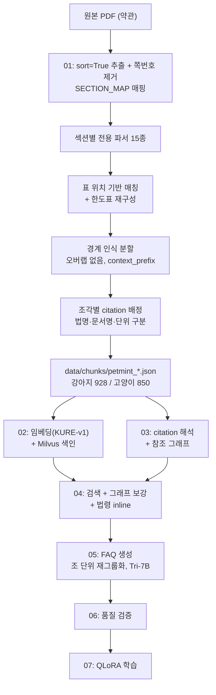

> 상태: 완료. 강아지 928·고양이 850 청크(`data/chunks/petmint_*.json`)와 한도 기준표(`data/limit_table.py`)를 만들었다. 11쪽 민원 사례 이미지는 OCR 하지 않기로 했다(13절).

!스크린샷 2026-10-07 오후 4.07.12.png

### 0. 도메인 배경

보험 약관은 일반 문서와 다르다 — 법적 효력을 가진 계약서라, 모든 조항이 정확한 번호와 위계를 가지고 조직돼 있고, 특정 조건(보장등급, 유형)에 따라 같은 주제라도 완전히 다른 조항이 별도로 존재한다. 예를 들어 "통원 치료비를 얼마까지 보장하는가"라는 하나의 질문에도, 가입한 등급(기본형/고급형/실속형)과 세부 유형(Ⅰ/Ⅱ/Ⅲ)에 따라 정답이 9가지로 갈린다.

이런 구조를 데이터로 담을 때 "대충 비슷하게"는 허용되지 않는다 — 잘못된 조항을 가져오면 실제로 존재하지 않는 보장을 약속하는 셈이 되기 때문이다. 그래서 01번에서는 이 복잡한 위계를 하나도 놓치지 않고 정확하게 데이터 구조로 옮기는 데 가장 많은 공을 들였다.

---

### 1. 문서 계층 구조 분석

문서를 보면 **약관 → 조 → 항 → 호**라는 법률 문서 특유의 계층이 기본 틀이다. 이 계층 위에 다시 "보통약관 / 특별약관(여러 개) / 별표 / 별첨 / 관련 법령" 이라는 상위 분류가 겹겹이 쌓여 있다. 같은 "제1조"라도 어느 특별약관 소속인지에 따라 완전히 다른 내용이라, 이 상위 구조를 정확히 구분하지 못하면 데이터 자체가 의미를 잃는다.

원문자(①②③)는 문서마다 역할이 다르다. 약관 본문(보통약관·특별약관)의 항 표지는 원문자가 아니라 PDF 글리프 ``이고(`split_into_paragraphs`가 이것으로 항을 나눈다), 본문에 보이는 ①②③은 항 안의 열거다 — 항 단위 청크 1,343개 중 364개에 ① 줄이 있다. 의료비 특약에서는 "① 고급형"처럼 등급 구분자이고(`TYPE_PATTERN`), 법규와 약관 본문에 끼워진 인용 법조문 박스(【상법 제731조】 등)에서는 그 법의 항 표시다(`parse_bupgyu`). 호는 1. · (1) · 1) 형태로 쓰인다. 그래서 원문자를 하나의 고정된 레벨로 취급하지 않고, 원문을 그대로 보존한 뒤 섹션별 파서와 등급 분리 로직(`coverage_type`)에서만 선택적으로 해석했다. 청크 v3(2026-10-22, `data/chunks_v2.py`)도 이 해석을 01 노트북 도구 그대로 가져다 쓴다.

---

### 2. 메타데이터 스키마

최종 청크는 다섯 가지 레이어의 정보가 하나의 JSON으로 저장된다.

> 아래는 필드 구성을 보여주는 예시다. 실제 레코드의 값과는 다르다.
> 

```json
{
  "doc_id": "petmint_dog_2604",
  "product_name": "무배당 펫퍼민트 Puppy&Family보험 다이렉트2604",
  "policy_version": "3.0.0",
  "effective_date": "2026-07-13",
  "expiry_date": null,
  "species": "강아지",

  "section": "특별약관",
  "section_name": "펫퍼민트 반려견 통원의료비Ⅱ보장 특별약관",
  "type": "Ⅱ",
  "article_block_id": 42,
  "article_num": 1,
  "article_title": "보험금의 지급사유",
  "coverage_type": "기본형",
  "paragraph_num": 2,

  "top_category": null,
  "item_num": null,
  "item_title": null,
  "sub_label": null,
  "sub_title": null,

  "citations": [
    {
      "article_num": 15,
      "paragraph_num": 6,
      "paragraph_type": "항",
      "sub_ho": null,
      "law_name": null,
      "doc_name": "반려동물 비용손해 관련 특별약관 일반조항"
    }
  ],

  "chunk_index": 0,
  "chunk_total": 1,
  "context_prefix": null,
  "printed_page_range": [130, 130],

  "content": "회사가 보상하는 비용은 각 항목별 피보험자가 부담한 치료비에서..."
}
```

| 레이어 | 필드 |
| --- | --- |
| 문서 식별 | doc_id, product_name, policy_version, effective_date, expiry_date, species |
| 구조 위치 | section, section_name, type, article_block_id, article_num, article_title, coverage_type, paragraph_num |
| 별표2 전용 | top_category, item_num, item_title, sub_label, sub_title |
| 참조 | citations (article_num, paragraph_num, paragraph_type, sub_ho, law_name, doc_name) |
| 분할 | chunk_index, chunk_total, context_prefix, printed_page_range |

**policy_version을 시맨틱 버저닝으로 통일한 이유**: 보험사 표기("판매버전 3.0")를 그대로 받아 끝에 `.0`을 붙였다. patch 자리는 보험사의 사소한 개정보다, 같은 PDF를 재파싱해 버그를 고친 **내부 재처리 이력**으로 쓰기로 했다.

**expiry_date 설계**: 현재 판매 중인 상품은 null, 판매 종료된 구버전은 종료일을 적는다.

**새 버전이 나오면 부분 업데이트 대신 전체 재생성**: 보험사는 "바뀐 조항이 어느 건지"만 알려주는 게 아니라 약관 전체를 다시 준다. 부분 업데이트는 누락 위험이 있어 PDF 전체를 01번부터 다시 돌려 새 doc_id/policy_version으로 통째로 새 레코드를 만든다. 예전 버전은 삭제하지 않고 Milvus에 공존시켜, 검색 시점에 policy_version으로 거를지 여지를 남겨둔다.

**citations의 2단계 구조**: 01번에서는 번호·단위·법률명·문서명까지만 1차로 추출하고, 그 번호가 실제로 어느 조를 가리키는지(제목, section 소속)는 03번에서 2차 보강한다. section이 다르면 같은 번호라도 다른 조이므로 두 단계를 분리해야 했다.

---

### 3. 구간(section) 매핑

**목표**: 각 청크에 "보통약관인지, 어느 특별약관인지, 별표인지, 법규인지"를 정확한 메타데이터로 붙여야 했다. 검색 정확도뿐 아니라, 03번에서 "이 조가 어느 조를 참조하는지" 그래프를 구성하려면 애초에 각 조의 소속이 확정돼 있어야 하기 때문이다.

**1차 시도 — 자동 인식**: 정규식/패턴 기반으로 구간 경계를 자동 감지하려 했으나 오탐이 반복됐다. 명확한 공통 패턴이 없어 페이지 레이아웃·문구 차이로 계속 잘못 잡혔다.

**전환 — 수동 매핑**: 문서가 강아지/고양이 2종뿐이고 구조가 고정적이라, 목차 원문을 그대로 옮겨 쪽수를 수동 매핑(SECTION_MAP)하는 게 더 안정적이라고 판단했다.

**이중 검증**: 수동 매핑 자체도 "맞게 옮겼는지" 검증이 필요했다. 목차 원문을 재대조하는 과정에서 강아지(배상책임 특약 있음)와 고양이(없음)의 대분류 순서가 다르다는 걸 발견했다 — 추정만으로 넘어갔다면 놓쳤을 차이다.

**고양이 구간 구성**: 고양이 47구간을 구성하면서 PDF 전수 스캔으로 경계를 확정하고 목차 원문과 교차검증했다. 이 과정에서 초안의 오류를 하나 잡았다 — 통원의료비Ⅰ 특약 시작점을 108쪽으로 잡았는데 실제로는 104쪽이었다. 그대로 뒀다면 고급형·기본형 한도표를 통째로 놓치고 일반조항에 잘못 붙였을 것이다.

---

### 4. 섹션별 전용 파서 체계

**왜 바꿨나**: 처음에는 "조 헤더를 찾아 자르고, 안 맞는 건 예외 처리"하는 단일 파이프라인이었다. 그런데 약관에는 조-항 구조가 아예 적용되지 않는 구간이 많았다.

```
안내문          ■ / □ / ○ 기호 계층
용어 해설        ○ 하나가 용어 하나
별표2           숫자(신체부위) → 가나다(분류/판정기준) 3단계
특정질병 분류표   조 번호 없는 순수 표
법규            조 헤더는 같지만 항 마커가 진짜 원문자(①②③)
```

예외 처리가 쌓이면서 어느 코드가 실제로 도는지 추적이 안 됐고, 같은 이름의 함수가 여러 셀에 중복 정의돼 실행 순서에 따라 결과가 달라지는 상태였다. 섹션별 파서로 전환한 뒤에도 셀 2와 셀 4에 `ARTICLE_HEADER`·`find_article_headers`·`PARAGRAPH_MARKER`·`split_into_paragraphs`가 두 번 정의돼 있고 정규식도 서로 다르다. 지금 도는 것은 나중에 실행된 셀 4 쪽이다 — 정리 대상으로 남았다.

**어떻게**: SECTION_MAP의 구간마다 전용 파서를 지정하는 구조로 전환했다. 파서는 15종이고, 입력 형태에 따라 세 부류로 나뉜다.

| 입력 | 파서 | 용도 |
| --- | --- | --- |
| text | 8종 | 안내류 (개인정보 안내문, 지급절차, 용어해설 등) |
| pages | 6종 | 조-항 구조와 표 — 글자 위치→페이지 추적이 필요 |
| pages + pdf_path | 1종 | 특정질병 분류표 — find_tables로 표를 직접 읽음 |

`pages`를 받는 파서가 따로 있는 이유는, 표를 본문 위치로 매칭하려면 각 청크가 원본 텍스트의 어느 구간인지(start_offset/end_offset) 알아야 하기 때문이다.

---

### 5. 분할 정책

**문제 발견**: 04번(RAG 조립)에서 참조 조문이 잘려 들어가는 것을 발견했다. 추적해보니 레코드 조립 시 1000자를 넘으면 **글자 수로만** 자르고 있었다.

**측정**: 분할 지점 45곳을 분류했다.

| 절단 위치 | 건수 |
| --- | --- |
| 단어 중간 ("체l결하고", "허브 요l법") | 17 |
| 어절 사이지만 문장 중간 | 25 |
| 줄바꿈 위치 | 2 |
| 문장 끝 | 1 |
| 항·호 경계 | 0 |

**설계 — 경계 인식 분할**: 목표 1000자, 창 600~1200자 안에서 아래 우선순위로 경계를 찾아 자른다.

```
법령박스(【) → 항(①) → 호(1.) → 목(가.) → 문장끝 → 빈줄 → 줄바꿈
```

- **법령박스를 항보다 위에 둔 이유**: 【소득세법 시행령 제118조의4】 같은 인용 박스가 중간에서 잘리면 조문이 반토막 난다. 실제로 그 박스가 "2. 상해보험"에서 끊긴 사례가 있었다.
- **줄바꿈을 최하위로 둔 이유**: PDF 줄바꿈은 단어 중간에서도 일어나므로 의미 경계가 아니다.

**결과**: 절단 38곳이 전부 경계에서 끊겼다(법령박스 10, 호 14, 항 8, 문장끝 3, 빈줄 3). 강제 절단 0.

**오버랩 제거**: 기존 200자 겹침을 없앴다.

- 오버랩은 문장 중간을 자를 때 생기는 손실을 메우려는 장치인데, 경계에서 자르면 그 역할이 사라진다.
- 04번이 분할된 조각을 이어 붙여 참조로 쓰는데, 겹친 부분이 두 번 들어갔다.

**맥락 보존 — context_prefix**: 오버랩을 없애면 호 경계에서 잘린 뒷조각이 "다음 각 호의 어느 하나에 해당하는 경우" 같은 도입 문장을 잃는다. 이를 별도 필드에 담아 분할된 뒷조각에만 붙였다.

| 유형 | 언제 붙나 | 예시 | 건수(종별) |
| --- | --- | --- | --- |
| 도입 문장 | 뒷조각이 열거 항목으로 시작하고, 같은 항에 "다음 각 호" 같은 문장이 있을 때 | "⑥ … 다음 각 호의 어느 하나에 해당하는 경우에는 제1항부터 제5항까지를 적용하지 아니한다" | 1 |
| 제목 메타 | 01 파서가 채운 제목 메타(`item_*`/`sub_*`)가 있을 때 | "1. 눈의 장해 > 나. 장해판정기준" | 18 |
| 본문 제목 | 열거 항목으로 시작하는데 위 둘이 없을 때, 본문 속 가장 가까운 "N. 제목 > 가. 제목" | "1. 다음 각 목의 구분에 따른 사항 > 라. 대출성 상품" | 1 |

판정 순서는 도입 문장 → 제목 메타 → 본문 제목이다.

content에 직접 넣지 않고 별도 필드로 둔 이유는, 조각을 다시 이어 붙일 때 도입부가 중복으로 들어가기 때문이다. 이 필드는 임베딩·BM25·리랭커 입력에 모두 포함되므로 02번 Milvus 스키마에도 추가했다.

---

### 6. citation 추출

#### 6-1. 조각별 추출에서 위치 기반 추출로

경계 인식 분할을 적용했더니 law_name이 **491 → 479로 줄었다**. 조각 경계가 법령 박스 바로 앞에서 끊기면, 뒷조각이 "소득세법" 같은 기준법 맥락을 잃기 때문이었다.

분할을 되돌리는 대신 citation 추출 방식을 바꿨다. **원본 전체를 순서대로 읽으며 법명·조번호 맥락을 이어가고, 각 조각에는 자기 구간에 속한 citation만 배정**한다. 조각별 citation의 합집합이 원본 전체 추출 결과와 일치하는 것을 검증했다.

#### 6-2. 법명 인식

| 패턴 | 문제 |
| --- | --- |
| "상법" | 법명 길이를 `{2,30}`으로 제한해 2글자 법명이 누락 |
| 「자본시장과 금융투자업에 관한 법\n률」 | 긴 법명이 줄바꿈으로 쪼개져 매치 실패 |
| 【소득세법 시행령 제118조의4】 | "령"으로 끝나 "~법" 패턴에 안 걸림 |
| "법 제59조" / "영 제118조" | 약칭 — 앞서 나온 법을 이어받아야 함 |
| 【「소득세법 시행령 제107조…】 | 【 다음에 「가 중첩 |

**약칭 처리가 까다로웠던 지점**: "영"을 바로 앞에 나온 법명으로 이어받으면 틀린다. 직전이 "소득세법 **시행규칙**"이면 "시행규칙 시행령"이 되기 때문이다. 그래서 시행령·시행규칙을 뺀 **기본법명을 따로 기억**하고, "법"→기본법 / "영"→기본법+시행령 / "규칙"→기본법+시행규칙으로 범주별 이어받기를 구현했다.

#### 6-3. 문서명 인식

약관은 다른 약관의 조문을 자주 인용한다. 그런데 특별약관 안에 일반조항이 둘(비용손해 관련, 배상책임 관련) 있고 둘 다 제7조가 있다. 문서명을 읽지 않으면 조 번호만 보고 엉뚱한 쪽으로 연결된다.

실제로 배상책임 일반조항 제13조가 "「반려동물 비용손해 관련 특별약관 일반조항」제7조(계약 전 알릴 의무)"를 인용하는데, 같은 문서의 제7조(보험금의 분담)로 연결돼 있었다.

표기는 두 가지였다.

```
낫표 안       「반려동물 비용손해 관련 특별약관 일반조항」제15조    75건
괄호 없음     보통약관 제35조 / 해당계약 보통약관 제29조           약 32건
```

**낫표만 잡으면 부족했다.** 그리고 낫표 75건이 지금 "맞게" 연결돼 있던 것도 문서명을 읽은 결과가 아니라, 인용한 문서에 그 조가 없어서 다음 후보로 넘어간 우연이었다. 괄호 없는 약관명은 "일반조항"으로 끝나는 이름과 보통약관만 공백 무시로 대조해 인식한다. SECTION_MAP 전체를 대조하지는 않는다.

**승계 범위**: 문서명과 법명은 열거로 바로 이어지거나("제32조·제33조"), "제N조(제목)의 제M항"처럼 붙어 있을 때만 다음 조문에 물려준다. 문장이 떨어져 있으면 승계하지 않는다 — "「일반조항」제15조에 따라 … 제6항을 적용하지 않습니다"에서 뒤의 "제6항"은 자기 조의 항이기 때문이다.

#### 6-4. 단위 구분 (항 vs 호)

"제2호"를 2항으로 조회하던 문제가 있었다(강아지 35건, 고양이 33건). 호와 항은 완전히 다른 단위라 전부 틀린 참조였다.

원인은 citation에 `paragraph_type`을 저장하면서도 그래프 엣지와 조회 단계로 전달하지 않은 것이었다. 호를 네 부류로 나눠 처리한다.

| 유형 | 처리 |
| --- | --- |
| 같은 항 안의 호 ("제1호부터 제10호까지") | 자기 본문이므로 참조하지 않음 |
| 앞서 항을 밝힌 호 ("제1항 제1호 또는 제2호") | 앞의 항을 상속 |
| 외부 법령의 호 | 해당 법령으로 연결 |
| 조+항+호 ("제7조 제1항 제4호") | 조와 항으로 조회, 호는 표기에만 |

#### 6-5. 그 밖에 고친 것

- **범위 표현**: "제24조 ~ 제27조"를 펼칠 때 원본 citation이 남아 "제24조 제27항" 같은 잘못된 참조가 생성됐다(강아지 10건, 고양이 9건).
- **자기참조**: 청크 맨 앞의 조 헤더가 citation으로 잡혔다. `strip_leading_article_header`로 제거.
- **"동법" 대명사**: 직전 법명을 이어받도록 처리.
- **법규 섹션 self-law**: 법규 본문의 law_name 없는 citation은 그 법 자신의 조문을 가리킨다(민사소송법 제254조 안의 "제249조제1항"). section_name에서 법명을 뽑아 채운다.
- **제외 조문**: "다만, 보통약관 제3조·제4조·제5조는 제외합니다"의 조문들은 01번에서 citations에 그대로 남긴다. 적용되지 않는 조항이라 참조로 쓰면 안 되는데, 그 판단은 03-1이 `excluded_reference`로 분류해 03-2가 그래프에서 뺀다 — 01번은 원문에 쓰인 것을 그대로 추출하고 해석은 03번이 한다

---

### 7. 표 처리

#### 7-1. 위치 기반 매칭으로 전환

**기존 방식**: 페이지 단위로 표를 캐시하고, 청크가 걸친 페이지 범위에 표가 있으면 붙였다. 그런데 한 조의 여러 항이 같은 페이지를 공유하면 같은 표가 여러 번 들어갔다. article_block_id 단위 추적 → 문서 전역 추적으로 두 번 보완했지만, 근본적으로 "어느 항에 속하는 표인지"를 모르는 방식이었다.

**전환**: 표마다 **탐침 문자열**(셀의 한 줄, 8자 이상)을 뽑아 본문에서 위치를 찾고, 그 위치가 속한 청크에 붙인다.

| 얻은 것 | 설명 |
| --- | --- |
| 중복 방지 로직 불필요 | 위치가 하나뿐이므로 |
| 가짜 표 자동 제거 | 본문 문단을 표로 오인식한 것은 탐침이 본문에서 안 찾아짐 |
| 정확한 분배 | 제2조처럼 항마다 다른 표가 있어도 제자리로 |

**세로로 쪼개진 표 대응**: 탐침을 첫 줄로만 잡으면 세로쓰기 라벨 때문에 매칭이 안 되는 표가 있었다. 모든 줄을 후보로 삼아 8자 이상인 줄을 탐침으로 쓴다.

#### 7-2. 표를 문장으로 변환하지 않는 결정

초기엔 표를 LLM으로 서술형 문장으로 재구성하려 했으나 두 가지 위험이 있었다.

1. 표 추출이 깨진 경우 LLM이 빈 정보를 그럴듯한 문장으로 채워 넣는다
2. 정상 추출된 표도 변환 과정에서 항목별 수치가 누락된다

반면 마크다운 표 구조를 그대로 LLM에 전달하면 행-열 관계가 유지되어 정답률이 높아짐을 실측으로 확인했다.

#### 7-3. 다단계 한도표 재구성

**발견 경위**: 01~04번을 검증 완료로 판단하고 05번 FAQ를 생성했는데, 전체 샘플 검사에서 "같은 조항, 같은 조건인데 답이 제각각인" 패턴이 나왔다. 모델 환각이 아니라 입력 데이터가 깨졌을 가능성을 의심해 원본을 대조하며 드러났다.

**원인**: 통원/입원 Ⅰ·Ⅱ·Ⅲ 특약의 한도표는 세로쓰기 라벨("통/원/의/료/비/Ⅲ")과 2단 헤더("자기/부담금"), Ⅲ는 4단계 조건(MRI 1차·2차이상·미실시·수술일)까지 겹친 복잡한 표라 pymupdf가 셀 읽는 순서를 잡지 못했다.

**전수 조사**: 특별약관 전체에서 "지급 한도"를 포함한 항을 추출해 훑은 결과, 깨진 것은 통원/입원 Ⅰ·Ⅱ·Ⅲ 세 유형뿐이고 민사소송법률비용Ⅱ·배상책임 등은 멀쩡했다(번호 목록형이라 단순해서).

**해결**: 범용 표 파싱이 아니라, 깨진 구간에서 "1일당 N만원"과 "X만원/Y만원 자기부담금"을 정규식으로 추출해 읽을 수 있는 텍스트 표로 재조립한다. 2단계(Ⅰ·Ⅱ)와 4단계(Ⅲ)를 각각 다른 함수로 처리해 36개 레코드를 재구성했고, 숫자를 전부 원문과 대조해 검증했다.

**자기부담금 처리**: 원문에서 자기부담금은 여러 행에 걸쳐 **병합된 셀**이다. 좌표로 확인한 뒤 모든 행에 같은 문구를 넣었다.

**한계에 대한 인식**: 이 재구성은 이 PDF의 두 특정 패턴에 맞춘 것이라 범용성이 없다. 다만 (1) 표가 두 종류뿐임을 전수 조사로 확인했고, (2) LLM에게 재구성시키는 대안보다 안전하다고 판단해 선택했다.

#### 7-4. 의료비 특약은 원본 표를 붙이지 않는다

한도표는 7-3의 재구성 텍스트로 이미 본문에 들어간다. 여기에 pymupdf가 뜬 원본 표를 덧붙이면 같은 숫자가 두 번 들어간다(실제로 강아지 4건에서 `[15, 200, 15, 200]`처럼 중복 집계됐다).

의료비 특약 6구간에 붙은 표가 전부 한도표뿐임을 확인하고, 해당 파서에서는 표 첨부를 생략한다.

---

### 8. 별표2·특정질병표 분리

**문제**: 별표2(장해분류표)와 특정질병 분류표는 "약관-조-항" 구조가 적용되지 않는다. 별표2는 "총칙/판정기준 → 1.눈의 장해 → 가.분류/나.판정기준" 3단계 계층이고, 특정질병표는 조 번호 없는 "구분/질병명/코드" 순수 표다.

**별표2**: 조 헤더와 무관하게 별도 파서로 분리. `\uf000`(총칙/판정기준) → 숫자(신체부위) → 가나다(분류/판정기준) 3단계를 각각 다른 정규식으로 순차 분리한다.

**특정질병표**: 테이블 추출 결과가 4열(분류번호, 질병분류명, 코드, 질병명)인데 병합 셀 때문에 분류번호와 질병분류명이 빈 값으로 나오는 행들이 있다. 두 열을 전방 채우기(forward fill)로 보정한 뒤 같은 분류끼리 그룹핑한다.

---

### 9. 쪽번호 제거

본문 중간에 PDF 쪽번호가 섞여 들어가 있었다. 조문이 "…서면으로 다시 알 / 189 / 니다" 처럼 끊기는 식이다.

**규칙**: 각 쪽의 마지막 줄이 그 쪽의 번호와 **정확히 일치**할 때만 삭제한다. 본문의 숫자(지급률 100, 한도 200만원 등)는 건드리지 않는다. 강아지 290/292쪽, 고양이 264/266쪽이 이 패턴이었다.

**덤으로 해결된 것**: 쪽번호가 조문 열거 중간에 끼어("「신용정보법」제32조·제33조 / 188 / 및 제38조") 뒤 조문이 법명을 상속받지 못하던 문제가 함께 풀렸다. 그리고 제목과 쪽번호만 있던 빈 레코드가 사라졌다.

---

### 10. 유형(Ⅰ·Ⅱ·Ⅲ) 구분과 한도 기준표 분리

**배경**: "통원/입원의료비보장" 계열은 같은 section_name 안에도 Ⅰ(번호 없음)·Ⅱ·Ⅲ 세 버전이 공존하고, 버전마다 한도액이 다르다(기본형Ⅰ 수술한도 200만원 vs 기본형Ⅱ 250만원). 이 구분이 별도 필드로 없으면 section_name 문자열만으로는 03번 citation 매칭이나 04번 검색에서 서로 다른 버전이 섞인다.

**발견 경위**: 05번 FAQ를 다 생성하고 06번을 준비하던 중, 계산이 들어간 FAQ에서 "같은 보장등급인데 한도액이 200만원이기도 250만원이기도 한" 사례가 반복됐다.

**해결 — 01번으로 소급**: 05번만 고치는 대신 근본 원인이 01번의 메타데이터 설계 부족임을 인정하고 `type` 필드를 추가했다. section_name에 "Ⅲ"/"Ⅱ"가 있고 "의료비"가 들어가는 경우에만 추출하고, 둘 다 없으면 Ⅰ, 의료비 계열이 아니면 None이다.

패치가 아니라 전체 재작업을 택한 이유는, 패치로는 이미 생성된 FAQ만 고칠 수 있을 뿐 03번 그래프와 04번 실시간 검색(실제 서비스)의 혼동은 그대로 남기 때문이다.

**한도 기준표 분리**: 각 조합(등급×유형)별 실제 한도액은 청크 메타데이터에 중복 저장하는 대신 독립 파일(`data/limit_table.py`)로 분리했다. 한 조항이 여러 항으로 쪼개져 같은 숫자가 수백 번 중복되는 걸 피하고, 05번(생성 직후 재검산)과 06번(품질 검증)이 이 파일 하나만 참조하도록 했다("진실의 원천"). 강아지/고양이 18개 조합 모두 원문 대조로 확정했으며 둘은 동일한 값이다.

여기에 지급액 산출 공식도 함께 넣었다.

```
min[(치료비 − 자기부담금) × 보상비율, 1일당 한도]
```

원문의 예시 계산 7건으로 검증했고, MRI와 수술이 같은 날 발생하면 수술 한도가 우선한다는 것도 원문에서 확인해 반영했다.

---

### 11. 최종 결과

| 항목 | 강아지 | 고양이 |
| --- | --- | --- |
| 전체 페이지 | 292쪽 | 266쪽 |
| SECTION_MAP 구간 | 49 | 47 |
| 레코드 수 (항 단위) | 890 | 812 |
| 최종 레코드 수 (분할 후) | 928 | 850 |
| law_name 있는 citation | 287 | 282 |
| 문서명 명시 citation | 116 | 101 |
| 해석 실패(not_found) | 0 | 0 |
| 20자 미만 청크 | 0 | 0 |
| 쪽번호 제거된 페이지 | 290 / 292 | 264 / 266 |

---

### 12. 데이터 파이프라인 흐름



---

### 13. 처리하지 않은 것

#### 11쪽 "보험 주요 민원 사례" — ✗ OCR 미처리

11쪽(0-indexed, 안내_절차 섹션)은 텍스트가 아니라 **이미지 한 장으로 통째로 삽입**돼 있다. pymupdf의 텍스트 추출로는 쪽번호 "11" 외에 아무것도 나오지 않는다.

OCR(tesseract-ocr-kor 등)로 처리할 수 있지만, 이번 파이프라인에서는 투입 대비 효율이 낮다고 판단해 **의도적으로 스킵**했다. SECTION_MAP에서 `parser: None`으로 표시해 둔 구간이다.

다만 이 페이지는 다시 볼 가치가 있다. 다른 구간이 "약관 조항을 그대로 인용하는" 성격인 데 비해, 여기에는 **"이런 이유로 보상/비보상된다"는 설명형 답변의 실제 사례**가 담겨 있다. 이 프로젝트가 지향하는 답변 톤(근거 + 이유 설명)의 좋은 예시 자료일 수 있다.

**나중에 재검토할 때의 선택지**: OCR 도입, 또는 수작업으로 텍스트를 옮겨 적기. 분량이 한 쪽이라 후자도 현실적이다.