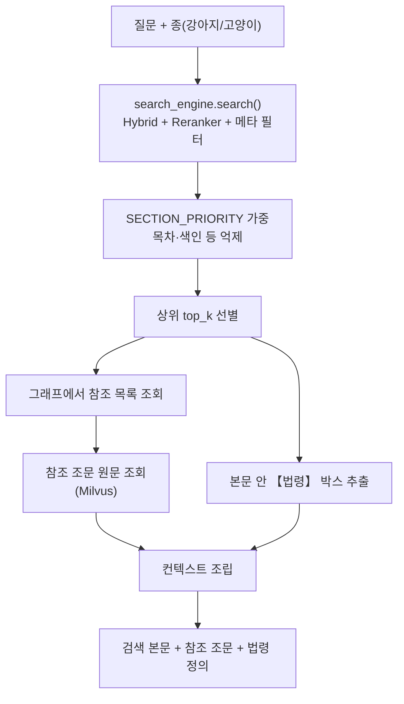

<!--
다루는 곳: data/rag_context.py, data/search_scope.py, data/search_engine.py, data/search_regression.py, data/eval/search_regression.json, notebooks/04_RAG_전체_조립.ipynb, scripts/search_regression_run.py, tests/test_retrieval_variant.py
읽은 커밋: 6710b83
-->
> 상태: 2026-11-19 코드와 맞춰 봄. ✓ 조립 모듈(data/rag_context.py)과 SearchScope 필터 교체, 검색 문장 정리(2-6절)는 2026-10-13까지 구현, 05(FAQ 생성)와 08(평가)이 이 경로를 쓴다. ✓ 09 서비스 경로(answer.py → search-service → build_full_context)는 운영 중이다(2026-11-19 확인. search-service는 호스트 systemd `petmint-search.service`, :8100. 서빙 설정 v3, 부모 표시, 질의 확장은 docs/14). △ 이웃 청크 포함(4-1절)은 검토만 했다. [code:data/faq_generate.py:56] [code:data/answer_eval.py:233-243] [code:data/rag_context.py:632-648] [code:data/search_scope.py:1-13] [code:app/services/answer.py:224-225] [code:deploy/host/petmint-search.service:21] [docs:02_pipeline/14_deployment.md] [c:ba373fe] <!-- 2026-11-19 잼: systemctl status petmint-search(active, running, enabled), curl http://192.168.122.1:8100/health(ok) -->

### 0. 한 줄 요약

검색(02번) 결과에 그래프(03번) 참조 조문과 법령 박스를 붙여, LLM이 답변을 쓸 수 있는 **완결된 컨텍스트**를 만든다. 05번(FAQ 생성)이 이 조립을 쓴다. 09번(실제 서비스)도 같은 경로를 탄다. answer.py가 retrieval.py(search-service)를 엔진 자리에 넣어 build_full_context를 부른다. ✓ 운영 중: search-service는 호스트 systemd `petmint-search.service`로 돈다(서빙 설정은 docs/14). [code:data/rag_context.py:1-8] [code:app/services/answer.py:14] [code:app/services/answer.py:224-225] [code:deploy/host/petmint-search.service:1] [docs:02_pipeline/14_deployment.md]

---

### 1. 최종 설계

#### 1-1. 전체 흐름



#### 1-2. rag_context.py로 모듈화

✓ 04번 노트북 셀 안에 있던 로직을 `data/rag_context.py`로 분리했다. 05번(FAQ 생성)이 04번 코드를 **복사해 쓰고 있어서**, 04번에서 고친 `limit=3` 버그와 법령 박스 패턴이 05번에 반영되지 않았기 때문이다. [code:data/rag_context.py:1-8] [code:data/rag_context.py:375] [c:ba373fe]

`ContextBuilder`는 Milvus 클라이언트, 청크, 그래프만 다루고 **모델은 올리지 않는다.** 05번이 Ollama와 GPU를 함께 써야 하므로, 컨텍스트 조립에 불필요한 임베딩, 리랭커 모델이 올라가면 안 되기 때문이다. [code:data/rag_context.py:6] [code:data/rag_context.py:313-325] [code:notebooks/05_FAQ_생성.ipynb:21]

#### 1-3. SECTION_PRIORITY

검색 점수에 섹션별 가중치를 곱해 재정렬한다. 01번 재작업으로 새 section 값이 생겨 갱신했다. [code:data/rag_context.py:44-53] [code:data/rag_context.py:608]

```
보통약관 1.0 / 특별약관 1.0 / 기타_제도성_특별약관 1.0
별표 0.95 / 별첨 0.95
법규 0.9
안내_요약 0.85 / 안내_용어 0.85 / 약관_이용 0.85
안내_절차 0.8 / 안내_개인정보 0.7
목차 0.5 / 색인 0.5 / 간지 0.3 / 표지 0.3
본칙 1.0 / 부칙 0.7          (인사규정)
목록에 없는 섹션 0.8
```

`약관_이용`을 0.85로 올린 이유: 이 섹션의 레코드는 "기타문의처 안내"(콜센터, 금감원 연락처) 1건뿐인데, "어디로 문의하나요" 같은 질문에는 이게 정답 문서다. 유일한 후보를 과하게 억제하면 그 질문에 답할 수 없다. [code:data/rag_context.py:49] [c:dcdecd9] <!-- 요약: data/review/chunks_graph_summary.md 61줄 -->

---

### 2. 왜 이렇게 했나

#### 2-1. 참조 조문이 잘려 들어가던 문제

가장 영향이 컸던 버그다.

```python
results = client.query(..., limit=3)
```

참조 조문을 조회할 때 `limit=3`이 걸려 있었다. 그런데 Milvus는 (제목행, 1항, 2항, …) 순서로 반환하므로, **3항 이후가 통째로 빠졌다.** [code:data/rag_context.py:375-384]

측정해보니 584건 중 **210건(36%)** 이 잘린 상태로 LLM에 들어가고 있었다. 일반조항 제17조는 제목과 ①, ②항까지만 들어가고 ③, ④항이 사라졌다. (2026-10-13 이전) <!-- 확인 못 함: 584건, 210건은 그때 원자료가 남지 않음 -->

`limit=100`으로 올리고 `(paragraph_num, chunk_index)` 순으로 정렬해 결합하도록 고쳤다(한 조문의 최대 청크 수는 33개라 100이면 충분하다). [code:data/rag_context.py:375-384]

> 숫자 지표만 보고 있었다면 못 찾았을 버그다. "참조 466건"처럼 건수는 정상으로 보였고, 실제 컨텍스트 내용을 눈으로 열어보고서야 드러났다. [code:data/review/04_context_samples_20261012.md] <!-- 확인 못 함: 참조 466건은 그때 원자료가 남지 않음 -->
> 

#### 2-2. 참조가 과도하게 많던 문제

| 문제 | 건수 | 원인 |
| --- | --- | --- |
| 같은 조를 "조 전체"와 "특정 항"으로 이중 참조 | 49 | 포함 관계를 검사하지 않음 (2026-10-12 기준) [code:KNOWN_ISSUES.md:83] [code:data/rag_context.py:481-485] |
| 검색된 본문 자체를 참조로 다시 포함 | 18 | 자기 참조 판정이 조 단위 (2026-10-12 기준) [code:KNOWN_ISSUES.md:84] [code:data/rag_context.py:434-435] |
| 다른 항이 인용한 조문까지 붙음 | — | 그래프 키가 조 단위 (03-2 참고) [code:data/rag_context.py:61-66] [docs:02_pipeline/03b_reference_graph.md] |

전부 제거한 결과 참조 본문이 285k자에서 크게 줄었다. (2026-10-12 기준) [code:KNOWN_ISSUES.md:82] [code:KNOWN_ISSUES.md:113-115]

**자기 참조는 내용 기준으로 판정한다**: 가져온 행을 하나씩 보면서 이미 이 단위의 본문에 있는 행만 빼고, 나머지는 붙인다. 조문 전체가 본문에 있으면 결과적으로 아무것도 안 붙는다. 키 기준이 아니라 내용 기준으로 한 이유는, 04번(항 단위)과 05번(묶음 단위)이 서로 다른 단위를 쓰는데 **하나의 규칙으로 둘 다 처리**되기 때문이다. 분할된 조각이 기준일 때는 나머지 조각이 본문에 없으므로 자동으로 유지된다. [code:data/rag_context.py:427-437]

#### 2-3. 조 전체 참조의 길이 문제

"제1조에서 정한 수의사"처럼 조 전체를 참조하는 경우가 226건 있었다. 대부분은 적당한 길이지만(중앙값 777자), 긴 꼬리가 있었다. (2026-10-12 기준) [code:data/rag_context.py:247] [code:KNOWN_ISSUES.md:129] <!-- 확인 못 함: 중앙값 777자는 그때 원자료가 남지 않음 -->

```
보통약관 제2조(용어의 정의)       5,026자
의료비Ⅲ 제1조                   3,261~3,436자
금융소비자보호법 제46조           2,151자
```

통원의료비Ⅲ 제4조는 "수의사 정의" 하나를 가져오려고 **한도표, 계산예시, 면책조항까지 3,400자**를 끌고 왔다. FAQ 생성 입력 예산이 약 6,990토큰인데 참조 하나가 절반을 먹는 셈이다. (2026-10-12 기준) [code:data/rag_context.py:249-250] [code:data/faq_generate.py:65-67] <!-- 확인 못 함: 통원의료비Ⅲ 제4조의 3,400자는 그때 원자료가 남지 않음 -->

**최종 규칙**: 2,500자를 넘을 때만 "용어가 든 항 + 조 머리"로 줄인다. [code:data/rag_context.py:251] [code:data/rag_context.py:277-293] [code:data/rag_context.py:449-450]

2,500이라는 값은 임의로 정한 게 아니라 **데이터의 빈 구간**에서 나왔다. 조 전체가 필요한 금융소비자보호법 제46조가 2,151자, 그다음이 3,261자라 2,151~3,261 사이면 어디든 결과가 같다. 처음에 생각했던 2,000자로 뒀다면 금소법 제46조에서 **어떤 방식을 써도 놓쳤다.** (2026-10-12 기준) [code:data/rag_context.py:247-251] [code:KNOWN_ISSUES.md:129]

| 방식 | 놓침 | 16건 참조 합계 |
| --- | --- | --- |
| 현행(조 전체) | 0 | 54,536자 (2026-10-12 기준) |
| 용어가 든 항만 | 2 | 8,232자 (2026-10-12 기준) [code:KNOWN_ISSUES.md:132] |
| 1항부터 2,000자까지 | 4 | 11,672자 (2026-10-12 기준) [code:KNOWN_ISSUES.md:132] |
| **2,500자 초과 시 용어 항 + 조 머리** | **0** | **12,278자** (2026-10-12 기준) [code:KNOWN_ISSUES.md:132] <!-- 확인 못 함: 16건 참조 합계 글자 수는 그때 원자료가 남지 않음 --> |

처리 대상은 14건이고 나머지 212건은 그대로 둔다. 다만 정의형에서 용어가 든 항을 찾지 못하면 "1항부터 자르기"가 대체 경로로 남아 있다. 표에서 탈락시킨 방식이지만, 아무것도 못 가져오는 것보다는 낫기 때문이다. (2026-10-12 기준) [code:KNOWN_ISSUES.md:131] [code:data/rag_context.py:283-293]

#### 2-4. 등급별 조문 병합

의료비Ⅲ 제1조는 1~10항의 모든 행이 등급(고급형/기본형/실속형)별로 나뉘어 있어 **공통 행이 하나도 없다.** 조 전체를 참조하면 3등급이 전부 들어와 9,458자가 된다. (2026-10-12 기준) [code:data/rag_context.py:438-441] [code:KNOWN_ISSUES.md:110-111]

같은 행은 한 벌만 두고 다른 부분만 병기하는 방식으로 병합했다. [code:data/rag_context.py:167-225]

```
1일당 {고급형: 100만원 / 기본형: 50만원 / 실속형: 30만원}
```

**9,458자 → 3,369자**로 줄었다. (2026-10-12 기준) [code:data/rag_context.py:439] [code:KNOWN_ISSUES.md:110]

#### 2-5. 법령 박스 추출

약관은 외부 법률을 인용할 때 그 조문을 본문 안에 【】 박스로 함께 인쇄하는 경우가 많다.

```
【상법 제731조(타인의 생명의 보험)】
 타인의 사망을 보험금 지급사유로 하는 계약에는...
```

이런 citation은 다른 조로 이동할 필요 없이 **같은 조 본문에서 직접 추출**한다. 추출 패턴이 03-1의 `find_inline_law_box`와 달라 10건을 놓치고 있었다(【「 중첩, "제59조의4" 같은 조의N 형태). 대부분을 맞췄으나 두 정규식이 완전히 같지는 않아, 03-1은 박스로 본 것을 04번이 못 뽑는 경우가 종별 3건 남아 있다. 보통약관 2건과 장애인전용보험전환 특별약관 1건이다. (2026-10-18 이전) [code:data/rag_context.py:228-244] [code:notebooks/03-1_citation_해석.ipynb:202] <!-- 확인 못 함: 놓친 10건과 종별 3건은 그때 원자료가 남지 않음 -->

**조문 번호 표기**: 03번 citation에는 `article_num=59`로만 저장돼 "의4"가 빠진다. 그대로 쓰면 LLM에 "소득세법 제59조"가 들어가는데, 소득세법 제59조는 "근로소득세액공제"고 제59조의4가 "특별세액공제"로 **완전히 다른 조문**이다. 상담원이 그걸 보고 안내하면 틀린 정보가 나간다. [code:data/rag_context.py:232-233]

원문 박스 제목을 그대로 가져와 `citation_label` 필드에 담았다. [code:data/rag_context.py:470-479]

#### 2-6. 검색 필터 결함: 측정 범위 밖이라 안 보였던 것

09번(UI) 설계를 검토하다가 발견했다. 등급과 유형 필터가 컬렉션 전체에 걸려, 등급 메타데이터가 없는 청크가 모두 제외되고 있었다. [code:data/search_scope.py:5-8]

| 필터 | 남는 청크 / 928 | 그중 보통약관 | 제외된 것 |
| --- | --- | --- | --- |
| 기존 | 54 | 0 | 874건, 등급 없는 청크가 전부 (2026-10-13 기준) [code:KNOWN_ISSUES.md:321] |
| 수정 후 | 820 | 164 | 108건, 가입 안 한 특약과 등급만 (2026-10-13 기준) <!-- 확인 못 함: 820, 164, 108은 그때 원자료가 남지 않음 --> |

**928건 중 54건만 남았다.** 가입하지 않은 특약과 등급만 빼면 820건이 남아야 하는데, 874건이 함께 제외됐다. 등급 메타데이터가 없는 청크 766건과 다른 등급 청크 108건이다. 보통약관, 일반조항, 별표, 안내, 법규가 앞쪽에 해당하고, 보통약관은 0건이었다. (2026-10-13 기준) [code:KNOWN_ISSUES.md:319-321] <!-- 확인 못 함: 766건, 108건은 그때 원자료가 남지 않음 -->

**왜 안 드러났나**: 필터는 질문에 등급 또는 유형이 명시됐을 때만 켜지고, 그런 질문은 대부분 한도 질문이라 의료비 특약 안에 정답이 있었다. 04번의 측정 질문이 거기 쏠려 있어 결함이 **측정 범위 밖**이었다. [code:data/search_scope.py:8] [code:KNOWN_ISSUES.md:322]

**수정**: ✓ `data/search_scope.py`의 SearchScope로 교체했다. "가입하지 않은 특약·등급만 빼고 나머지는 전부 남긴다"는 의미로 바꿨다. Milvus의 not in은 null 행을 통과시키지 않으므로 (section_name IS NULL or section_name not in [...]) 형태로 써야 한다. [code:data/search_scope.py:5] [code:data/search_scope.py:13] [code:data/search_scope.py:177-193] [c:ba373fe]

**함께 고친 것**: BM25가 상위 20개를 먼저 자른 뒤 걸러서, 범위 안 후보가 20개보다 적게 남고 있었다. 이제 범위 밖을 먼저 거르고 상위 후보(기본 20개, 서빙은 `PETMINT_SEARCH_POOL`=50, docs/14)를 고른다. [code:data/search_engine.py:183-185] [code:data/search_engine.py:153-154] [code:app/config.py:37] [docs:02_pipeline/14_deployment.md:274]

##### 2-6-1. 회귀 질문 세트

측정 질문이 쏠려 있던 것이 원인이므로, 섹션별로 고른 세트를 만들어 파일로 남겼다(data/eval/search_regression.json, 103문항). [code:data/eval/search_regression.json] [code:data/search_regression.py]

> 회귀 세트는 103문항이다(꼬리 질의 10문항 추가). 아래 표는 93문항 시점의 수치다. 103문항으로 다시 재면 상위 5개 안 88/97, MRR 0.745, 등급 언급 18/19, 한도 5/5, 꼬리 9/10이다. (2026-10-13 기준) [code:data/review/eval_results_summary.md:110] [code:KNOWN_ISSUES.md:368-370] [code:KNOWN_ISSUES.md:381] [c:dcdecd9] <!-- 요약: data/review/eval_results_summary.md 2절 「10-13 17:12 A_current 줄의 갈래별」(등급언급_타섹션 18/19, 한도 5/5, 꼬리_512창밖 9/10) -->
> 

| 지표 | 수정 전 | 수정 후 |
| --- | --- | --- |
| 정답이 상위 5개 안 | 56/87 | 75/87 (2026-10-13 기준) [code:data/review/eval_results_summary.md:108-109] [code:KNOWN_ISSUES.md:344] |
| MRR | 0.569 | 0.677 (2026-10-13 기준) [code:data/review/eval_results_summary.md:108-109] [code:KNOWN_ISSUES.md:345] |
| 미가입 특약 또는 등급이 섞인 문항 | 18 | 0 (2026-10-13 기준) [code:KNOWN_ISSUES.md:346] |
| 등급 언급 + 다른 섹션 (19문항) | 0 | 15 (2026-10-13 기준) [code:KNOWN_ISSUES.md:347] |
| 한도 (대조군, 5문항) | 4 | 5 (2026-10-13 기준) [code:KNOWN_ISSUES.md:348] |

**새로 실패한 문항은 0건이다.** 04번 셀 3~6의 출력도 수정 전후가 같다. (2026-10-13 기준) [code:KNOWN_ISSUES.md:350-352] [code:notebooks/04_RAG_전체_조립.ipynb:161]

질문은 원문 문구를 그대로 쓰지 않고 상담원 말투로 바꿨다. BM25가 문구만 맞추어 맞히면 측정이 의미가 없기 때문이다. [code:data/eval/search_regression.json]

##### 2-6-2. 검색 문장에서 등급과 유형을 뺐다

필터가 등급을 책임지는데 검색 문장에도 등급이 남아 있으면, 그 단어가 강한 일치 신호가 되어 의료비 제1조를 상위로 끌어올린다. 02번 3-3절에서 임베딩 텍스트에 등급 헤더를 붙인 조치의 부작용이다. [code:data/search_scope.py:84-87] [code:data/search_engine.py:48-52] [docs:02_pipeline/02_embedding_index.md:134]

| 검색 문장 | 상위 5개 안 | MRR | 등급 언급 (19) | 한도 (5) |
| --- | --- | --- | --- | --- |
| 원문 | 75 | 0.677 | 15 | 5/5 (2026-10-13 기준) [code:data/search_scope.py:87] |
| 등급만 제거 | 78 | 0.694 | 18 | 5/5 (2026-10-13 기준) <!-- 확인 못 함: 그때 원자료가 남지 않음 --> |
| 유형만 제거 | 75 | 0.690 | 15 | 5/5 (2026-10-13 기준) <!-- 확인 못 함: 그때 원자료가 남지 않음 --> |
| 둘 다 제거 | 78 | 0.707 | 18 | 5/5 (2026-10-13 기준) [code:data/search_scope.py:87-88] |

한도 질문은 떨어지지 않았다. "고급형 수술 한도?"가 "수술 한도?"가 되어도 필터가 등급을 책임지기 때문이다. [code:data/search_scope.py:88]

✓ 필터는 원문 질문으로 만들고, 검색 문장에서만 뺐다. 특약명 안의 "Ⅱ"는 예외로 둔다. [code:data/search_scope.py:76-80] [code:data/search_scope.py:156-159] [code:app/services/answer.py:225]

---

### 3. 시도했던 것들

#### 3-1. "1항만 가져오기"

**"1항만 가져오기"는 안 됐다.** 측정해보니:

- 정의형 48건 중 10건을 놓친다 (보통약관 제2조의 "적립보험료"는 5항에 있다) (2026-10-12 기준) [code:data/rag_context.py:256-259] <!-- 확인 못 함: 48건 중 10건은 그때 원자료가 남지 않음. 코드 주석의 48건은 용어 찾기 방식 비교(23/48 실패)다 -->
- 적용형("~를 준용", "~에 따라")은 111건 전부 조문의 일부만 전달된다 (2026-10-12 기준) <!-- 확인 못 함: 111건은 그때 원자료가 남지 않음 -->

#### 3-2. 등급 병합 1차 구현

다만 1차 구현에서 계산식이 깨졌다. 중괄호 그룹 16개 중 12개에서 괄호 짝이 경계에서 끊겼다. (2026-10-12 기준) [code:KNOWN_ISSUES.md:126-127] [code:data/rag_context.py:140-142]

```
{고급형: [(33만원 / 기본형: [(23만원} - {고급형: 3만원)×70%, 30만원] / ...}
```

`[(33만원`과 `3만원)×70%`가 다른 그룹으로 쪼개져 LLM이 "33만원에서 뭘 빼는지" 연결할 수 없는 상태였다. **괄호 짝이 맞을 때까지 그룹을 넓히도록** 고쳤다(+67자). [code:data/rag_context.py:136-153] [code:data/rag_context.py:187-191] <!-- 확인 못 함: +67자는 그때 원자료가 남지 않음 -->

---

### 4. 남은 한계

#### 4-1. 이웃 청크를 안전망으로 포함하지 않는다

**이웃 청크를 안전망으로 포함할지**

지금은 그래프로 **명시적으로 연결된 참조만** 가져온다. citation이 원문에 쓰여 있어야 하고, 그걸 03번이 해석에 성공해야 한다는 뜻이다. [code:data/rag_context.py:334-347] [code:data/rag_context.py:430]

그런데 약관에는 citation으로 표현되지 않는 관계도 있다. 바로 앞 조에서 정의한 용어를 다음 조가 그냥 쓰는 경우처럼, 사람은 문맥으로 아는 연결이다.

△ 보완책으로 **검색된 청크의 물리적 이웃**(`article_block_id` 기준 앞뒤 1~2개)을 자동으로 컨텍스트에 포함시키는 방식을 검토할 수 있다. 그래프가 모든 참조를 완벽히 커버하지 못하더라도 검색 시점에 느슨한 안전망 역할을 하게 된다.

다만 트레이드오프가 분명하다.

| 얻는 것 | 잃는 것 |
| --- | --- |
| 그래프가 놓친 암묵적 연결을 커버 | 관련 없는 조문이 노이즈로 섞임 |
| citation 해석 실패에 대한 보험 | 컨텍스트 길이 증가. 2-3절에서 조 전체 참조를 2,500자로 묶어 둔 효과가 상쇄된다 [code:data/rag_context.py:251] |

특히 두 번째가 걸린다. 2-3절에서 조 전체 참조를 2,500자로 제한한 이유가 입력 예산 때문이었는데, 이웃 청크를 무조건 더하면 그 노력이 상쇄된다. [code:data/rag_context.py:251]

까닭: 위 표의 잃는 것(관련 없는 조문이 노이즈로 섞임, 컨텍스트 길이 증가).
