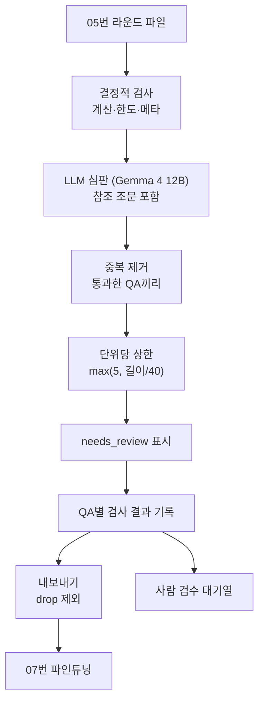

<!--
다루는 곳: data/faq_checks.py, data/faq_judge.py, notebooks/06_품질검증.ipynb
읽은 커밋: 6710b83
-->
### 0. 목표

05번이 생성한 FAQ를 전수 검증해, 파인튜닝에 쓸 수 있는 것만 남긴다. [code:notebooks/06_품질검증.ipynb:8-18]

05번 10-3절에서 세운 가정("오류 대부분이 정답이 명확한 성격이라 코드로 잡힌다")이 맞는지 먼저 측정하고, 결과에 따라 검증 구조를 정한다. [docs:02_pipeline/05_faq_generation.md]

**정답지**: 05번에서 샘플 100개를 세 차례 사람이 전부 검수한 결과 300건이 있다. 이것으로 각 검사의 오탐·미탐을 잴 수 있다. [docs:02_pipeline/05_faq_generation.md] [code:data/faq_checks.py:270] <!-- 확인 못 함: 정답지 300건은 검수 원자료(data/faq/review/)가 git 밖이다 -->

---

### 1. 05번에서 세운 가정과 실제

#### 1-1. 코드로 잡히는 오류는 18%뿐이었다

정답지 282건(법규·중복 제외: OK 181 / 수정 52 / 폐기 49)에 결정적 검사를 전부 돌렸다. (2026-10-12 기준) [code:data/faq_checks.py:206-230] <!-- 확인 못 함: 정답지 건수는 검수 원자료(data/faq/review/)가 git 밖이다 -->

| 검사 | 처리 | OK인데 문제로 판정(오탐) | 문제 QA 검출 |
| --- | --- | --- | --- |
| 계산 재검산 | 버림 | 0 | 7 (2026-10-12 기준) [code:data/faq_checks.py:22] |
| 등급 혼동 | 버림 | 0 | 0 (2026-10-12 기준) [code:data/faq_checks.py:24] |
| 종 혼동 | 버림 | 0 | 0 (2026-10-12 기준) [code:data/faq_checks.py:25] |
| 한도·보상비율 문장 대조 | 표시 | 0 | 0 (2026-10-12 기준) [code:data/faq_checks.py:23] |
| 통원/입원 혼동 | 표시 | 0 | 0 (2026-10-12 기준) [code:data/faq_checks.py:26] |
| 답변 숫자 근거 | 표시 | 2 | 8 (2026-10-12 기준) [code:data/faq_checks.py:27] |
| 조문 번호 ↔ citation | 표시 | 0 | 0 (2026-10-12 기준) [code:data/faq_checks.py:28] |
| needs_review | 표시 | 5 | 7 (2026-10-12 기준) [code:data/faq_checks.py:30] <!-- 확인 못 함: 오탐과 검출 칸은 검수 원자료(data/faq/review/)가 git 밖이다 --> |

사람이 문제로 판정한 **101건 중 코드가 잡은 것은 18건**(버림 7, 표시 11)이었다. (2026-10-12 기준) <!-- 확인 못 함: 검수 원자료(data/faq/review/)가 git 밖이다 -->

**오탐은 0에 가깝다.** 걸리는 건 확실히 걸리고 멀쩡한 걸 버리지는 않는다. 다만 잡히는 양이 적다. [code:data/faq_checks.py:22]

#### 1-2. 왜 안 잡히나 — 유형별 분해

| 유형 | 건수 | 버림 | 표시 | 통과 |
| --- | --- | --- | --- | --- |
| 규정 지어내기 | 25 | 0 | 2 | 23 (2026-10-12 기준) |
| 핵심 조건 누락·회피 | 20 | 0 | 1 | 19 (2026-10-12 기준) |
| 질문 품질 | 17 | 0 | 0 | 17 (2026-10-12 기준) |
| 조건 뒤집기 | 9 | 0 | 2 | 7 (2026-10-12 기준) |
| 단서 섞기 | 9 | 0 | 3 | 6 (2026-10-12 기준) |
| 계산 | 7 | 5 | 0 | 2 (2026-10-12 기준) |
| 수치 잘못 옮김 | 4 | 2 | 0 | 2 (2026-10-12 기준) |
| 숫자 지어내기 | 3 | 0 | 3 | 0 (2026-10-12 기준) <!-- 확인 못 함: 유형별 건수는 검수 원자료(data/faq/review/)가 git 밖이다 --> |

**잡히는 것은 "정답이 데이터에 있는" 유형**이다. 계산은 `calculate_payout`으로 다시 계산하면 되고, 수치는 `limit_table.py`에 정답이 있고, 지어낸 숫자는 원문에서 문자열을 찾으면 된다. [code:data/faq_checks.py:216-224] [code:data/faq_verify.py:12] [code:data/limit_table.py:72]

**안 잡히는 것은 "정답이 의미에 있는" 유형**이다. 상위 네 유형(71건)이 전부 여기 속한다. (2026-10-12 기준)

```
조건 뒤집기    "2년이 지난 후 지급"을 "2년 이내 지급"으로
              → 숫자도 맞고 단어도 원문에 다 있다
핵심 조건 누락  맞는 말만 쓰고 중요한 조건을 빠뜨림
              → 쓴 내용은 전부 원문에 있다
규정 지어내기  "서류 불필요", "별도 약정 체결" 같은 절차를 만듦
              → 없다는 걸 알려면 원문 전체를 이해해야 한다
질문 품질      "이 약관의 제5조는 어떤 역할을 하나요?"
              → 틀린 건 없다. 다만 상담에서 안 나올 질문이다
```

> 05번의 가정이 빗나간 지점이다. 검증의 무게는 코드가 아니라 **심판과 사람**에 있다.
> 

---

### 2. 검사 구조

#### 2-1. 처리 구분

세 가지로 나눈다.

| 처리 | 의미 | 해당 검사 |
| --- | --- | --- |
| **버림** | 판별이 확실해 제거 | 계산, 한도 금액, 등급·종 혼동, 중복 [code:data/faq_checks.py:22-25] [code:data/faq_checks.py:31] <!-- 안 맞음: 문서는 「한도 금액」을 버림으로, 코드는 「"limit_value": "flag"」(data/faq_checks.py:23) --> |
| **수정** | 결정적 변환으로 고침 | 근거 표기 재조립 [code:data/faq_checks.py:29] |
| **표시** | 사람 검수 대기열로 | 숫자 근거, 조문 번호, needs_review, 심판 [code:data/faq_checks.py:27-30] <!-- 안 맞음: 문서는 심판을 「표시」로, 코드는 심판 판정이 문제면 버림(data/faq_judge.py:3, notebooks/06_품질검증.ipynb:15) --> |

**자동 수정은 결정적 변환에만 쓴다.** 모델이 답변을 고쳐 쓰게 하면 그 결과를 또 검증해야 해서 문제가 되풀이된다. 데이터가 13,760건으로 넉넉해 **버리는 비용이 싸다.** [code:data/faq_checks.py:5-8] [code:data/review/exp_c_compare_20261014_1511.md:9] (2026-10-14 기준)

#### 2-2. 검사는 지우지 않고 기록한다

QA마다 `checks: {검사명: 통과/표시/버림, 사유}`를 남기고, 마지막 **내보내기 단계에서만 거른다.** [code:data/faq_checks.py:3-4] <!-- 안 맞음: 문서는 「checks: {검사명: 통과/표시/버림, 사유}」, 코드는 「{"check": check, "action": ACTION[check], "detail": detail}」 목록이고 통과는 기록하지 않는다(data/faq_checks.py:38-39, 373-379) -->

기준을 바꿔도 재생성할 필요가 없기 때문이다. 생성에 3~4시간이 걸리므로 기준 변경마다 다시 돌릴 수는 없다. [code:data/faq_checks.py:4] <!-- 확인 못 함: 걸린 시간은 생성 기록(data/faq/)이 git 밖이다 -->

#### 2-3. 오탐과 미탐 중 미탐을 경계한다

파인튜닝 데이터에서 틀린 QA는 모델에게 **"자신 있게 틀리는 법"** 을 가르친다. 반면 멀쩡한 QA를 버리는 비용은 작다 — 같은 단위를 10라운드 생성하므로 대체 QA가 있다. [code:data/faq_checks.py:6] [code:data/faq_generate.py:9-10]

**예외 둘**:

- **오탐이 특정 주제에 몰리면 안 된다.** 한 주제의 QA가 전부 버려지면 챗봇이 그 주제를 통째로 모르게 된다. 단위별로 남은 QA 수를 집계하고 0이 된 단위를 보고한다. [code:notebooks/06_품질검증.ipynb:351-389]
- **수정 단계의 오탐은 더 위험하다.** 맞는 답을 고쳐서 틀리게 만들 수 있다. 그래서 수정을 결정적 변환으로 한정했다. [code:data/faq_checks.py:8] [code:data/faq_checks.py:29]

---

### 3. 결정적 검사

"결정적(deterministic)"은 같은 입력에 항상 같은 결과가 나온다는 뜻이다. 계산을 다시 하거나 기준표와 대조하면 맞다/틀리다가 확정되는 검사들이라, LLM 심판과 달리 판단이 개입하지 않는다.

그래서 이 검사에 걸린 것은 바로 버릴 수 있다 — 오탐이 0에 가깝기 때문이다(1-1절). [code:data/faq_checks.py:22]

#### 3-1. 계산 재검산

`limit_table.py`의 `calculate_payout`으로 답변의 계산을 다시 한다. 05번에서 생성 직후 관문으로도 쓰고(`faq_verify.py`), 06번에서 전수로 다시 확인한다. [code:data/faq_verify.py:12] [code:data/faq_generate.py:448] [code:data/faq_checks.py:213-215]

**측정에서 놓친 두 건을 보강했다**: 질문에 나온 연간 한도를 치료비로 읽는 문제, 결론 금액을 느슨하게 확인하는 문제. [code:KNOWN_ISSUES.md:176] [code:data/faq_verify.py:100-104]

**별표3·4까지 확대**: 변호사비용(8구간)·인지액(4구간) 계산도 검증 범위에 넣었다. 구간 공식을 잘못 고르거나 덧셈을 틀린 사례가 있었다. [code:data/limit_table.py:100-108] [code:data/limit_table.py:114-119] [code:data/faq_verify.py:109-111]

#### 3-2. 중복 검출 — 설계를 바꿨다

처음에는 질문 임베딩 유사도로 잡으려 했다. 그런데 정답지의 중복 8건을 보니 예상과 달랐다. (2026-10-12 기준) [code:data/faq_checks.py:270-272]

```
실제 중복:    "같은 주제를 다른 특약으로 또 물은 것" — 유사도 0.70~0.85 (낮음)
유사도 0.95:  통원Ⅱ와 입원Ⅲ의 "'수술'에 포함되지 않는 것" — 둘 다 필요한 QA
```

**유사도만 봤으면 필요한 걸 버렸을 것이다.** 비교 범위를 같은 단위 안으로 좁혔다 — 실제 중복은 같은 단위를 10라운드 생성할 때 생긴다. [code:data/faq_checks.py:269-273] [code:data/faq_checks.py:281-282] <!-- 안 맞음: 문서는 「같은 단위 안」, 코드는 묶음 키가 「(species, section_name, article_num, coverage_type)」(종, 특약, 조, 등급)이라 unit_id보다 넓다(data/faq_checks.py:281-282) -->

#### 3-3. needs_review 표시

남은 오류가 **의료비 특약 제1조의 예외 조항**에 몰려 있다. 그 범위를 좁게 표시해 사람이 본다. [code:data/faq_checks.py:190-202]

```
조건: 의료비 특약 제1조 3항 이후 단위
    + 답변에 재가입·부활·30일·1년·180일이 포함
```

전량 적용 시 약 735건(전체의 6%)으로 추정된다. (2026-10-18 기준) <!-- 확인 못 함: 추정의 원자료가 저장소에 없다 -->

**한계**: 키워드 기반이라 실제 오류를 전부 포함한다는 보장이 없다. 대상 단위에서 나올 오류를 약 300건으로 추정하는데, 그 300건이 모두 735건 안에 들어가는지는 확인되지 않았다. [code:data/faq_checks.py:191] (2026-10-18 기준) <!-- 확인 못 함: 추정의 원자료가 저장소에 없다 -->

---

### 4. LLM 심판

#### 4-1. 왜 생성 모델과 달라야 하나

05번 9-1절에서 확인한 것 — Tri-7B는 **맞는 문장을 정확히 인용해놓고 결론을 정반대로 쓴다.** 자기 출력을 자기가 심판하면 같은 곳에서 똑같이 틀린다. [docs:02_pipeline/05_faq_generation.md] [code:data/faq_judge.py:5]

그래서 후보 조건은 셋이다.

1. 생성 모델(Tri-7B)과 다를 것
2. 상업 이용 가능한 라이선스
3. 16GB VRAM에 들어갈 것 (생성과 동시에 돌리지 않는 전제) <!-- 확인 못 함: GPU 사양은 호스트 장비라 저장소에서 볼 수 없다 -->

**라이선스에 대해**: Gemma 4는 Apache 2.0이다. Gemma 3 이하는 커스텀 라이선스(상업 이용은 되지만 금지 사용 정책 준수와 하위 전달 의무가 붙는다)라, 버전 선택에도 라이선스를 고려했다. EXAONE은 비상업이라 후보에서 제외했다. [code:data/faq_judge.py:5] [code:data/faq_judge.py:8] <!-- 확인 못 함: 라이선스 조건은 외부 모델 카드다 -->

**외부 API는 제외했다.** 사내 전용·외부 유출 금지가 요건이고, 색인·서비스 경로에서 외부 API 0건으로 가기로 했기 때문이다. FAQ 검증도 그 경로에 속한다. [code:data/faq_judge.py:5] [code:data/faq_judge.py:18-19] [docs:requirements.md]

#### 4-2. 후보 측정

정답지 183건(1·2회차, 개발용)으로 측정했다. 3회차 100건은 최종 시험용으로 손대지 않았다. (2026-10-13 기준) [code:data/faq_judge.py:6-11] <!-- 안 맞음: 문서는 「183건(1·2회차)」과 「3회차 100건」, 코드는 「후보(개발용 1·2차 88건)」와 「최종 시험(3차 99건, 한 번만)」(data/faq_judge.py:7, 11) -->

지표 설명:

- 문제 재현율 — 사람이 문제로 본 것 중 심판도 문제라고 한 비율 (놓치지 않는 정도)
- OK 오탐 — 사람이 괜찮다고 본 것 중 심판이 문제라고 한 비율 (멀쩡한 걸 문제로 판정하는 정도)
- 정밀도 — 심판이 문제라고 한 것 중 실제로 문제인 비율

| 조건 | 문제 재현율 | OK 오탐 | 초/건 |
| --- | --- | --- | --- |
| Qwen3-14B (thinking 끔) | 42% | 12% | 1.3 (2026-10-13 기준) [code:data/faq_judge.py:7] |
| Qwen3-14B (thinking 켬) | 50% | 6% | 7.5 (2026-10-13 기준) [code:data/faq_judge.py:7] |
| Gemma 4 12B | 69% | 24% | 1.5 (2026-10-13 기준) <!-- 안 맞음: 문서는 「69% / 24%」(참조 없이), 코드는 「재현 77% / OK 오탐 15%」(참조를 함께 준 조건, data/faq_judge.py:6-7) --> |
| Kanana 1.5 8B | 56% | 31% | 0.9 (2026-10-13 기준) <!-- 안 맞음: 문서는 「56% / 31%」, 코드는 「Kanana 1.5 8B(53%/29%, …)」(data/faq_judge.py:8) --> |
| A.X 4.0 Light | 28% | 23% | — (2026-10-13 기준) [code:data/faq_judge.py:8] |

위는 참조 조문 없이 판정한 결과다. 06번의 실제 조건(참조를 함께 주는 경우)에서는
Gemma가 재현율 77%, 오탐 15%로 올라간다. (2026-10-13 기준) [code:data/faq_judge.py:6-7] <!-- 안 맞음: 문서는 표 전체를 「참조 조문 없이 판정한 결과」라 하는데, 코드는 Qwen3, Kanana, A.X 수치까지 「참조를 함께 준 조건」으로 적는다(data/faq_judge.py:6-8) -->

→ Gemma 4 12B 채택. [code:data/faq_judge.py:19]

관찰된 것:

- **참조 조문을 함께 넣어야 한다.** 참조 없이 판정하면 원문에 있는 내용을 "지어냈다"고 판정해 오탐이 크게 늘었다. (2026-10-13 기준) [code:data/faq_judge.py:12] [code:data/faq_judge.py:37-42]
- **thinking은 비용 대비 효과가 작다.** 오탐을 절반으로 줄였지만 재현율 개선이 작고 시간이 6배다. thinking 켠 Qwen이 잡은 문제는 모두 Gemma도 잡았다. (2026-10-13 기준) [code:data/faq_judge.py:7]
- **Kanana는 탈락.** 오탐 29%이고 `wrong_term`(용어·주체 오류) 0/3이다. 상담에서 가장 치명적인 유형을 못 잡는다. (2026-10-13 기준) [code:data/faq_judge.py:8]
- KMMLU 점수는 이 과제의 성능과 이어지지 않았다. A.X 4.0 Light는 KMMLU 64.2 Kanana(48.3)보다 훨씬 높지만, 판정에서는 재현율 28%로 가장 낮았다. [code:data/faq_judge.py:8] <!-- 확인 못 함: KMMLU 점수는 외부 공개 수치다 -->

#### 4-3. 유형별 재현율 (Gemma)

```
잘 잡음:  단서 섞기 6/6, 조건 뒤집기 5/6, 수치 4/4, 용어·주체 3/3, 규정 지어내기 15/19
약함:     질문 품질 6/15, 핵심 조건 누락 5/11
```

**독해 오류는 잡지만 질문 품질은 못 잡는다.** 프롬프트 조정의 대상이다. [code:data/faq_judge.py:9]

#### 4-4. 문제로 판정되는 비율이 40%다

심판이 문제로 판정하는 비율(40%)을 전량에 적용하면 13,760건 중 약 5,500건이다. 사람이 볼 수 있는 규모가 아니다. (2026-10-14 기준) [code:data/review/exp_c_compare_20261014_1511.md:35]

| 선택지 | 남는 데이터 | 남은 오류 | 버려지는 정상 QA |
| --- | --- | --- | --- |
| A. 심판이 문제라고 판정하면 버림 | 약 60% | 41% → 약 15% (3회차 기준 25% → 5%) | OK의 15~20% (2026-10-13 기준) [code:data/faq_judge.py:7] [code:data/faq_judge.py:11] |
| B. 3개 모델 다수결로 문제면 버림 | 약 70% | 41% → 약 24% | OK의 8% (2026-10-13 기준) [code:KNOWN_ISSUES.md:243-245] <!-- 확인 못 함: 정답지 원자료가 git 밖이다. 기록은 B로 「남는 데이터의 오류율이 약 17%에서 23%로 오른다」(KNOWN_ISSUES.md:245)라 기준이 다르다 --> |
| C. 표시만 하고 사람 검수 | 100% | — | 0 |

전량 적용 결과는 8절 참고. 중복 제거와 단위 상한까지 포함해 13,760 → 5,343건(39%)이 남았다. (2026-10-14 기준) [code:data/faq_style.py:6] [code:data/review/exp_c_compare_20261014_1511.md:35]

**A를 선택했다.** "미탐을 더 경계한다"는 원칙에 맞고, 10라운드 생성으로 대체 QA가 있어 정상 QA를 15% 잃는 비용이 작다. [code:data/faq_judge.py:3] [code:KNOWN_ISSUES.md:225-228]

> 이 선택은 앞서 세운 기준("정밀도 95% 이상인 판정만 버림")을 바꾸는 결정이다. Gemma의 정밀도는 77%다. 기준보다 **원칙(미탐 경계)을 우선**한 판단이다. <!-- 안 맞음: 문서는 「Gemma의 정밀도는 77%」, 코드의 77%는 재현율이다(「Gemma 4 12B 재현 77%」, data/faq_judge.py:7). 기록된 정밀도는 「3회차 시험이 59%(22/37), 개발용 검수 1·2회차가 67%(52/78)」(KNOWN_ISSUES.md:223) -->
> 

#### 4-5. 프롬프트 조정 — 원형을 유지했다

약한 두 유형(질문 품질 6/15, 핵심 조건 누락 5/11)을 보강하려고 프롬프트 변형 세 가지를 시험했다. (2026-10-13 기준) [code:data/faq_judge.py:9]

질문 품질 재현율은 6/14에서 최대 11/14까지 올랐다. 그런데 **재현율을 올린 만큼 정상 QA도 더 버려서,
남는 데이터의 오류율은 세 변형 모두 15%로 같았다.** (2026-10-13 기준) [code:data/faq_judge.py:9] <!-- 확인 못 함: 6/14, 11/14는 판정 원자료가 git 밖이다 -->

같은 품질이면 데이터를 가장 많이 남기는 원형이 낫다고 보고 조정하지 않았다. [code:data/faq_judge.py:9] [code:data/faq_judge.py:24-34]

> 이 과정에서 사람 정답지가 놓친 오류도 몇 건 드러났다. 심판이 "문제"로 걸었는데
확인해보니 실제로 틀린 경우다. 정답지 자체가 완벽하지 않다는 뜻이라,
재현율 수치에는 약간의 여유를 두고 읽어야 한다.
> 

#### 4-6. 안정성

| 조건 | 두 번 돌렸을 때 판정 일치 |
| --- | --- |
| temperature 0 | 183/183 (100%) (2026-10-13 기준) [code:data/faq_judge.py:10] |
| temperature 0.3 | 96.7% (2026-10-13 기준) [code:data/faq_judge.py:10] |

temperature 0.3에서 흔들린 6건 중 5건은 정상 QA였다. 즉 흔들리더라도 **실제 오류를 놓치는 쪽이 아니라 멀쩡한 걸 거는 쪽**으로 흔들린다. 운영에서는 temperature 0을 쓰고, 판정 결과를 캐시해 고정한다. (2026-10-13 기준) [code:data/faq_judge.py:49] [code:notebooks/06_품질검증.ipynb:226-228] <!-- 확인 못 함: 6건 중 5건은 판정 원자료가 git 밖이다 -->

#### 4-7. 3회차 최종 시험

3회차 100건은 후보 선정·프롬프트 조정에 쓰지 않고 남겨뒀다가 **한 번만** 썼다. [code:data/faq_judge.py:11] <!-- 안 맞음: 문서는 「3회차 100건」, 코드는 「최종 시험(3차 99건, 한 번만)」(data/faq_judge.py:11) -->

| 지표 | 결과 |
| --- | --- |
| 문제 재현율 | 88% (2026-10-13 기준) [code:data/faq_judge.py:11] |
| 사람이 폐기로 판정한 9건 | 9/9 전부 적발 (2026-10-13 기준) [code:data/faq_judge.py:11] |
| 정상 QA 오탐 | 20% (2026-10-13 기준) [code:data/faq_judge.py:11] |
| 전체에서 버려진 비율 | 37% (2026-10-13 기준) [code:data/faq_judge.py:11] |
| 남는 데이터의 오류율 | 25% → 5% (2026-10-13 기준) [code:data/faq_judge.py:11] |

놓친 3건은 전부 "수정" 판정이었다. 폐기급 오류는 하나도 놓치지 않았다. (2026-10-13 기준) [code:data/faq_judge.py:11] <!-- 확인 못 함: 놓친 3건은 판정 원자료가 git 밖이다 -->

**결정적 검사는 3회차에서 추가로 잡은 게 없었다.** 05번의 계산 관문이 이미 걸러냈기 때문이다. 같은 검사를 두 단계에서 하는 셈이라, 06번의 결정적 검사는 05번을 거치지 않은 데이터에 대한 안전망 역할이다. (2026-10-13 기준) [code:data/faq_generate.py:448-451] [code:data/faq_checks.py:213-215] <!-- 확인 못 함: 3회차 결정적 검사 결과는 원자료가 git 밖이다 -->

---

### 5. 심판으로 해결되지 않는 것 — 0이 되는 단위

2-3절에서 "오탐이 특정 주제에 몰리면 안 된다"를 예외로 뒀다. 실제로 그런 일이 일어나는지
예외 조항이 많은 단위(의료비 제1조 계열 8개)에 심판을 돌려봤다. (2026-10-13 기준) [code:KNOWN_ISSUES.md:192]

| 단위 | 남은 QA |
| --- | --- |
| 통원Ⅰ 4~8항 (1년 슬관절탈구·180일·재가입·부활) | 0/9 (2026-10-13 기준) |
| 입원Ⅱ 4~8항 / 통원Ⅲ 8~10항 | 2/9, 2/6 (2026-10-13 기준) <!-- 확인 못 함: 판정 원자료가 git 밖이다 --> |
| 1~3항 단위들 | 대부분 유지 |

**원인은 심판의 오탐이 아니었다.** 0이 된 단위의 버림 9건 중 7건이 실제 오류였다. (2026-10-13 기준) <!-- 확인 못 함: 판정 원자료가 git 밖이다 -->

```
계산 오류 ("19만1천원")

1년 이내 슬관절탈구인데 200만원을 지급한다고 답함

부활 보장개시일을 "해약환급금을 받지 않은 날"로 설명
```

즉 **생성 모델이 이 주제에서 맞는 QA를 거의 만들지 못한다.** 05번 9절에서 확인한 "예외·단서 조항 독해 오류"가 그대로 드러난 것이다. [docs:02_pipeline/05_faq_generation.md]

**생성 후 거르기로는 해결되지 않는다.** 전량 생성하면 단위당 약 20개가 만들어지므로 완전히 0이 되지는
않을 수 있지만, 1년 슬관절탈구·재가입·부활 같은 주제는 거의 남지 않을 것으로 보인다. (2026-10-13 기준) <!-- 확인 못 함: 단위당 약 20개는 추정이라 원자료가 없다 -->

**대응**: 06번은 실행할 때마다 이런 단위를 집계해 출력한다(`unit_coverage.json`). [code:notebooks/06_품질검증.ipynb:353-389]
전부 버려진 단위와 애초에 생성되지 않은 단위를 나눠 보여주므로, 거기서 골라 사람이 직접 QA를 쓴다. [code:notebooks/06_품질검증.ipynb:379-388]

> 측정으로 "모델이 못 하는 영역"을 식별하고 그 부분만 사람이 채우는 방식이다.
전량을 사람이 보는 것(05번 10-2절)과 전량을 모델에 맡기는 것 사이의 절충이다.
> 

**실제 결과**: 전부 버려진 단위는 0개였다. (2026-10-14 기준) <!-- 확인 못 함: unit_coverage.json(data/faq/)이 git 밖이다 -->

측정 시점(생성 7~8라운드)에는 의료비 제1조 계열 8개 단위가 0에 가까웠지만, 두 가지 조치로 해소됐다. (2026-10-13 기준) [code:KNOWN_ISSUES.md:247-252]

| 조치 | 효과 |
| --- | --- |
| 중복·심판 순서 수정 | 중복 대표가 버려질 때 함께 사라지던 QA를 되찾음 (+177) (2026-10-13 기준) [code:KNOWN_ISSUES.md:263-264] [code:notebooks/06_품질검증.ipynb:20] |
| 긴 단위 추가 생성 | 원문 600자 이상 단위에 라운드 3개 추가 [code:data/faq_generate.py:107-108] <!-- 안 맞음: 문서는 「라운드 3개 추가」, 코드는 「LONG_UNIT_ONLY_FROM_ROUND = {"강아지": 8, "고양이": 9}」라 고양이는 2개다(data/faq_generate.py:107) --> |

결과적으로 사람이 QA를 직접 써야 할 단위는 없어졌다. 다만 "잔여 25% 미만"이 강아지 36 / 고양이 33개 남아 있고, 이쪽이 더 넓은 문제다(8-3절). (2026-10-14 기준) [code:notebooks/06_품질검증.ipynb:356] <!-- 확인 못 함: 단위 수는 unit_coverage.json(data/faq/)이 git 밖이다 -->

---

### 6. 설계 결함 — 중복을 먼저 지우면 안 된다

처음 설계는 결정적 검사 → 중복 제거 → 심판 순서였다. 중복을 먼저 지워 심판 비용을 줄이려는 의도였다. [code:notebooks/06_품질검증.ipynb:20] [code:KNOWN_ISSUES.md:260]

그런데 이 순서는 **중복 그룹의 대표가 심판에 걸리면 나머지도 함께 버린다.** 대표만 판정하고 중복본은 판정 없이 따라가기 때문이다. [code:KNOWN_ISSUES.md:261]

```
대표가 버려진 그룹   417개
함께 버려진 중복본   721건
```

심판 정밀도가 77%이므로 대표가 오탐으로 걸리는 경우가 실제로 있다. 그러면 멀쩡한 중복본까지 사라진다. <!-- 안 맞음: 문서는 「심판 정밀도가 77%」, 코드의 77%는 재현율이다(「Gemma 4 12B 재현 77%」, data/faq_judge.py:7). 기록된 정밀도는 59%, 67%(KNOWN_ISSUES.md:223) -->

**순서를 바꿨다**: 결정적 검사 → 심판 → 중복 제거 [code:notebooks/06_품질검증.ipynb:12-20] [code:notebooks/06_품질검증.ipynb:271-281]

이제 심판을 통과한 QA끼리만 중복을 본다. 그룹에서 살아남은 것이 대표가 된다. 판정 비용은 늘지만(중복본 2,534건을 추가로 판정) 판정 캐시가 있어 한 번만 치르면 된다. (2026-10-13 기준) [code:notebooks/06_품질검증.ipynb:278-281] [code:KNOWN_ISSUES.md:220]

**결과**: 5,010 → 5,186건(+176). 0이 된 단위도 4개 → 1개로 줄었다. (2026-10-13 기준) [code:KNOWN_ISSUES.md:263-266] [code:data/faq_checks.py:307]

---

### 7. 오류 유형 태그

정답지 300건에 오류 유형을 붙였다. 심판을 "전체 재현율"로만 평가하면 어떤 유형을 잘 잡고 못 잡는지 알 수 없기 때문이다. <!-- 확인 못 함: 정답지 원자료(data/faq/review/)가 git 밖이다 -->

| 태그 | 의미 |
| --- | --- |
| `fabricated_rule` | 원문에 없는 규정을 지어냄 |
| `incomplete` | 핵심 조건을 누락하거나 회피 |
| `question_quality` | 상담에서 나오지 않을 질문 |
| `reversal` | 조건을 뒤집음 |
| `mixed_proviso` | 단서를 섞음 |
| `calc` | 계산 오류 |
| `wrong_value` | 다른 곳의 수치를 잘못 가져옴 |
| `fabricated_number` | 숫자를 지어냄 |
| `wrong_term` | 용어·주체를 틀림 [code:data/faq_judge.py:30] |

`wrong_term`은 측정 중에 추가했다. "보험수익자"를 "피보험자"로 쓰는 식인데, 용어가 곧 주체를 가리키므로 상담에서는 치명적이다. [code:data/faq_judge.py:30]

**태그의 한계**: 117건 중 66건은 검수 당시 사유가 기록에 남아 있었지만, 51건은 원문을 다시 대조해 추정했다. 13건은 사유가 불확실해 따로 검토했다. (2026-10-13 기준) <!-- 확인 못 함: 정답지 원자료(data/faq/review/)가 git 밖이다 -->

---

### 8. 단위당 QA 상한

#### 8-1. 분량 대비 15배 차이가 났다

원문 길이별로 최종 QA 수를 재보니 편차가 컸다. 1,000자당 최종 QA가 150자 미만은 91개, 150~300자는 48개, 300~600자는 21개, 600~1000자는 10개, 1000~1500자는 6개였다. (2026-10-13 기준) [code:data/faq_checks.py:307-308] [code:KNOWN_ISSUES.md:275] <!-- 확인 못 함: 150~1000자 구간 값은 원자료(data/faq/)가 git 밖이다 -->

모든 단위에 똑같이 라운드를 돌린 결과다. **짧은 조항은 과하게, 긴 조항은 부족하게 다뤄졌다.** [code:data/faq_checks.py:308]

보통약관 제41조(소멸시효, 237자)가 전형적이다. 원문에 담긴 사실은 4개 정도인데 최종 QA가 9건 남았다. (2026-10-13 기준) [code:data/faq_checks.py:308-309] [code:KNOWN_ISSUES.md:276]

```
"언제부터 소멸시효가 진행되나요?"
"소멸시효가 시작되는 시점은 언제인가요?"
```

같은 질문을 바꿔 말한 것들이고, 유사도 0.95 검사도 0.85 검사도 통과했다. [code:data/faq_checks.py:273]

> 참고로 중복률 자체는 길이와 거의 상관이 없었다(19~25%). 짧은 단위에서도 바꿔 말한 질문이 고유 질문으로 세어지기 때문이다. (2026-10-13 기준) <!-- 확인 못 함: 원자료(data/faq/)가 git 밖이다 -->
> 

#### 8-2. 길이 비례 상한

고정값과 길이 비례를 비교했다.

| 규칙 | 줄어드는 QA | 걸리는 긴 단위 |
| --- | --- | --- |
| 고정 8 | 1,235 | 167 (2026-10-13 기준) [code:data/faq_checks.py:311] |
| 고정 10 | 676 | 101 (2026-10-13 기준) [code:data/faq_checks.py:311] |
| max(5, 길이/40) | 699 | 3 (2026-10-13 기준) [code:KNOWN_ISSUES.md:281-282] |
| max(5, 길이/50) | 852 | 11 (2026-10-13 기준) <!-- 확인 못 함: 고정 8, 10, 길이/50의 건수는 원자료(data/faq/)가 git 밖이다 --> |

**고정값은 긴 단위를 100~170개 깎는다.** "긴 조항이 부족하게 다뤄졌다"는 진단과 정면으로 부딪힌다. (2026-10-13 기준) [code:data/faq_checks.py:311] [code:KNOWN_ISSUES.md:282]

max(5, 길이/40)을 택했다. 근거는 짧은 조항 6개의 사실 수를 직접 센 것이다(제41조는 237자에 사실 4개). 길이/40이면 **사실 하나당 QA 약 1.5개**가 되어, 표현을 바꾼 질문도 조금 남는다. [code:data/faq_checks.py:309-310] [code:data/faq_checks.py:317-327]

적용 결과 150자 미만은 1,000자당 91 → 44로, 150~300자는 48 → 26으로 줄었고, 600자 이상은 거의 그대로다. (2026-10-13 기준) [code:KNOWN_ISSUES.md:282] <!-- 확인 못 함: 44, 26은 원자료(data/faq/)가 git 밖이다 -->

#### 8-3. 무엇을 버릴 것인가 — 군집 순환

심판에는 점수가 없다(이진 판정). 그래서 "점수가 낮은 것부터 버리기"는 할 수 없다. 세 방식을 비교했다.

| 정책 | 사라지는 0.80 군집 | 남는 QA 평균 라운드 |
| --- | --- | --- |
| 나중 라운드부터 버림 | 228 | 2.6 (2026-10-13 기준) [code:data/faq_checks.py:314] |
| 서로 먼 것 남김 | 101 | 3.7 (2026-10-13 기준) [code:data/faq_checks.py:314] |
| 군집 순환 | 88 | 3.0 (2026-10-13 기준) [code:data/faq_checks.py:314] <!-- 확인 못 함: 평균 라운드 칸은 원자료(data/faq/)가 git 밖이다 --> |

**군집 순환을 택했다.** 단위 안에서 유사한 QA를 군집으로 묶고, 큰 군집부터 돌아가며 가장 이른 라운드 QA를 하나씩 남긴다. 같은 내용을 바꿔 말한 큰 군집이 우선 깎인다. [code:data/faq_checks.py:313] [code:data/faq_checks.py:336-371]

- 나중 라운드부터 버리면 라운드 1~3에서 안 나온 주제가 통째로 사라진다
- 서로 먼 것을 남기면 손실은 적지만 무관한 질문을 일부러 남긴다. 소멸시효 조항에서 "보상하지 않는 손해 규정은 어디서 찾나요"가 남은 사례가 있었다 [code:data/faq_checks.py:314] <!-- 확인 못 함: 사례 질문은 원자료(data/faq/)가 git 밖이다 -->

**한계**: 상한은 원문 길이로만 정한다. 참조 조문이 긴 단위는 상한이 실제보다 빡빡하게 걸린다. 상한에 걸린 131개 단위 중 19개가 답변의 절반 이상을 외부 참조에 기대고 있었다. (2026-10-13 기준) [code:data/faq_checks.py:316] [code:KNOWN_ISSUES.md:289]

---

### 9. 전체 흐름



---

### 10. 결과

### 10-1. 전체

| 단계 | 강아지 | 고양이 | 합계 |
| --- | --- | --- | --- |
| 05번 생성 (10라운드) | 7,097 | 6,663 | 13,760 (2026-10-14 기준) [code:data/review/exp_c_compare_20261014_1511.md:9] [code:data/faq_style.py:6] |
| 심판 버림 | −2,968 | −2,640 | −5,608 (2026-10-14 기준) [code:data/review/exp_c_compare_20261014_1511.md:35] |
| 중복 제거 | −996 | −1,028 | −2,024 (2026-10-14 기준) |
| 단위 상한 | −333 | −406 | −739 (2026-10-14 기준) |
| 제외 단위(도입 문장) | −21 | −24 | −45 (2026-10-14 기준) [code:data/review/exp_c_compare_20261014_1511.md:35] [code:data/faq_units.py:103-113] |
| 메타데이터 버림 | 0 | −1 | −1 (2026-10-14 기준) [code:data/review/exp_c_compare_20261014_1511.md:35] |
| 최종 | 2,779 (39%) | 2,564 (38%) | 5,343 (2026-10-14 기준) [code:data/faq_style.py:6] <!-- 확인 못 함: 종별 칸과 중복, 상한 줄은 06 결과(data/faq/checked/)가 git 밖이다 --> |

`flag`(사람 검수 대기열)는 강아지 156 / 고양이 174, 합계 330건이다. 버리지 않고 `review_queue.json`으로 따로 뺀다. (2026-10-14 기준) [code:notebooks/06_품질검증.ipynb:315-317] <!-- 안 맞음: 문서는 「review_queue.json」, 코드는 종별 파일 「petmint_{sp}_review_queue.json」(notebooks/06_품질검증.ipynb:317) --> <!-- 확인 못 함: 330건은 06 결과(data/faq/checked/)가 git 밖이다 -->

**메타데이터 버림이 1건뿐**이라는 점이 중요하다. 전량 13,760건에서 등급 혼동 1건, 종 혼동 0건이다. 01~04번의 메타데이터 구조화가 제대로 작동했다는 뜻이다. (2026-10-14 기준) [code:data/review/exp_c_compare_20261014_1511.md:35] [code:data/faq_checks.py:24-25]

### 10-2. 단위 커버리지

|  | 강아지 | 고양이 |
| --- | --- | --- |
| 전체 단위 | 301 | 274 (2026-10-14 기준) |
| 생성 안 됨 | 0 | 0 (2026-10-14 기준) |
| 전부 버려짐 | 0 | 0 (2026-10-14 기준) |
| 잔여 25% 미만 | 36 | 33 (2026-10-14 기준) [code:notebooks/06_품질검증.ipynb:356] [code:notebooks/06_품질검증.ipynb:379-383] <!-- 확인 못 함: 단위 수는 unit_coverage.json(data/faq/)이 git 밖이다 --> |

**모든 단위가 QA를 남겼다.** 5절에서 예상했던 "사람이 직접 써야 할 단위"는 없어졌다. (2026-10-14 기준) <!-- 확인 못 함: unit_coverage.json(data/faq/)이 git 밖이다 -->

측정 시점(7~8라운드)에는 전부 버려진 단위가 4개였는데, 중복·심판 순서 수정(6절)과 긴 단위 추가 생성으로 전부 채워졌다. (2026-10-13 기준) [code:KNOWN_ISSUES.md:248-252] [code:data/faq_generate.py:107-108]

다만 "잔여 25% 미만"이 69개 남아 있고, 이쪽이 더 넓은 문제다(10-3절). (2026-10-14 기준)

| 단위 | 생성 → 최종 | 사유 |
| --- | --- | --- |
| 강아지 비용손해 일반조항 제2조(용어의 정의) | 21 → 0 | 심판 18, 중복 1, 종 혼동 2 (2026-10-13 기준) [code:data/faq_units.py:104-105] |
| 강아지 통원의료비 제1조 고급형 | 18 → 0 | 심판 15, 중복 3 (2026-10-13 기준) [code:KNOWN_ISSUES.md:249] |
| 강아지 입원의료비 제1조 실속형 | 12 → 0 | 심판 11, 중복 1 (2026-10-13 기준) [code:KNOWN_ISSUES.md:250] |
| 고양이 입원의료비Ⅱ 제1조 기본형 | 3 → 0 | 심판 3 (2026-10-13 기준) [code:KNOWN_ISSUES.md:251] <!-- 확인 못 함: 사유별 건수는 06 결과(data/faq/checked/)가 git 밖이다 --> |

위는 중간 측정(생성 7~8라운드, 순서 수정 전) 시점의 기록이다. 의료비 제1조가 셋인 것은 5절의 예측과 맞았고, 용어의 정의 조항은 예상 밖이었다. [code:KNOWN_ISSUES.md:218-219]

확인해 보니 **심판이 옳았다.** 버려진 단위는 용어 정의 조항 전체가 아니라 조 첫머리의 도입 문장만 담긴 73자짜리였다. 정의가 하나도 없는 단위라 모델은 21건 모두 지어냈다. (2026-10-13 기준) [code:data/faq_units.py:103-105] [code:KNOWN_ISSUES.md:267-269]

실제 정의가 든 뒤쪽 단위들은 8~13/21이 남았으므로 주제 자체가 빠진 것은 아니다. 원인은 단위를 묶는 규칙이었고, 이런 단위는 종마다 하나뿐이라 FAQ 생성에서 제외했다(unit_excluded 45건). (2026-10-14 기준) [code:data/faq_units.py:106-118] [code:data/review/exp_c_compare_20261014_1511.md:35] [code:notebooks/06_품질검증.ipynb:153] <!-- 확인 못 함: 8~13/21은 06 결과(data/faq/checked/)가 git 밖이다 -->

### 10-3. 잔여율이 낮은 섹션

| 섹션 | 잔여 |
| --- | --- |
| 고양이 【별표4】 민사소송 인지액 /【별표5】 송달료 | 3/15 (20%) (2026-10-14 기준) |
| 강아지 보험금 지급 절차 | 9/40 (22%) (2026-10-14 기준) |
| 강아지 【별표4】 민사소송 인지액 /【별표5】 송달료 | 3/12 (25%) (2026-10-14 기준) |
| 고양이 가입자 유의사항 | 5/20 (25%) (2026-10-14 기준) |
| 고양이 지정대리청구서비스 특별약관 | 50/172 (29%) (2026-10-14 기준) |
| 강아지 보험용어 해설 | 6/20 (30%) (2026-10-14 기준) |
| 고양이 보험료 자동납입 특별약관 | 19/62 (31%) (2026-10-14 기준) |
| 강아지 【별표3】 소송목적의 값에 따른 변호사비용 | 5/16 (31%) (2026-10-14 기준) |
| 고양이 【별표3】 소송목적의 값에 따른 변호사비용 | 5/16 (31%) (2026-10-14 기준) |
| 고양이 특정질병 분류표(반려묘) | 32/100 (32%) (2026-10-14 기준) [code:notebooks/06_품질검증.ipynb:390] <!-- 확인 못 함: 섹션별 잔여는 06 결과(data/faq/checked/)가 git 밖이다 --> |

**안내류와 별표에 몰려 있다.** 5절의 예외 조항(의료비 제1조)과는 다른 유형이다.

이 구간들은 표만 있거나 절차 설명이라, 질문-답변 형태로 만들기 어려운 성격일 가능성이 있다. 모델의 독해 오류가 아니라 **소재 자체가 FAQ에 맞지 않는** 경우로 보이며, 확인이 필요하다.

---

### 11. 정직한 한계

- **심판 정밀도는 77%다.** 정상 QA의 약 15~20%를 함께 버린다. 10라운드 생성으로 대체 QA가 있다는 전제 위에 선 선택이라, 생성 라운드를 줄이면 이 판단도 다시 해야 한다. [code:data/faq_judge.py:7] [code:data/faq_judge.py:11] <!-- 안 맞음: 문서는 「심판 정밀도는 77%」, 코드의 77%는 재현율이다(「Gemma 4 12B 재현 77%」, data/faq_judge.py:7). 기록된 정밀도는 59%, 67%(KNOWN_ISSUES.md:223) -->
- **needs_review는 키워드 기반**이라 실제 오류를 전부 포함한다는 보장이 없다. [code:data/faq_checks.py:191]
- **정답지 300건은 지금보다 오류가 많던 시기(1·2회차)의 데이터를 포함한다.** 1·2회차는 문제 41%,
3회차는 25%였다. 현재 파이프라인에서 어떤 수치가 나올지는 전량 검증으로 확인해야 한다. (2026-10-13 기준) [code:data/faq_judge.py:11] <!-- 확인 못 함: 1, 2회차 41%는 정답지 원자료(data/faq/review/)가 git 밖이다 -->
- **정답지 자체가 완벽하지 않다.** 프롬프트 조정 중에 사람이 놓친 오류를 심판이 찾은 사례가 있었다.
- **판정이 완전히 결정적이지는 않다.** temperature 0이어도 모델을 다시 올리면 100건 중 약 3건의
판정이 달라진다. 그래서 판정 결과를 캐시해 고정한다. 전부 다시 판정하려면 캐시를 지워야 한다. (2026-10-18 기준) [code:notebooks/06_품질검증.ipynb:49-50] <!-- 확인 못 함: 100건 중 약 3건은 판정 원자료가 git 밖이다 -->
- **최종 잔존율이 39%다.** 설계 시 예상(약 60%)보다 낮다. 심판 버림 41%에 중복 제거 15%, 단위 상한 5%가 겹친 결과다. (2026-10-14 기준) [code:data/review/exp_c_compare_20261014_1511.md:35]
- **flag 330건을 아직 처리하지 않았다.** 사람이 보면 상당수가 통과할 수 있다. (2026-10-14 기준) <!-- 확인 못 함: 처리 여부와 330건은 06 결과(data/faq/checked/)가 git 밖이다 -->
- **단위 상한은 원문 길이로만 정한다.** 참조 조문이 긴 단위는 상한이 빡빡하게 걸린다(8-3절). [code:data/faq_checks.py:316] [code:data/faq_checks.py:326-327]
- **안내류·별표의 잔여율이 낮다**(20~32%). 모델의 오류가 아니라 소재가 FAQ에 맞지 않는 것일 수 있어 원인 확인이 필요하다. (2026-10-14 기준)
- **심판이 버린 5,608건 중 약 1,100건은 정상 QA였을 것으로 추정된다.** 3회차 시험의 오탐률(20%)을 전량에 적용한 값이다. "미탐을 더 경계한다"는 원칙으로 A를 택한 대가이며, 10라운드 생성으로 대체 QA가 있다는 전제 위에 선 선택이다. (2026-10-14 기준) [code:data/faq_judge.py:11] [code:data/review/exp_c_compare_20261014_1511.md:35]