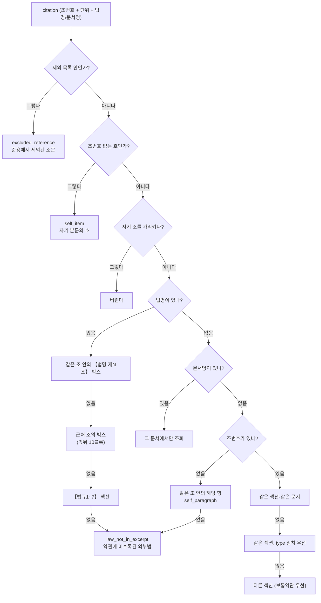

### 0. 목표

01번이 추출한 citation은 "제15조 제6항"처럼 **번호만** 있다. 이 번호가 실제로 어느 문서의 어느 조를 가리키는지 해석해, 04번(RAG)이 그 원문을 가져올 수 있게 만든다.

같은 "제7조"라도 어느 약관 소속인지에 따라 완전히 다른 조문이므로, 이 해석이 틀리면 **상담원에게 엉뚱한 조항을 근거로 제시하게 된다.**

---

### 1. 왜 01번과 분리했나

01번에서는 citation의 **번호·단위·법명·문서명**까지만 추출한다. 그 번호가 어느 조를 가리키는지는 03번에서 해석한다.

분리한 이유는 **해석에 필요한 정보가 01번 시점에 아직 없기 때문**이다. "제15조"를 해석하려면 전체 문서에 어떤 제15조들이 있는지 알아야 하는데, 01번은 청크를 하나씩 만드는 중이라 전체 목록이 완성되지 않았다.

---

### 2. 해석 경로

citation 하나를 받으면 아래 순서로 해석한다.



---

### 3. 문서명을 읽지 않으면 틀린다

**증상**: 배상책임 일반조항 제13조가 "「반려동물 비용손해 관련 특별약관 일반조항」제7조(계약 전 알릴 의무)"를 인용하는데, 참조로 붙은 것은 **같은 문서의 제7조(보험금의 분담)** 였다. 조 번호만 같고 완전히 다른 조문이다.

**원인**: 해석 로직이 "같은 섹션·같은 문서를 먼저 본다"로 시작하는데, 원문에 뭐라고 쓰여 있든 자기 문서에 그 번호가 있으면 거기로 연결해버렸다. 특별약관 안에 일반조항이 둘(비용손해 관련, 배상책임 관련) 있고 둘 다 제7조가 있기 때문에 생긴 문제다.

**더 근본적인 원인**: 01번의 citation 추출이 **문서명을 아예 잡지 않고 있었다.** 법률명(「전자서명법」)은 잡는데 약관명(「배상책임 관련 특별약관 일반조항」)은 "법"으로 끝나지 않아 걸리지 않았다.

**원문 표기는 두 가지였다**:

| 표기 | 건수(강아지) | 예 |
| --- | --- | --- |
| 낫표 안 | 75 | 「반려동물 비용손해 관련 특별약관 일반조항」제15조 |
| 괄호 없음 | 약 32 | 보통약관 제35조 / 해당계약 보통약관 제29조 |

**낫표만 잡으면 부족했다.** 그리고 측정해보니 낫표 75건이 지금 "맞게" 연결돼 있던 것도 문서명을 읽은 결과가 아니었다 — 인용한 문서에 그 조가 없어서 다음 후보로 넘어간 **우연**이었다.

**해결**: 01번 citation 추출에 `doc_name` 필드를 추가했다. 낫표 안의 약관명과, 괄호 없는 이름(SECTION_MAP의 section_name과 공백 무시로 대조)을 모두 인식한다. 03번은 `doc_name`이 있으면 **그 문서에서만** 조회하고, 없으면 `not_found`로 둔다.

**결과**: 문서명을 명시한 인용의 오연결이 강아지 4건·고양이 3건에서 0건으로 줄었다.

---

### 4. 호(號)를 항(項)으로 조회하던 문제

약관에서 호와 항은 완전히 다른 단위다.

```
① 회사는 다음 각 호의 경우 보험금을 지급하지 않습니다.   ← 1항
   1. 고의로 인한 사고                                   ← 1호
   2. 전쟁, 혁명...                                      ← 2호
```

"제2호"를 2항으로 조회하면 전혀 다른 내용이 나온다. 강아지 35건, 고양이 33건이 이 상태였다.

**원인**: citation에 `paragraph_type`("항"/"호")을 저장하면서도 그래프 엣지와 조회 단계로 전달하지 않았다. Milvus의 `paragraph_num`은 항 번호만 담고 호는 본문 안에 텍스트로만 있으므로, 호 번호로 조회하면 엉뚱한 항이 나온다.

**호를 네 부류로 나눠 처리했다**:

| 유형 | 예 | 처리 |
| --- | --- | --- |
| 같은 항 안의 호 | "제1호부터 제10호까지" | 자기 본문이므로 참조하지 않음 |
| 앞서 항을 밝힌 호 | "제1항 제1호 또는 제2호" | 앞의 항을 상속 |
| 외부 법령의 호 | 「전자서명법」 제2조제2호 | 해당 법령으로 연결 |
| 조+항+호 | "제7조 제1항 제4호" | 조와 항으로 조회, 호는 표기에만 |

**결과**: 호가 항 자리에 들어간 참조 68건 → 0건.

---

### 5. 단독 항 참조를 실제로 연결하기

"제1항에도 불구하고"처럼 **조번호 없이 항만** 참조하는 경우가 citation 전체의 약 52%였다. 기존에는 `self_block`이라는 라벨만 붙이고 **실제로 그 항이 어느 청크인지 찾지 않았다.**

01번에서 `article_block_id`가 "섹션+조 단위"로 바뀌면서 같은 조의 여러 항이 같은 id를 공유하게 됐고, 그 덕에 "같은 block_id 안에서 paragraph_num이 일치하는 청크"를 찾을 수 있게 됐다.

당시 측정에서는 397건 중 **385건(97%)이 같은 조 안에 해당 항이 실재**했다. 실제 연결로 바꿨고, 못 찾은 12건은 별도 scope로 두어 그래프에서 제외했다. 이후 01번 citation 추출을 고치면서 그 12건도 해소돼 지금은 0건이다.

---

### 6. 법규 섹션의 자기 참조

법규(【법규1~7】) 본문에 있는 law_name 없는 citation은 **그 법 자신의 조문**을 가리킨다. 민사소송법 제254조 안의 "제249조제1항"은 민사소송법 제249조다.

01번에서 section_name("【법규6】 민사소송법")에서 법명을 뽑아 채우도록 했다. 이때 **다른 법을 인용하는 건 덮어쓰지 않는다** — 금융소비자보호법 제17조가 「전자서명법」 제2조를 인용하면 그건 그대로 둔다.

다만 법규는 **발췌본**이라 참조 대상 조문이 수록되지 않은 경우가 많다(민사소송법은 254·266·269·393·399·402·412·425만 수록, 제249조는 없음). 이런 경우를 `not_found`와 구분해 `law_not_in_excerpt`로 분류했다 — "찾기 실패"와 "애초에 미수록"은 성격이 다르기 때문이다.

---

### 7. 적용되지 않는 조문을 참조로 붙이던 문제

준용규정을 측정하다 발견했다.

```
"다만, 보통약관 제3조·제4조·제5조… 는 제외합니다"
```

이 문장의 조문들이 **참조로 붙고 있었다.** 그 결과 적용되지 않는 조항을 적용되는 것처럼 설명하는 FAQ가 만들어졌다(해당 9개 전부).

제외 목록 안의 조문은 참조에서 빼도록 수정했다(강아지 17건, 고양이 11건). "단, 제15조(재가입)에 따라 … 적용하지 않습니다"처럼 **조건을 설명하는** 인용은 그대로 둔다.

> 이 버그는 04번 검색 답변에도 같은 영향을 준다. 상담원이 "이 조항이 적용됩니다"라고 안내하면 틀린 안내가 된다.
> 

---

### 8. matched_scope를 문자열이 아니라 필드로

기존에는 해석 결과를 문자열에 욱여넣었다.

```python
cit["matched_scope"] = f"cross_section({section}/{section_name})"
```

03-2번이 이걸 다시 파싱해 참조 대상을 꺼냈는데, `cross_section(보통약관/None)`에서 `split("/")[-1]`이 문자열 `"None"`을 만들어냈다(41건). 04번이 `section_name == "None"`으로 필터링해 조회가 실패했다.

`matched_scope`는 분류값만 담고, 참조 대상은 `ref_section`·`ref_section_name` 별도 필드로 분리했다.

---

### 9. 결과

| scope | 의미 | 강아지 |
| --- | --- | --- |
| `self_paragraph` | 같은 조 안의 항 (실제 연결) | 498 |
| `same_section` | 같은 섹션·같은 문서 | 105 |
| `law_not_in_excerpt` | 약관에 미수록된 외부법 | 101 |
| `named_document` | 문서명이 명시된 인용 | 99 |
| `law_section_reference` | 【법규】 섹션으로 연결 | 49 |
| `inline_law_same_block` | 같은 조의 【법명】 박스 | 47 |
| `self_item` | 조번호 없는 호 — 자기 본문 | 39 |
| `excluded_reference` | 준용에서 제외된 조문 | 17 |
| `inline_law_nearby` | 근처 조의 【법명】 박스 | 6 |
| `cross_section` | 다른 섹션 | 5 |
| `same_section_diff_type` | 같은 섹션이되 type이 일치하는 후보가 없을 때 | 0 |
| `not_found` | 해석 실패 | **0** |
| `same_section_same_type` | 같은 섹션, type 일치 | 0 |
| `self_paragraph_not_found` | 같은 조 안의 항을 못 찾음 | 0 |