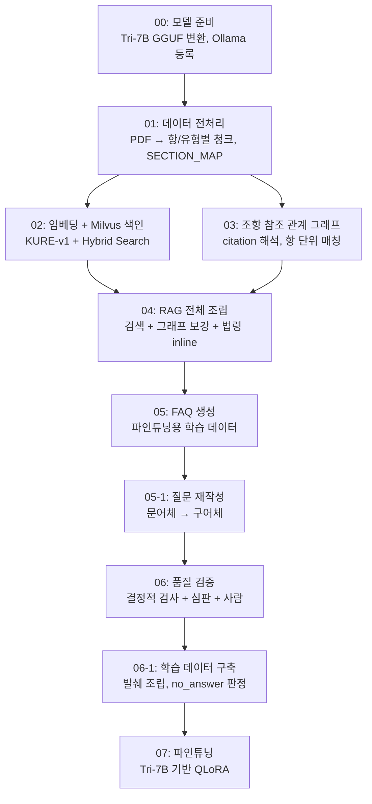
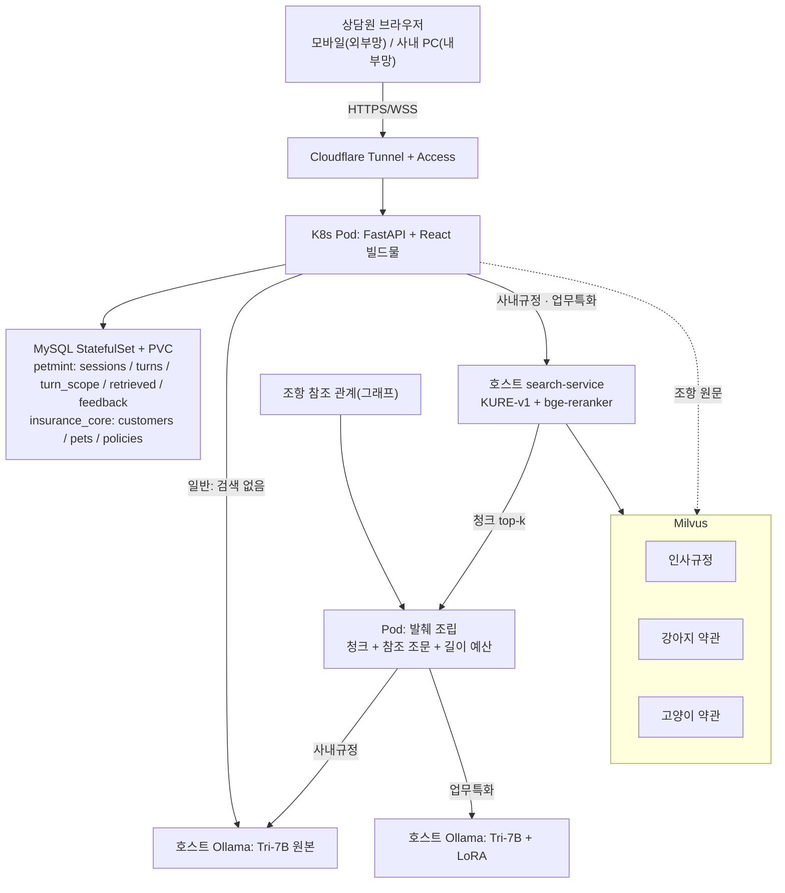

> 상태: 00~04 데이터 구축 완료, 05~08 재구축 진행 중. 09~14 화면·세션 저장·터널·배포는 구현됐다(클러스터 이주 2026-10-16). 답변 생성은 일반 모드만 배포 서버에서 확인(2026-10-18). search-service는 기동 전이라 업무특화·사내규정은 답하지 못한다. 인사규정 Milvus 색인은 시작 전, 15 모니터링은 매니페스트만 작성(2026-10-18, 적용 전).

### **1. 전체 파이프라인**

```
00. 모델 준비 (Tri-7B GGUF 변환, Ollama 등록)
01. 데이터 전처리 (PDF → 항/유형별 청크, SECTION_MAP)
02. 임베딩 + Milvus 색인 (KURE-v1, Hybrid Search + Reranker)
03. 조항 참조 관계 그래프 (citation 해석, 항 단위 정밀 매칭)
04. RAG 전체 조립 (검색 + 그래프 보강 + 법령 inline)
05. FAQ 생성 (파인튜닝용 학습 데이터)
05-1. 질문 재작성 (문어체 → 구어체)
06. FAQ 품질 검증 (결정적 검사 + LLM 심판 + 사람 표본)
06-1. 학습 데이터 구축 (발췌 조립, distractor 선정, no_answer 판정)
07. 파인튜닝 (Tri-7B 기반 QLoRA)
08. RAG 성능 정량 평가 (Ragas — Context Precision/Recall, Faithfulness)
09. UI 설계 (화면·API·동시 접속 처리)
10. 상담 흐름 설계 (전화 알림, 세션 수명, 화면 전환)
11. 디자인 시스템 (색·글꼴·질감·캐릭터)
12. 데이터 저장 (MySQL — 세션·턴 로그)
13. 외부 노출과 인증 (Cloudflare Tunnel + Access)
14. 배포 인프라 (CI/CD, Kubernetes, Docker)
15. 모니터링 (Prometheus + Grafana) — △ 매니페스트 작성(2026-10-18), 적용 전
```

위 목록 중 00~07(데이터 구축 과정)을 시각화하면:



### **2. 전체 시스템 아키텍처**



**GPU를 쓰는 것은 전부 호스트에 둔다.** Ollama와 검색(KURE + bge-reranker) 둘 다 호스트에 상주하고, Pod는 HTTP로 부른다. 그래서 Pod를 롤링해도 모델이 다시 올라갈 일이 없고, uvicorn worker를 1개로 제한할 이유도 사라졌다(09번 7-3절).

**search-service는 청크 top-k만 돌려주고, 발췌 조립은 Pod가 한다.** 그래프를 따라 참조 조문을 붙이고 길이 예산에 맞춰 자르는 일은 GPU가 필요 없고, 그 규칙은 자주 바뀌는 부분이라 Pod에 두어야 앱만 롤링하면 된다. 그래프는 모델이 쓰는 것이 아니라 코드가 발췌를 조립할 때 쓴다(4-1절 "근거는 코드가 조립한다"). 근거 패널에서 조항을 눌렀을 때 보여주는 원문도 Pod가 Milvus에서 바로 읽어 온다 — Milvus를 검색만 보는 것이 아니다.

**✗ 아직 띄우지 않았다 — search-service.** search-service(`search_service/main.py`)와 턴 파이프라인(`answer.py`·`retrieval.py`)은 코드 작성(2026-10-18), 실행 확인 전이다. 배포 설정의 주소는 아직 `search-service-not-deployed.invalid`다. **✗ 인사규정 Milvus 컬렉션(`hr_regulation`)도 적재 전이다.** ✗ 업무특화·사내규정은 답하지 못한다(search-service 기동 전, hr_regulation 적재 전, 어댑터 모델 tri-7b-rag-1이 Ollama에 없음). 위 그림은 설계이며, ✓ 실제로 도는 것은 브라우저 → 터널 → Pod → MySQL 경로, 조항 원문 조회, 일반 모드 답변(Pod → Ollama, 2026-10-18)이다.

---

### 3. 사용한 주요 모델·도구

| 용도 | 선택 | 비고 |
| --- | --- | --- |
| LLM(생성) | Tri-7B | 한국어 중심 다국어 모델(ko·en·ja), Apache 2.0 |
| 임베딩 | KURE-v1 | 한국어 특화, MIT |
| 리랭커 | bge-reranker-v2-m3 | Hybrid Search 2차 재정렬, max_length 1024 + fp16 |
| 벡터 DB | Milvus | 메타데이터 필터링 지원 |
| 키워드 검색 | BM25(rank-bm25) | Dense 검색의 길이 편향 보완 |
| PDF 파싱 | pymupdf | `sort=True`로 읽기 순서 보정 (인사규정은 sort=False — 쓰면 띄어쓰기를 잃는다) |

각 모델을 선택한 근거(대안 모델과의 비교 등)는 단계별 하위 문서 참고.

---

### 4. 보험 도메인의 신뢰성 문제

보험 챗봇이 "보장된다"고 잘못 안내하면, 단순한 정보 오류가 아니라 실제 보험금 지급 분쟁으로 이어질 수 있다. 일반적인 챗봇이라면 어느 정도의 부정확함이 허용될 수 있지만, 이 도메인에서는 "대충 맞는 답"이 아니라 **"정확히 근거를 댈 수 있는 답"**이 필수였다.

그래서 모델의 생성 능력에 기대기보다, 데이터 전처리 과정에서 최대한 정밀하게 구조화해(조-항 단위 분리, 유형 메타데이터 명시, 참조 관계 그래프화) 모델이 "틀릴 여지" 자체를 줄이는 방향으로 설계했다.

#### 4-1. 핵심 설계 원칙

**답변 근거는 모델이 직접 쓰지 않고 코드로 조립한다**

"이 답변의 근거는 제O조입니다"라는 출처 표기를 모델이 스스로 쓰게 하면 틀린 조항을 지어낼 위험이 있다. 어떤 조항을 참조했는지는 코드가 미리 정확하게 찾아서 끼워 넣고, 모델은 그 내용을 자연스러운 문장으로 정리하는 역할만 맡긴다.

**데이터를 쪼개는 단위를 작업마다 다르게 한다**

보험 약관은 "제1조(보험금의 지급사유)"처럼 조로 큰 항목을 나누고, 그 안에서 항으로 세부 내용을 다시 나누는 계층 구조다. 이 구조를 그대로 활용해 원문을 **항 단위**로 나눠두면 "이 조의 6항만 참조한다" 같은 세밀한 인용 관계까지 정확히 찾아올 수 있다. 반대로 파인튜닝용 FAQ를 생성할 땐 항 단위로 쪼개진 걸 다시 **조 단위**로 묶어서, 전체를 보고 자연스러운 질문-답변이 나오도록 재구성한다.

**반려동물 종(강아지/고양이)을 검색 전에 고정한다**

종은 고객 조회 단계에서 반려동물을 고르면 따라온다(여러 마리면 개체 선택). 그 값으로 검색 단계부터 해당 종의 컬렉션만 조회하도록 고정한다. 강아지와 고양이는 약관 자체가 다른데(강아지는 배상책임 특약이 있지만 고양이는 없음), 질문만 보고 모델이 스스로 판단하게 두면 틀릴 위험이 있다. 고객 데이터가 정해 주므로 그 추론 자체를 할 필요가 없다.

**유형(Ⅰ·Ⅱ·Ⅲ) 구분을 별도 필드로 명시한다**

이 약관에는 "통원의료비보장" 특약이 Ⅰ·Ⅱ·Ⅲ 세 버전으로 따로 존재하고 버전마다 한도가 다르다. 그런데 이름이 "통원의료비보장", "통원의료비Ⅱ보장", "통원의료비Ⅲ보장"처럼 거의 똑같이 생겨서, 코드가 다른 조항을 찾아올 때 엉뚱한 버전을 섞어 가져오는 오류가 있었다. `type` 필드로 구분을 명시해 해결했다.

**FAQ 생성과 실제 서비스의 역할을 분리한다**

FAQ를 만들 때는 "이미 정해진 조항 + 그 조항이 참조하는 다른 조항"만 가져다 쓰면 충분하지만, 실제 서비스는 사용자가 어떤 질문을 할지 모르니 매번 가장 관련 있는 내용을 찾는 검색이 필요하다. 그래서 둘을 구조적으로 분리했다.

---

### 5. 로직을 노트북이 아니라 모듈에 둔다

파이프라인이 노트북 00~07로 나뉘어 있는데, 로직을 노트북 셀 안에만 두면 다음 단계가 그걸 **복사해 쓰게 된다**. 그러면 앞 단계를 고쳐도 뒤 단계에는 반영되지 않는다.

실제로 겪은 일이다. 04번에서 "참조 조문이 3개까지만 조회돼 잘린다"는 버그를 고쳤는데, 05번이 04번 코드를 복사해 쓰고 있어서 05번에는 그 수정이 들어가지 않았다. 같은 데이터로 FAQ를 만드는데 한쪽만 온전한 조문을 받는 상태였다.

그래서 여러 단계가 공유하는 로직은 전부 `data/` 아래 독립 모듈로 분리하고, 노트북은 그걸 import만 하도록 했다.

| 모듈 | 역할 | 쓰는 곳 |
| --- | --- | --- |
| `limit_table.py` | 등급×유형별 한도표와 지급액 산출 공식 | 05, 06 |
| `search_engine.py` | Hybrid Search(BM25+Dense) + Reranker + 메타 필터 | 02, 04 |
| `rag_context.py` | 참조 조문 조회·조립, 법령 박스 추출, 그래프 키 | 04, 05, 06, 앱 |
| `faq_units.py` | FAQ 생성 단위 구성(조·등급 단위 묶기) | 05, 06 |
| `faq_verify.py` | 계산 재검산 (생성 직후 관문) | 05 |
| `faq_checks.py` | 결정적 품질 검사 | 06 |
| `faq_judge.py` | LLM 심판 (gemma4:12b) | 06 |
| `faq_style.py` | 질문 성질 측정 (라벨 누출·상황형·주제) | 05, 06, 재구축 |
| `build_review.py` | 빌드 뒤 사람 표본 검수 | 빌드 |
| `ckpt_select.py` | 체크포인트 고르기 (30문항 선택 세트) | 학습 |
| `search_scope.py` | 검색 범위(메타 필터) — 가입 특약·등급으로 Milvus 식과 BM25 술어를 한 곳에서 만든다 | 04, 08, 09 |
| `faq_rewrite.py` | 질문 재작성(문어체 → 구어체), 거부 조건 검사 | 재구축 |
| `na_judge.py` | no_answer 발췌에 답이 들어 있는지 LLM 판정 (원래 답변 기준) | 빌드 |
| `na_qjudge.py` | 같은 판정을 질문 기준으로 — "이 발췌만 읽고 질문에 답할 수 있는가". 원래 판정기는 답변 전체를 요구해 너무 엄격했다 | 빌드 |
| `finetune_data.py` | train.jsonl 빌드, distractor 선정 | 빌드 |
| `topic_weights.py` | 주제 가중치·주제 회차 계산 | 05, 06 |
| `rebuild.py` | 전체 재구축 단일 진입점. 
A는 생성 → 06 → 재작성 → 빌드 → 학습 → select, 
B는 생성 → 재작성 → 06 → 빌드 → 검수 → 학습 → select → 평가 | 전체 |
| `ref_usage.py` | 참조 조문 활용도 측정 | 분석 |

이 중 `limit_table.py`는 **"진실의 원천"** 역할이다. 한도 금액을 청크 메타데이터에 중복 저장하면 같은 숫자가 수백 번 복제되고, 하나를 고쳐도 나머지가 남는다. 파일 하나로 분리해 05번(생성 직후 재검산)과 06번(품질 검증)이 같은 값을 보도록 했다.

---

### 6. 문서 작성 원칙 — 단계별 문서를 고칠 때 먼저 읽을 것

모든 단계별 문서는 **"최종 설계 → 왜 이렇게 했나 → 시도했던 것들"** 순서로 쓴다.

"이렇게 했다 → 수정 → 다시 수정 → 최종" 식의 시간순 기록은 읽는 사람이 결론을 찾기 어렵다. 변경 이력은 본문에 섞지 말고 3번 절로 모은다.

| 절 | 내용 |
| --- | --- |
| 0. 한 줄 요약 | 이 단계가 하는 일 |
| 1. 최종 설계 | 지금 어떻게 돌아가는가. 처음부터 그렇게 정한 것처럼 쓴다 |
| 2. 왜 이렇게 했나 | 설계 판단의 근거 |
| 3. 시도했던 것들 | 무엇을 해봤고 왜 접었는가 — **수치와 함께** |
| 4. 남은 한계 | 알면서 못 고친 것 |
| 5. 검증 항목 | 체크리스트 |

**3번이 핵심이다.** 실패한 실험을 수치와 함께 적어두면 "이것저것 해봤다"가 아니라 "재보고 판단했다"로 읽힌다. 예: 참조 조문 활용을 두 번 시도했으나 질문 노출 25.8%, fabricated 13.2%, 심판 탈락 76%로 접었다 — 이렇게 써야 판단의 근거가 남는다.

---

### 7. 단계별 문서

00. 모델 준비

01. 데이터 전처리

02. 임베딩 + Milvus 색인

03-1. Citation 해석

03-2. 참조 관계 그래프

04. RAG 전체 조립

05. FAQ 생성

06. FAQ 품질 검증

07. 파인튜닝

08. RAG 성능 정량 평가

**09. UI 설계안**

10. 상담 흐름 설계

11. 디자인 시스템 (계속 수정 중)

12. 데이터 저장 (MySQL)

13. 외부 노출과 인증 (Cloudflare)

14. 배포 인프라 (컨테이너·K8s·CI/CD)

---

### 8. 폴더 구조

```python
~/AI_programming/petmint-rag-chatbot/
  data/
    raw_pdf/              원본 약관 PDF (강아지/고양이), 인사규정 PDF
    chunks/               01번 결과: petmint_{종}.json (항 단위), hr_인사규정.json
    graph/                03번 결과: petmint_{종}_resolved.json, petmint_{종}_graph.json, hr_인사규정_graph.json
    cache/                표 변환 캐시
    faq/                  05번 결과: 생성 라운드별 FAQ와 _failures
      checked/            06번 결과: checked_all, final, review_queue, judge_cache
      review/             검수 회차별 표본·판정·오류 태그
      rewrite/            질문 재작성 파일럿
      rebuild/, rebuild2/, rebuild3/   전체 재구축 출력 (라운드, checked/, logs/)
      exp_*/, rebuild3_b1*/            실험용 (exp_c·exp_g·exp_r·exp_r3smoke, rebuild3_b1·b1p)
    finetune/             train.jsonl, val.jsonl, stats.json, no_answer 판정·검색 캐시
      rebuild/, rebuild2/              재구축 학습 데이터
      exp_*/, rebuild3_b1*/, search_*_20261014/   실험용·스냅샷
    eval/                 회귀 세트, 답변 평가 라벨, 체크포인트 선택 세트, 축소판 세트
      results/            08번 평가·체크포인트별 답변 평가 결과
    review/               주제 가중치 초안, 표본 검수, 판정기 비교, 답변 평가·빌드 검수 리포트
    limit_table.py        한도표 (진실의 원천)
    search_engine.py      Hybrid Search + Reranker + 메타 필터
    search_scope.py       검색 범위 (메타 필터)
    rag_context.py        참조 조문 조회·컨텍스트 조립
    faq_units.py          FAQ 생성 단위
    faq_generate.py       FAQ 생성
    faq_verify.py         계산 재검산
    faq_checks.py         결정적 품질 검사
    faq_judge.py          LLM 심판 (gemma4:12b)
    faq_style.py          질문 성질 측정 (라벨 누출·상황형·주제)
    faq_rewrite.py        질문 재작성 (문어체 → 구어체)
    topic_weights.py      주제 가중치·주제 회차
    na_judge.py           no_answer 판정 (원래 답변 기준)
    na_qjudge.py          no_answer 판정 (질문 기준)
    finetune_data.py      학습 데이터 구축, distractor 선정
    build_review.py       빌드 뒤 사람 표본 검수
    ckpt_select.py        체크포인트 고르기 (30문항 선택 세트)
    rebuild.py            전체 재구축 단일 진입점 (A/B 순서)
    answer_eval.py        97문항 답변 평가
    prompts.py            학습·추론 프롬프트
    search_regression.py  검색 회귀 측정
    ref_usage.py          참조 조문 활용도 측정
    exp_gen_model.py      실험 G (생성 모델·재작성 위치)
    hr_preprocess.py      인사규정 전처리
    hr_index.py           인사규정 색인
  db/
    migrations/petmint/          번호 붙인 SQL (0001~0004)
    migrations/insurance_core/   고객 원장 스키마
    conn.py               접속 정보 (전부 환경변수, 기본값 없음)
    migrate.py            미적용 파일을 순서대로 적용
    bootstrap.py          DB·계정 생성 (멱등)
    seed_insurance_core.py  고객 원장 시드
    wait_ready.py         DB 준비 대기
  app/                    FastAPI 백엔드
    main.py, config.py, deps.py, db.py
    schemas.py            고객·세션·로그·REST·WS 모델
    services/             customers, sessions, retrieval, llm, answer,
                          titles, turn_log, policy_data
    routers/              customers, sessions, consultations, articles,
                          feedback, chat_ws
    fixtures/             샘플 고객 (git 제외, example만 올림)
    requirements.txt      컨테이너용 의존성
  web/                    React + TypeScript (Vite)
    src/
      pages/              ModeSelect / Chat / CustomerSelect / Consultation
      components/         TopBar, SourcePanel, CalcCard, ExclusionBanner, CallAlert,
                          PastConsultations, TurnView, ArchDiagram 등
      hooks/              useChatSocket, useCallSimulator 등
      api/                REST·WS 클라이언트, 타입
      assets/             fonts/, characters/ (png + mp4)
      styles/             tokens.css(:root), global.css
    dist/                 빌드 결과 — FastAPI가 StaticFiles로 서빙
  deploy/
    scripts/host-nfs-setup.sh   매니페스트는 ronanlab-infra/apps/petmint/
  models/
    base/Tri-7B/          HF 원본 (safetensors, 29GB)
    gguf/                 Tri-7B-f16.gguf, Tri-7B-Q4_K_M.gguf, Modelfile.tri7b
    lora_adapter/         rag-1_<N>건_<이름>/ (재구축·실험별 어댑터)
  notebooks/
    00_모델_준비.ipynb … 07_파인튜닝.ipynb
  docs/
    README.md             문서 목록과 규칙 (노션 사본 아님)
    next_rebuild.md       다음 재구축 계획 (노션 사본 아님)
    requirements.md, pipeline.md, 00~14   노션 사본 (원천은 노션)
  Dockerfile, .dockerignore, Jenkinsfile, .env.example
  backups/                단계별 산출물 백업
  logs/                   긴 실행 로그 (git 제외)
  _executed/              노트북 실행 결과물 (git 제외)
  KNOWN_ISSUES.md         미해결 항목과 보류 사유
```

---

### 9. 다음에 반영할 개선 사항

- vLLM 서빙 최적화, 임베딩 모델 양자화
- **참조 조문을 엮는 학습 데이터** — 다른 조 참조가 붙은 단위는 39%인데 답변이 그 내용을 쓰는 것은 17%다(최종 데이터 기준 5.9%). 05 프롬프트 수정을 두 번 시도했으나 7B가 지시를 소화하지 못했다(질문 노출 25.8%, fabricated 13.2%, 심판 탈락 76%). 더 큰 모델을 쓰거나 다른 방법이 필요하다 — 코드는 `REF_ROUNDS=0`으로 꺼둔 채로 남겨 두었다
- **부담보 동의어 대조** — 현재 프론트에서 글자 일치로만 비교한다. "무릎"과 "슬개골" 같은 동의어는 잡지 못한다
- **09번 UI — 메타데이터 선택 받기** △ 코드 작성(2026-10-18), 실행 확인 전. 고객 레코드의 `section_name`·`coverage_type`으로 만든 `SearchScope`(`customers.scope_for`)를 턴의 검색 범위로 넘긴다(`answer.scope_of`)
- **09번 UI — 판단 불가 시 되묻기** △ 코드 작성(2026-10-18), 실행 확인 전. 09번 4절 조건대로 `answer.clarify_options`가 판정하고 `resume_clarified`가 고른 쪽으로 잇는다
- **같은 질문으로 양성과 no_answer 쌍 구성** — no_answer를 gold 빼고 만들면 겹침이 구조적으로 낮아져, 모델이 발췌를 읽지 않고 질문 형태만 보고 라벨을 맞힌다. 지금 양쪽에 다 나오는 질문은 11개뿐이다(07번 10절)
- **VM 메모리 증설** — Vagrantfile 4096 → 8192. 호스트가 61GB에 여유 44GB라 넉넉하다. `vagrant reload`가 필요하므로 아래 노드 재배치와 함께 한다
- **노드 재배치** — w1에 MySQL+Harbor, w2·w3에 앱, Jenkins는 w3에 둔다. Jenkins와 MySQL을 떼어놓는 것이 핵심이다. Jenkins는 빌드 때 메모리가 튀지만 서비스 경로 밖이다
- **사내규정 모드** ✓ 전처리(청크 49개, 참조 그래프 7엣지). △ Pod 쪽 `SearchScope`(`SearchScope.unrestricted("인사규정")`)는 코드 작성(2026-10-18), 실행 확인 전. ✗ Milvus 색인(`python -m data.hr_index`) 전. 2절 그림의 사내규정 경로는 아직 돌지 않는다