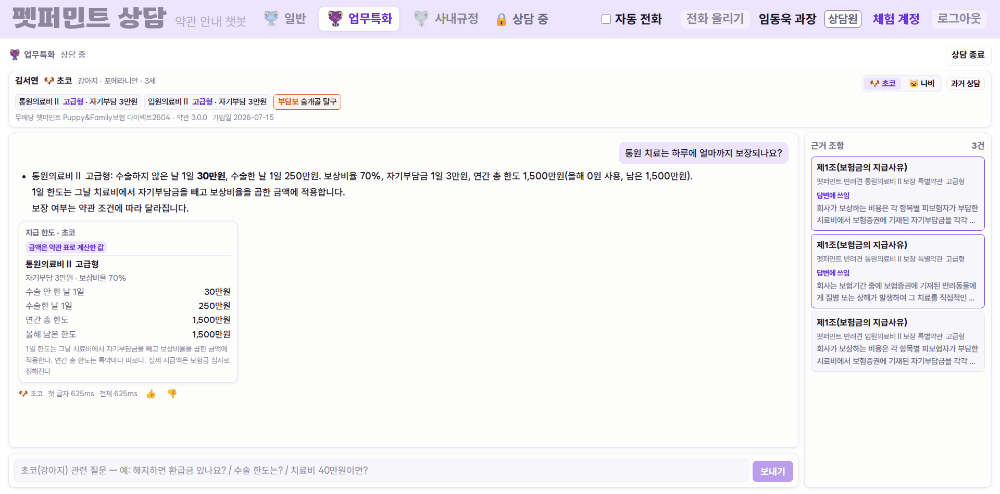
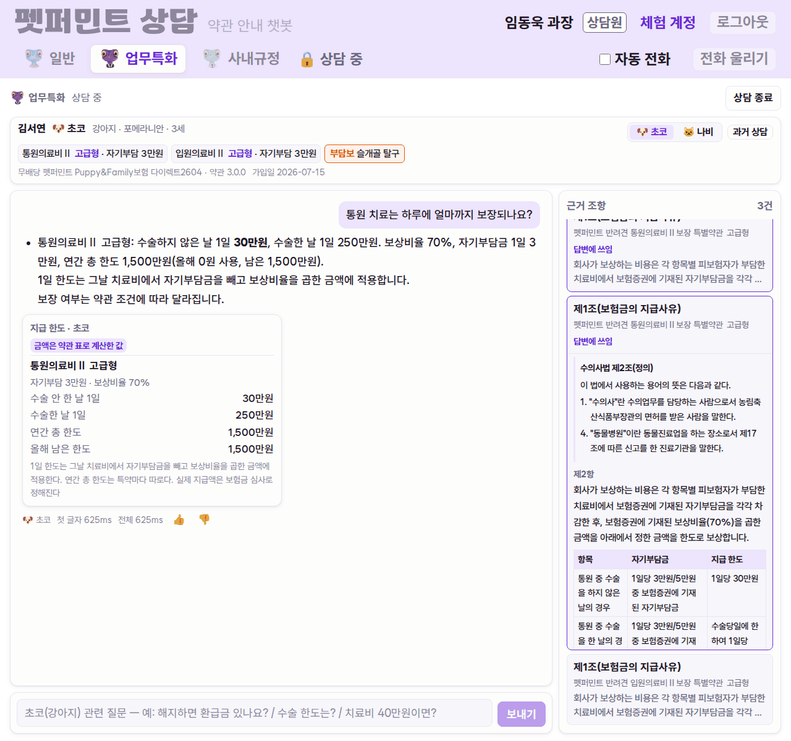
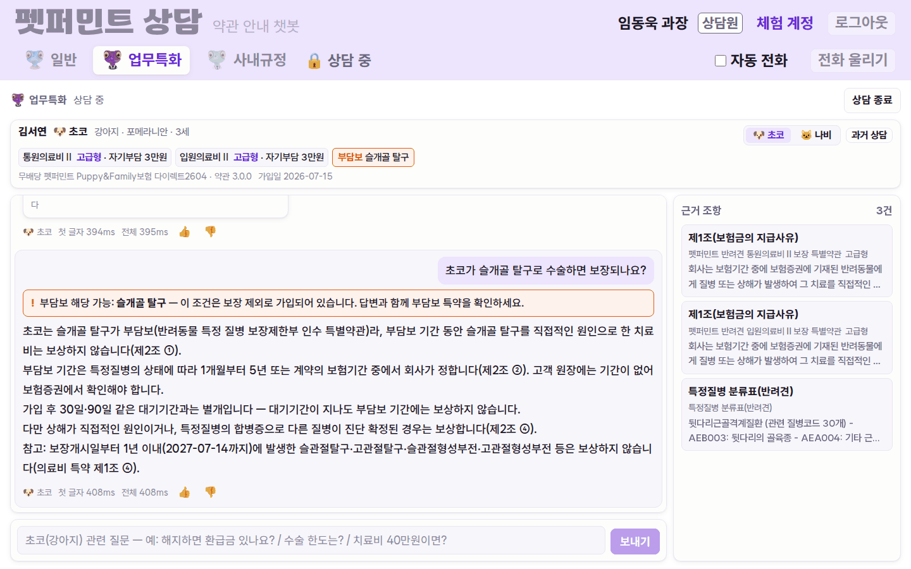
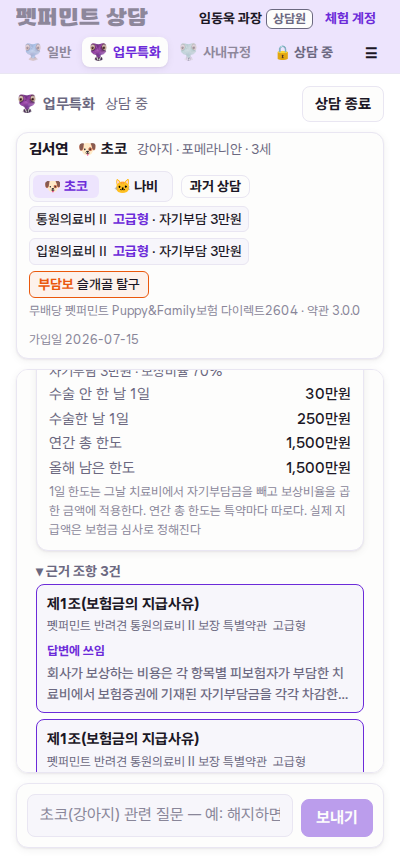

<!--
다루는 곳: web/src/components/SourcePanel.tsx, web/src/components/SourcePanel.module.css, web/src/components/ArticleText.tsx, web/src/components/ArticleText.module.css, web/src/components/TurnView.tsx, web/src/components/ExclusionBanner.tsx, web/src/pages/Consultation.tsx, web/src/pages/Consultation.module.css, app/routers/articles.py, app/services/article_display.py, app/services/answer.py, data/rag_context.py
읽은 커밋: f7bd15c
-->
# 05-02 근거를 보여 주는 법

이 챗봇이 내야 하는 것은 대충 맞는 답이 아니라 근거를 댈 수 있는 답이다. 보험 챗봇이 보장된다고 잘못 안내하면 그 말을 믿은 고객과 보험금 지급을 두고 다툼이 될 수 있기 때문이다(→ 「전체 그림」). [docs:pipeline.md] 그래서 업무특화 상담 화면은 답마다 그 답을 내려고 찾아 읽은 약관 조항을 옆에 붙이고, 그 가운데 답이 실제로 쓴 조항을 따로 표시하며, 조항을 누르면 원문을 그 자리에서 펼쳐 준다. 이 편은 근거를 언제, 어디에, 어떤 모양으로 보여 주는지와 그렇게 정한 까닭을 다룬다.

## 근거 패널의 자리

넓은 화면에서는 대화 오른쪽에 근거 조항 패널이 한 칸으로 붙는다. 휴대폰처럼 좁은 화면에서는 오른쪽 칸을 둘 자리가 없어, 답마다 그 아래에 접힌 칸으로 두고 누르면 펼친다. 두 모양은 같은 데이터를 배치만 다르게 보여 준다. [docs:02_pipeline/09_ui_design.md:108-115] 오른쪽 패널의 폭은 360px이고, 화면 폭이 899px 이하로 좁아지면 한 줄로 쌓는 배치로 바뀌며 패널 대신 답 아래의 접힌 칸이 나온다. [code:web/src/pages/Consultation.module.css:7] [code:web/src/pages/Consultation.module.css:31-34] 접힌 칸의 머리에는 근거 조항이 몇 건인지가 적힌다. [code:web/src/components/SourcePanel.tsx:80]

오른쪽 패널은 한 번에 한 턴(질문 하나와 그 답)의 근거만 보여 준다. 기본은 마지막 턴이고, 대화에서 앞선 턴을 누르면 그 턴의 근거로 바뀐다. [code:web/src/pages/Consultation.tsx:47-48] 아직 질문이 없으면 질문하면 검색된 조항이 여기에 뜬다는 안내만 있다. [code:web/src/components/SourcePanel.tsx:91] 사내규정 모드는 오른쪽 패널 없이 답 아래 접힌 칸으로만 근거를 보여 주고, 일반 모드는 찾아 읽는 문서가 없어 근거 칸이 없다. [code:web/src/pages/Chat.tsx:154]

## 먼저 찾은 것, 나중에 쓴 것

근거는 두 번에 나눠 화면에 온다. 서버는 질문을 받으면 약관을 먼저 검색하고 그 결과로 답을 쓴다. 검색 결과는 답을 쓰기 전에 이미 나와 있으므로 먼저 보내 근거 패널부터 채운다. 답이 실제로 어느 조항을 썼는지는 답을 다 쓴 뒤에야 알 수 있어서 마지막에 따로 보낸다. [docs:02_pipeline/09_ui_design.md:523] 그사이 답은 한 글자씩 흘러나온다(스트리밍). 상담원은 답이 다 나오기를 기다리는 동안에도 어떤 조항을 찾았는지 볼 수 있다. [docs:02_pipeline/09_ui_design.md:527]

답에 쓴 조항은 패널에서 테두리가 보라색으로 바뀌고 "답변에 쓰임" 표시가 붙는다. [code:web/src/components/SourcePanel.tsx:47] [code:web/src/components/SourcePanel.tsx:53] [code:web/src/components/SourcePanel.module.css:11] 어느 조항을 썼는지는 모델에게 묻지 않고 코드가 정한다. 답 글과 조항 본문을 맞대어, 답에 그 조문 번호가 나오거나 조항 본문과 8글자 이상 똑같이 겹치는 구간이 있으면 쓴 것으로 본다. [code:data/rag_context.py:507-512] 학습 데이터를 만들 때도 같은 방식으로 근거를 달았는데, 모델에게 쓴 근거를 적으라고 시키지 않은 까닭은 모델이 근거를 적는 일 자체가 또 하나의 지어낼 기회이기 때문이다. [docs:02_pipeline/05_faq_generation.md:130-132]

모델에게 건넨 발췌는 여러 개라, 먼저 답 글과 가장 길게 겹친 발췌 하나를 고르고 그 안에서만 쓴 조항을 찾는다. 고르지 않은 발췌에 붙은 조문은 보지 않는다. 발췌와 검색 결과는 순서 위치로 짝지어 서로 엇갈리지 않게 했다. 가장 길게 겹친 발췌 하나만 고르도록 바꾼 뒤, 답 234건에서 잘못 걸린 근거가 43건에서 21건으로 줄었다(2026-10-18). [docs:02_pipeline/09_ui_design.md:7] [code:app/services/answer.py:456-462] 모델에게 건네기 전에 길이에 맞춰 잘려 나간 발췌는 모델이 보지 못했으므로 쓴 근거로 치지 않는다. [code:app/services/answer.py:458]

## 원문은 패널 안에서 펼친다

패널의 조항 하나에는 조 번호와 제목, 특약 이름, 등급, 그리고 본문 앞부분 두 줄이 보인다. 조항을 누르면 그 조의 원문 전체가 그 자리에서 펼쳐진다. [code:web/src/components/SourcePanel.tsx:47-60] [code:web/src/components/SourcePanel.module.css:27] [docs:02_pipeline/09_ui_design.md:115] 원문을 모달 창으로 띄우지 않고 패널 안에서 펼친 까닭은 둘이다. 모달은 대화를 가리고, 조항 원문은 길 수 있다. 보통약관 제2조 용어 정의처럼 표가 두 번 들어가는 조항도 있다. [docs:02_pipeline/10_consultation_flow.md:148-150] 펼친 원문 칸은 높이 480px까지 자라고 그 안에서 스크롤된다. [docs:02_pipeline/11_design_system.md:137]

원문은 검색 데이터베이스의 내부 번호가 아니라 종, 특약, 조 번호 같은 구조 경로로 불러온다. 약관을 다시 색인하면 내부 번호가 바뀌기 때문이다. [docs:02_pipeline/09_ui_design.md:498] 한 번 펼친 조항은 화면이 기억해 두어 다시 펼칠 때 서버를 다시 부르지 않는다. [code:web/src/components/SourcePanel.tsx:23-25]

## PDF에서 뽑은 글을 읽히게

원문을 처음 그대로 보여 주었을 때는 읽기 어려웠다. 약관은 PDF 두 단 조판에서 뽑은 글이라, 문장과 낱말 한가운데서 줄이 끊긴 곳이 조 416개 가운데 400개에 7,806곳 있었다(2026-10-28). 의료비 특약 제1조 12개는 고급형, 기본형, 실속형 세 벌의 내용이 이름표 없이 이어져 나와, 상담원이 그 고객 등급의 한도를 찾기 어려웠다. 본문 사이에 끼운 【】 상자와 빈칸으로 줄을 맞춘 표도 날것 그대로 보였다. [docs:02_pipeline/10_consultation_flow.md:152] [code:data/review/article_display_survey.md:4]

고치는 길은 둘이었다. 처음 데이터를 만드는 전처리에서 줄바꿈을 고치는 길과, 화면에 보일 때만 고치는 길이다. 전처리를 고치면 모델에게 건네는 발췌가 모두 바뀐다. 그런데 운영 중인 모델은 이 줄바꿈이 든 발췌로 학습했다. 발췌 모양이 바뀌면 답이 흔들릴 수 있어 평가를 다시 해야 하고, 나쁘면 재학습까지 가야 한다. 그래서 원문, 조각, 색인, 발췌, 모델에게 주는 글은 그대로 두고, 화면에 보낼 때만 읽기 좋은 모양으로 바꾸는 쪽을 골랐다. [docs:02_pipeline/10_consultation_flow.md:152] [docs:next_rebuild.md:170] 바꾼 뒤 평가 질문으로 돌려 보니 모델에게 간 글은 102건 모두 전과 같았다(2026-10-28). [code:data/review/article_display_survey.md:76]

화면용으로 바꾸는 일은 서버가 한다. 가장 손이 간 것은 끊긴 줄을 잇는 일이다. 줄바꿈 자리가 원래 띄어 쓰는 자리인지 낱말 한가운데인지는 글자만 봐서는 알 수 없다. 그래서 같은 약관 안에서 그 줄바꿈 양옆 글자가 붙은 꼴과 띄운 꼴 가운데 어느 쪽이 더 많이 나오는지를 먼저 보고, 그래도 가려지지 않으면 낱말 빈도와 조사, 어미 규칙으로 정한다. 실제 약관 줄 2,494곳을 일부러 끊어 맞혀 보니 93.8%를 맞혔다(2026-10-28). [docs:02_pipeline/10_consultation_flow.md:153]

등급이 여러 벌인 조항은 가입한 등급을 먼저 펼치고 나머지 등급은 접어 둔다. 항이 둘 이상이면 항마다 작은 머리를 단다. 항 안의 목록이 이미 동그라미 번호를 쓰므로 항에는 그 기호를 붙이지 않고 "제N항"이라고 쓴다. [docs:02_pipeline/10_consultation_flow.md:154] 【】 상자는 왼쪽에 띠를 두른 상자로, 예시 상자는 다른 색으로, 빈칸으로 맞춘 줄은 실제 표로 그리고, 쪽이 넘어가며 생긴 빈 줄은 지운다. [docs:02_pipeline/10_consultation_flow.md:155] 패널에 접힌 채 보이는 두 줄 미리보기에도 같은 줄 잇기를 쓴다. [docs:02_pipeline/10_consultation_flow.md:152] 인사규정은 원문이 이미 깨끗해 손대지 않고 그대로 보인다. [docs:02_pipeline/10_consultation_flow.md:194]

## 근거 곁의 다른 표시들

근거 조항 말고도 답 곁에는 코드가 확인한 표시가 몇 가지 붙는다. 가입한 특약에 부담보가 있고 질문이 거기에 해당하면 답 위에 경고 배너가 뜬다. 이 판정은 모델에게 맡기지 않는다. 70억 매개변수 모델이 예외와 단서를 따지는 추론에서 가장 많이 틀리기 때문이다. [docs:02_pipeline/09_ui_design.md:131] 대조는 서버가 하며, 부담보 이름뿐 아니라 특정질병 분류표에서 그 분류에 든 질병 이름과 같은 부위의 다른 이름까지 본다. 그래서 질문이 무릎이라고 하고 부담보가 슬개골이라고 적혀 있어도 잡는다. [docs:02_pipeline/09_ui_design.md:133]

보험금 계산 카드에는 금액이 약관 표로 계산한 값이라는 표시가 붙는다. 답 글이 거절하거나 다른 금액을 말하더라도 카드의 숫자가 어디서 왔는지 보이게 하려는 것이다. [docs:02_pipeline/11_design_system.md:163] 답이 쓴 발췌에 표가 있으면 그 표를 모델이 다시 그리게 하지 않고 코드가 발췌 원문의 표를 답 아래에 붙이며, 모델이 본 글과 카드 어디에도 없는 금액이 답에 나오면 경고 한 줄을 덧붙인다. [docs:02_pipeline/16_code_answers.md:56-58] 이 표시들의 규칙은 다른 편에 모았다(→ 「코드가 답하는 질문」).

## 그때 모습 그대로

지난 상담을 다시 열면 대화와 근거 패널이 그때 값으로 보인다. 등급이 바뀐 고객의 작년 상담을 열었는데 지금 등급으로 보이면 그때 이렇게 안내했다는 기록이 거짓이 된다. [docs:02_pipeline/09_ui_design.md:100] 그래서 상담 기록에는 고객 번호만 적지 않고, 판단에 필요한 그 순간의 등급, 자기부담금, 부담보를 그대로 박아 둔다. 주문서에 상품 가격을 복사해 두는 것과 같은 이치다. 상품 가격이 올라도 작년 주문서의 금액은 그대로여야 한다. [docs:02_pipeline/12_data_storage.md:250-256]

검색된 조항도 번호만이 아니라 본문을 통째로 남기고, 조 번호, 제목, 등급 같은 표시용 값을 함께 둔다. 번호만 남겨 두면 약관을 다시 색인한 뒤에는 그때 무엇을 보았는지 알 수 없기 때문이다. [docs:02_pipeline/12_data_storage.md:86] [docs:02_pipeline/12_data_storage.md:260-262] 지난 상담을 보는 창은 이 기록으로 근거 패널을 다시 그린다. 다만 화면이 부담보를 글자로 대조하는 방식은 서버 대조 값이 없는 지난 턴에만 쓴다. [docs:02_pipeline/09_ui_design.md:133]

## 알려진 한계

- 줄 잇기가 맞히는 비율은 93.8%(2026-10-28)이고, 드문 낱말은 한 칸 틀리게 띄워질 수 있다. [docs:02_pipeline/10_consultation_flow.md:153] [code:data/review/article_display_survey.md:74]
- 답에 쓴 근거를 가르는 일은 글자 대조라, 쓰지 않은 조항이 걸리거나 쓴 조항이 빠지는 오판이 남아 있다(답 234건에 21건, 2026-10-18). [docs:02_pipeline/09_ui_design.md:7]
- 줄 잇기를 화면에서만 하고 모델은 줄이 끊긴 발췌를 그대로 읽는 일과 서비스 전체에 걸린 한계, 조건은 → 「알려진 한계」 한 편에 모았다.

## 용어 풀이

- 발췌: 검색으로 찾은 조항에 그 조항이 부르는 조문을 붙여 모델에게 건네는 글 묶음
- 턴: 질문 하나와 그에 대한 답 하나
- 스트리밍: 답을 다 만든 뒤 한꺼번에 보내지 않고 만들어지는 대로 조금씩 흘려 보내는 방식
- 색인: 검색할 수 있게 조각마다 벡터와 꼬리표를 만들어 검색 데이터베이스에 넣는 일
- 전처리: 약관 PDF에서 글을 뽑아 조와 항 단위 조각으로 나누는 첫 단계(→ 「약관 PDF를 조각내기」)
- 【】 상자: 약관이 다른 법률 조문이나 용어 정의를 본문 사이에 끼워 인쇄한 상자
