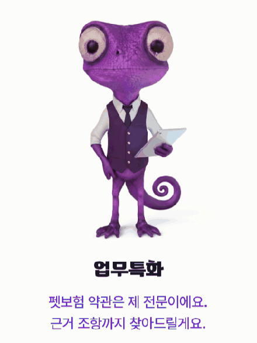
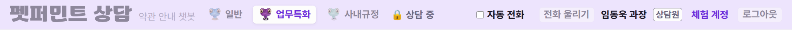
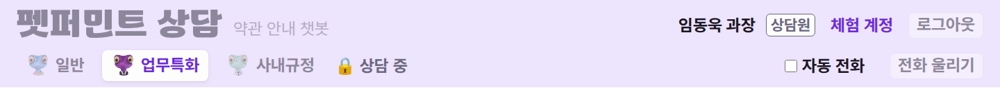
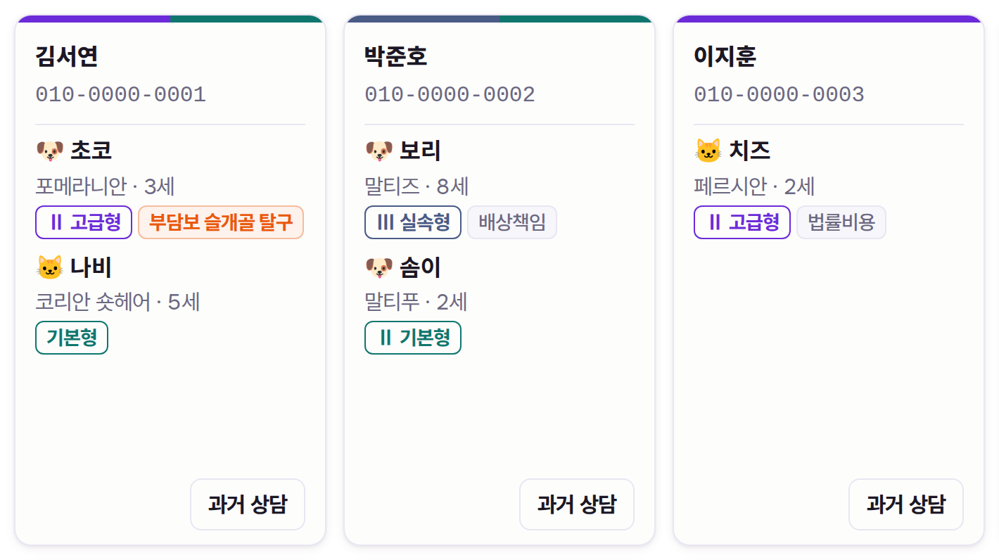
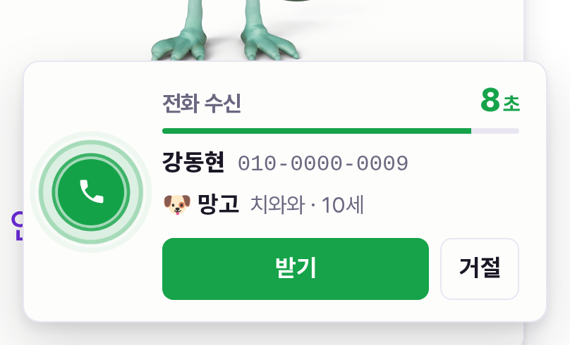

<!--
다루는 곳: web/src/styles/, web/src/assets/fonts/, web/src/assets/characters/, web/src/components/TopBar.tsx, web/src/components/TopBar.module.css, web/src/components/CallAlert.tsx, web/src/components/CallAlert.module.css, web/src/components/CustomerCard.module.css, web/src/pages/ModeSelect.tsx, web/src/pages/ModeSelect.module.css, web/src/pages/CustomerSelect.module.css, web/src/policySummary.ts
읽은 커밋: f7bd15c
-->
# 05-04 디자인

앞의 편들이 화면에 무엇을 보여 주고 상담원이 화면 사이를 어떻게 오가는지를 정했다면, 이 편은 그것을 어떤 생김새로 보이게 하는지를 다룬다. 색, 글꼴, 질감, 글씨 크기, 그리고 모드마다 하나씩 있는 캐릭터다. [docs:02_pipeline/11_design_system.md:12-14] 한 줄로 줄이면 흰 바탕에 보라 하나를 포인트로 쓰고, 평면 카드를 그림자로 띄운 차분한 업무 도구다.

## 흰 바탕에 보라 하나

화면은 밝은 모드 하나로만 간다. 상담원이 사무실에서 하루 종일 쓰는 도구라 흰 바탕이 눈에 편하다. [docs:02_pipeline/11_design_system.md:22] 바탕은 흰색과 아주 옅은 회보라이고, 보라는 버튼과 고른 항목과 강조에만 쓴다. 보라는 진한 것과 연한 것 둘로 나눠, 진한 보라는 주요 버튼을 채우는 데, 연한 보라는 헤더 바탕이나 고른 항목의 배경에 쓴다. [docs:02_pipeline/11_design_system.md:28]

뜻이 정해진 색은 셋을 더 둔다. 초록은 전화에만 쓰고, 주황은 부담보 경고에만 쓴다. 특약 등급을 가르는 색은 따로 있다. 주요한 값을 나란히 놓으면 이렇다. [docs:02_pipeline/11_design_system.md:30-46]

| 쓰임 | 값 |
|---|---|
| 바탕 | `#FFFFFF` |
| 진한 보라(주요 버튼, 고른 항목의 글자, 고급형 등급) | `#6C2BD9` |
| 연한 보라(헤더 바탕, 고른 항목 배경, 배지) | `#EDE4FD` |
| 전화 | `#16A34A` |
| 부담보 경고 | `#EA580C` |
| 기본형 등급(청록) | `#0F766E` |
| 실속형 등급(남회색) | `#4A5B86` |

초록과 주황은 흰 바탕에 맞춰 한 단계 어둡게 골랐다. 어두운 바탕에서 선명하던 밝은 색은 흰 바탕 위에서 눈부셔 오히려 읽히지 않는다. [docs:02_pipeline/11_design_system.md:48] 등급 색은 부담보의 주황과 헷갈리지 않게 따뜻한 색을 피했다. 기본형의 청록은 전화의 초록과 가깝지만, 작은 칩의 테두리와 얇은 띠에만 쓰고 면을 채우지 않아 섞이지 않는다. [docs:02_pipeline/11_design_system.md:50] 초록을 전화에만 쓰는 원칙에는 예외가 하나 있다. 지난 상담 목록에서 진행 중인 상담을 표시할 때인데, 이것도 지금 통화 중이라는 같은 뜻이다. [docs:02_pipeline/11_design_system.md:52]

이 방향에 이르기까지 두 안을 버렸다. 처음에는 어두운 보라 그라데이션 바탕에 유리처럼 비치는 카드와 빛 덩어리를 올린 안으로 갔다. 실제로 만들어 보니 화면이 칙칙하고 한 화면에 담기는 정보가 적었다. 상담 도구에는 평면 카드에 그림자만 주는 쪽이 맞았다. [docs:02_pipeline/11_design_system.md:252] 바탕을 초록 계열로 하는 안도 버렸다. 전화 알림이 같은 색 계열에 묻히고, 경고로 쓸 주황도 초록의 이웃이라 애매해진다. 청록도 초록과 색상환에서 너무 가까워 같은 문제가 있었다. [docs:02_pipeline/11_design_system.md:255] 색은 모두 이름 붙은 값(토큰)으로 한 곳에 정의하고, 화면의 부품들은 값 대신 그 이름만 쓴다. 토큰 파일 밖에 직접 적은 색은 없다. [docs:02_pipeline/11_design_system.md:237] [docs:02_pipeline/11_design_system.md:276]

## 글꼴

글꼴은 둘을 쓰임에 따라 나눈다. 헤더 로고, 모드 선택 화면의 제목과 카드 제목, 소개 영역의 모드 이름에는 완주군이 배포한 완주대둔산체를 쓰고, 그 밖의 모든 글(화면 제목, 본문, 대사, 메뉴, 고객 정보, 대화)은 Wanted Sans로 쓴다. [docs:02_pipeline/11_design_system.md:58-63] 완주대둔산체를 몇 곳에만 쓴 까닭은 지자체 글꼴이 개성이 강해 긴 글에 쓰면 읽기 피곤하기 때문이다. 짧은 낱말에서는 개성이 읽기를 방해하지 않고, 모드 선택 화면은 서비스를 처음 소개하는 자리라 인상이 중요하다. 상담 화면은 모두 Wanted Sans다. [docs:02_pipeline/11_design_system.md:244] 완주대둔산체는 공공누리 제1유형 저작물이라 상업적 이용과 웹에 싣는 것이 모두 허용된다. [docs:02_pipeline/11_design_system.md:65]

글씨 크기는 새로 만들지 않는다는 규칙을 둔다. 화면마다 필요한 크기를 그때그때 만들지 않고 이미 정해 둔 크기 계단(1440px 화면에서 제목 52, 섹션 40, 묶음 30, 본문 26, 보조 24px)에서만 고른다. 그래야 화면끼리 같은 계단이 맞는다. [docs:02_pipeline/11_design_system.md:69] 굵기도 부연 설명, 본문, 메뉴와 버튼, 제목, 작은 제목을 더 굵게 할 때의 다섯 단계로만 쓴다. [docs:02_pipeline/11_design_system.md:71]

## 그림자로 띄운 평면 카드

그라데이션과 유리 효과는 쓰지 않는다. 평면 카드에 그림자만으로 깊이를 만든다. 카드는 흰 면에 엷은 그림자를 주어 바탕에서 살짝 떠 보이게 하고, 테두리는 없거나 아주 엷게 둔다. 그림자도 본문 글자색에서 투명도만 바꿔 만든다. [docs:02_pipeline/11_design_system.md:77-79] [docs:02_pipeline/11_design_system.md:238] 카드를 누를 때는 살짝 올라오며 그림자가 한 단계 커지고, 이 움직임은 짧게 끝낸다. 모드 선택 카드만 더 크게 올라오는데, 그 화면은 카드가 셋뿐이라 과하지 않다. 운영체제에서 움직임 줄이기를 켜 둔 사람에게는 이 움직임을 끈다. [docs:02_pipeline/11_design_system.md:80-84]

주요 버튼은 마우스를 올리면 조금 어두워지고, 누르면 한 단계 더 어두워지며, 누를 수 없을 때는 흐려진다. 어두워지는 쪽과 흐려지는 쪽이 반대라 눈으로 쉽게 갈린다. 버튼의 크기와 위치는 바꾸지 않는다. 누르는 사이 버튼이 움직이면 손가락이 빗나가기 때문이다. 전에는 로그인 버튼이 마우스를 올리면 연한 보라로 바뀌어 누를 수 없는 버튼처럼 보였다. [docs:02_pipeline/11_design_system.md:82]

## 글씨 배율과 헤더

글씨는 한 벌의 크기 이름에 배율을 곱해 정한다. 헤더처럼 대화 밖의 글은 본문 배율(두 배)을 받고, 대화 화면 안의 글은 대화 배율 1.3배를 받는다. 대화 화면에도 두 배를 썼더니 1280px 화면의 업무특화 대화가 한 화면에 6줄밖에 들어가지 않았고, 1.3배로 줄이자 10줄이 들어갔다. [docs:02_pipeline/11_design_system.md:95] 이렇게 줄인 만큼 상담 화면 위쪽 고객 정보 칸이 144px에서 110px로 낮아지고 대화 칸이 그만큼 길어졌다(2026-10-23). [docs:02_pipeline/11_design_system.md:109] 640px 이하 휴대폰 폭에서는 배율을 더 줄인다. [docs:02_pipeline/11_design_system.md:95]

헤더는 스크롤해도 화면 위에 붙어 있다. [docs:02_pipeline/11_design_system.md:90] 1920px 이상에서는 제목, 모드 탭, 전화 묶음, 상담원 이름이 한 줄에 서고, 그보다 좁으면 두 줄이 된다. 첫 줄에 제목과 상담원, 둘째 줄에 모드 탭과 전화 묶음이다. 상담원 이름은 어느 폭, 어느 화면에서도 첫 줄 오른쪽 끝에 고정한다. 전에는 헤더를 한 줄로 흐르게 두었더니, 상담이 시작되어 모드 탭 자리에 상담 중 표시가 생기면 상담원 이름이 아래 줄로 밀렸다. 1023px 이하에서는 전화 묶음을 메뉴 단추 하나로 접는다. [docs:02_pipeline/11_design_system.md:92]

## 화면마다 다른 밀도

같은 색과 글꼴을 쓰되 화면마다 촘촘한 정도를 달리한다. 모드 선택 화면과 전화 알림은 여백을 넉넉하게 두어 캐릭터와 카드가 살아나게 한다. [docs:02_pipeline/11_design_system.md:159] 모드 선택 카드는 화면 폭을 셋으로 나눈 폭으로 키워 세 장이 화면을 채우고, 1023px 이하 좁은 화면에서는 한 장씩 손으로 끌거나 화살표로 넘긴다. [docs:02_pipeline/11_design_system.md:138] [docs:02_pipeline/11_design_system.md:149]

고객 조회 화면은 촘촘하게 둔다. 1920px 화면에서 고객 카드가 한 줄에 여섯 장씩 서서 고객 10명이 한 화면에 다 들어온다. 카드 위쪽의 얇은 띠는 반려동물 수만큼 칸으로 나뉘고, 칸마다 그 반려동물이 가입한 가장 높은 등급의 색을 칠한다. 반려동물마다 등급 칩과 부담보 칩이 그 반려동물 줄에 붙어, 상담 화면에 들어가지 않고도 특약을 훑어볼 수 있다. 전에는 모든 반려동물의 부담보를 카드 맨 아래 한 줄에 모아 두어 다른 반려동물의 부담보처럼 보였다. [docs:02_pipeline/11_design_system.md:160] 상담 화면은 같은 색을 쓰되 밀도를 더 올려, 고객 정보를 세 줄 안에 담는다. [docs:02_pipeline/11_design_system.md:161]

## 전화 알림

전화 수신 카드에서는 초록 원 바깥으로 고리가 퍼져 나가며 옅어지는 움직임을 시차를 두고 되풀이해 파장처럼 보이게 한다. 그림 파일 없이 스타일 규칙만으로 그려 부담이 없다. [docs:02_pipeline/11_design_system.md:177] 흰 바탕에서는 반투명한 테두리만으로는 고리가 보이지 않아, 진한 초록 테두리에 옅은 초록을 채운 원반이 퍼지게 했다. [docs:02_pipeline/11_design_system.md:183] 원 안의 수화기는 흰 아이콘 그림이다. 처음에는 수화기 이모지를 썼는데, 글꼴에 든 빨간 수화기가 초록 원 위에 그대로 얹혀 나왔다. 이모지는 글자색으로 색을 바꿀 수 없다. [docs:02_pipeline/11_design_system.md:181]

카드는 고객 조회 카드와 같은 크기의 글씨를 쓰고, 카드 폭과 원의 크기는 글씨를 따라 커지고 작아지게 두었다. 받기와 거절 단추는 손가락으로 누를 수 있게 높이를 44px 이상으로 둔다. [docs:02_pipeline/11_design_system.md:185] [docs:02_pipeline/11_design_system.md:193]

## 캐릭터

모드마다 캐릭터가 하나씩 있다. 셋 다 같은 도마뱀이다. 큰 둥근 눈에 2~3등신, 말려 올라간 꼬리를 한 입체 캐릭터로, 생김새는 고정하고 색과 옷만 바꿔 같은 캐릭터로 보이게 했다. 옷은 모드가 업무에 가까울수록 갖춰 입는다. [docs:02_pipeline/11_design_system.md:200-202] 일반 모드는 하늘색에 니트를 입고 머그잔을 든 유연한 동료, 사내규정 모드는 민트색에 흰 셔츠와 넥타이를 매고 사원증을 단 선배, 업무특화 모드는 진한 보라 정장 조끼에 태블릿을 든 베테랑 실무자다. [docs:02_pipeline/11_design_system.md:204-208]

셋의 색은 색상환에서 고르게 퍼져 있어 서로 쉽게 갈린다. 초록에 가까운 것은 민트뿐인데, 채도를 낮춰 전화 알림의 초록과 갈리게 했다. 사내규정 캐릭터의 넥타이는 처음에 빨강이었으나 네이비로 바꿨다. 이 화면의 색 가운데 빨강이 없고, 빨강은 경고색 주황과 헷갈리기 때문이다. [docs:02_pipeline/11_design_system.md:246] 소품은 손에 든 것만 둔다. 공중에 뜬 홀로그램이나 빛나는 아이콘은 AI로 만든 영상에서 프레임마다 모양이 바뀌어, 되풀이해 재생할 때 어색해진다. [docs:02_pipeline/11_design_system.md:210]

캐릭터는 짧은 영상으로도 움직인다. 모드 선택 카드에서는 평소에 정지 그림이고 마우스를 올렸을 때만 영상이 돈다. 상담원이 고객 전화를 받으며 쓰는 도구라 평소에 움직이면 산만하다. 그 아래 소개 영역에서는 화면에 들어온 영상만 소리 없이 되풀이해 재생한다. 그곳은 읽는 영역이라 움직임이 시선을 끄는 편이 낫다. [docs:02_pipeline/11_design_system.md:216-218] 머그잔으로 한 모금 마시기, 고개 한 번 끄덕이기, 태블릿 한 번 내려다보기처럼 셋 다 시작 자세로 돌아오는 동작이라 되풀이해도 끊기지 않는다. [docs:02_pipeline/11_design_system.md:220-226] 만들 때는 정지 그림 셋을 먼저 만들고 그 그림으로 영상을 만들었다. 영상 단계에서 색과 옷을 한꺼번에 바꾸면 세 캐릭터의 생김새가 서로 달라졌기 때문이다. [docs:02_pipeline/11_design_system.md:258]

## 여섯 폭에서 잰다

화면을 바꿀 때마다 1920, 1440, 1280, 1024, 800, 400px 여섯 폭에서 가로로 넘치는 곳과 겹치는 곳이 없는지 확인한다. [docs:02_pipeline/11_design_system.md:274] 스타일은 부품마다 따로 둔 스타일 파일에 직접 쓰고, 화면을 꾸미는 바깥 라이브러리는 쓰지 않는다. 화면이 몇 장 되지 않아 복잡하지 않기 때문이다. [docs:02_pipeline/11_design_system.md:236]

## 알려진 한계

- 어두운 화면 모드가 없다. 상담원이 사무실에서 하루 종일 쓰는 도구라 밝은 모드 하나로 정했고, 색을 모두 토큰으로 잡아 두어 필요해지면 더할 수 있다. [docs:02_pipeline/11_design_system.md:267]
- 체험 관리자 계정으로 상담 중일 때는 헤더 한 줄에 약 1985px가 필요해, 1920px 화면에서 그 경우만 상담 중 표시가 탭 아래로 내려간다(겹침은 없다, 2026-11-12). 경계를 더 올리면 모든 계정의 1920px 화면이 두 줄이 되어 그대로 둔다. [docs:02_pipeline/11_design_system.md:268]
- 이 서비스 전체에 걸린 한계와 조건은 → 「알려진 한계」 한 편에 모았다.

## 용어 풀이

- 토큰: 색이나 크기에 이름을 붙여 한 곳에 정의한 값. 화면 곳곳은 값 대신 이 이름을 쓴다
- 배율: 정해 둔 글씨 크기에 곱하는 수. 배율 하나만 바꾸면 그 영역의 글씨가 한꺼번에 커지거나 작아진다
- 채도: 색이 얼마나 짙고 선명한지의 정도. 낮추면 회색에 가까워진다
- 색상환: 색을 둥글게 늘어놓은 고리. 고리에서 멀리 떨어진 색일수록 서로 잘 갈린다
- 공공누리: 공공기관이 만든 저작물을 누구나 쓸 수 있게 조건을 붙여 여는 표시 제도
