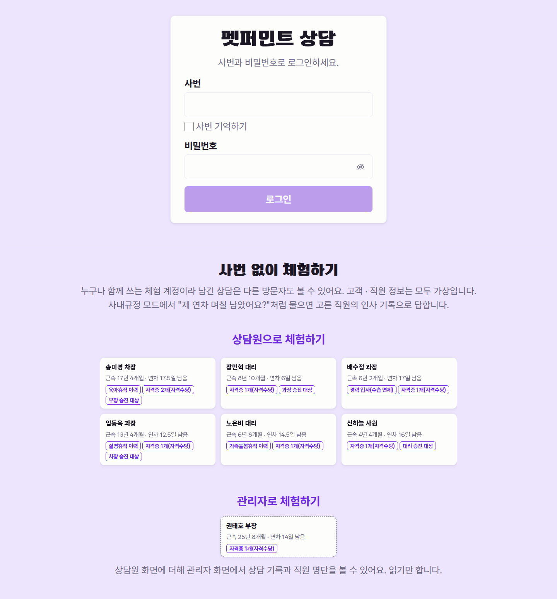
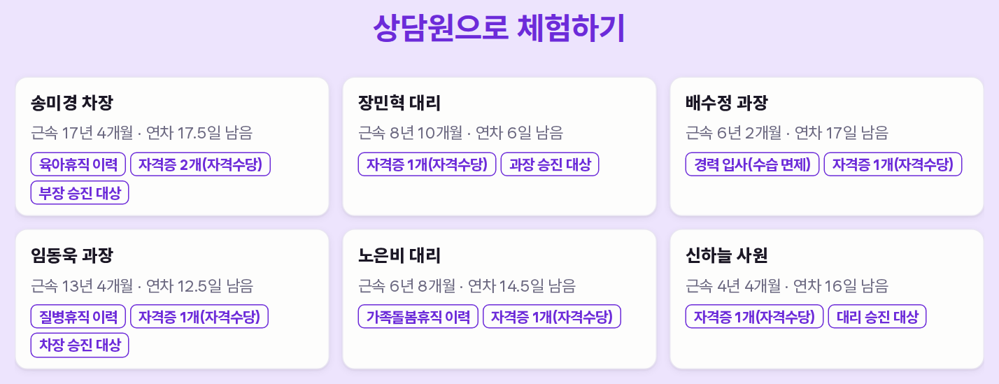

<!--
다루는 곳: app/routers/auth.py, app/services/auth.py, app/deps.py, app/config.py, app/services/demo.py, app/services/rate_limit.py, app/routers/chat_ws.py, db/employees.py, db/migrations/petmint/0006_accounts.sql, db/migrations/petmint/0010_auth_session_demo.sql, db/migrations/petmint/0012_accounts_precreated.sql, web/src/auth/, web/src/components/FlowCarousel.tsx
읽은 커밋: f7bd15c
-->
# 07 로그인, 체험 계정, 터널

펫퍼민트 상담 챗봇은 사번과 비밀번호로 로그인하는 사내 도구다. 가입은 없고, 직원 원장에 있으면서 앱 계정이 있는 사람만 들어온다. [docs:02_pipeline/13_access_and_tunnel.md:5] [docs:02_pipeline/13_access_and_tunnel.md:107] 처음 보는 사람은 사번이 없으니, 로그인 화면 아래 체험 카드를 눌러 가상 직원으로 바로 들어온다. [docs:02_pipeline/13_access_and_tunnel.md:129] 서버는 사설망 안에 있고, Cloudflare 터널로 바깥에 나간다. [docs:02_pipeline/13_access_and_tunnel.md:15] 이 편은 이 세 가지가 어떻게 돌아가고 왜 그렇게 정했는지를 다룬다.

## 로그인을 앱이 직접 하게 된 까닭

처음에는 앱에 로그인을 만들지 않으려 했다. 상담에는 책임이 따라 누가 어떤 답을 받았는지 남아야 하지만, 앱이 로그인을 직접 하면 비밀번호 저장과 세션 관리와 재설정을 모두 떠안는다. 사내 계정 체계가 이미 있는데 하나를 더 만드는 셈이라 퇴사 처리도 두 곳에서 해야 한다. 앱이 비밀번호를 다루지 않으면 새어 나갈 것도 없다. 그래서 사내 도구의 흔한 방식대로, 앞단의 Cloudflare Access(터널 앞에서 사내 계정 로그인을 대신 받아 주는 서비스)가 신원을 확인하고 그 이메일을 앱에 넘겨주는 설계로 시작했다. [docs:archive/13_access_and_tunnel_log.md:7-13]

요구가 두 군데서 바뀌었다. 하나는 데모를 보는 사람에게 사내 계정이 없다는 것이다. Access를 "로그인한 누구나"로 열면 상담원 명단으로 거르지 못하고, 계정을 만들어 주면 사내 계정 체계 밖의 사람을 넣게 된다. 다른 하나는 앱이 상담원 명단과 역할과 재직 여부를 알아야 한다는 것이다. 사내규정 모드가 퇴직금이나 연차를 직원 본인 기준으로 계산하려면 로그인한 사람이 누구인지 사번 단위로 알아야 한다. [docs:02_pipeline/13_access_and_tunnel.md:87-91] 그래서 직원 원장을 두고 앱이 그 직원을 직접 인증하기로 했다. Access 헤더의 이메일을 신원으로 받던 길은 코드에 남아 있으나 운영에서는 쓰지 않는다. [docs:02_pipeline/13_access_and_tunnel.md:6]

## 사번과 비밀번호

직원이 누구인지는 보험사 기간계를 흉내 낸 인사 원장에 있고, 앱은 그것을 읽기만 한다. 앱 쪽에는 역할, 비밀번호 해시, 잠금 상태 같은 앱이 쓰는 값만 따로 둔다(→ 「대화 기록과 관리자 화면」). [docs:02_pipeline/13_access_and_tunnel.md:97] 원장의 직원 11명은 모두 가상 인물이다. [docs:02_pipeline/12_data_storage.md:134]

비밀번호는 argon2id(일부러 느리고 메모리를 많이 쓰게 만든 비밀번호 해시 방식)로 바꿔 저장하고 최소 10자다. 관리자가 준 임시 비밀번호는 첫 로그인 때 바꾸게 하고, 바꾸면 그 직원의 다른 로그인을 모두 끊는다. [docs:02_pipeline/13_access_and_tunnel.md:98] 로그인하면 32바이트 난수를 쿠키에 담아 준다. 이 쿠키는 화면의 스크립트가 읽을 수 없고 보안 연결로만 오가며, 데이터베이스에는 그 값 자체가 아니라 되돌릴 수 없게 바꾼 값만 남는다. 2시간 동안 쓰지 않거나 12시간이 지나면 끊긴다. 서명만으로 통하는 토큰(JWT)을 쓰지 않은 것은 퇴직, 비밀번호 변경, 로그아웃 때 그 자리에서 끊어야 하기 때문이다. [docs:02_pipeline/13_access_and_tunnel.md:99]

비밀번호를 하나씩 넣어 보는 공격은 5번 실패하면 15분 잠그는 것으로 막는다. 틀렸을 때 문구는 "사번 또는 비밀번호가 올바르지 않습니다" 하나뿐이고, 없는 사번을 넣어도 비밀번호 대조에 같은 시간을 쓴다. 문구나 걸리는 시간이 다르면 어떤 사번이 있는지 떠볼 수 있기 때문이다. [docs:02_pipeline/13_access_and_tunnel.md:100] 인사 원장의 퇴직일이 지나면 다음 요청부터 막히고, 원장은 두고 앱만 끊을 때는 앱 계정을 중지한다. [docs:02_pipeline/13_access_and_tunnel.md:101] 다른 사이트가 로그인 쿠키를 몰래 실어 요청을 보내는 위조를 막으려고, 상태를 바꾸는 요청과 실시간 대화 연결은 출처가 같은 주소이거나 허용 목록에 있어야 받는다. [docs:02_pipeline/13_access_and_tunnel.md:102]

계정 만들기, 임시 비밀번호 재발급, 중지와 되살리기는 화면이 아니라 운영자가 명령으로 한다. 비밀번호는 명령줄에 쓰지 않고 화면에 보이지 않게 두 번 묻는다. [docs:02_pipeline/13_access_and_tunnel.md:105] [docs:02_pipeline/13_access_and_tunnel.md:173] 역할을 바꾸는 명령은 따로 없고, 데이터베이스의 역할 칸을 바꾸면 다음 요청부터 반영된다. [docs:02_pipeline/13_access_and_tunnel.md:183]

로그인한 직원의 이메일은 상담 기록에 그대로 남고, 기록용이면서 누구 것인지 가리는 데도 쓰인다. 제목 바꾸기, 목록에서 치우기, 평가처럼 상담을 바꾸는 요청은 이 이메일로 거르고, 남의 상담은 없는 상담과 똑같이 답한다. 다만 고객이 있는 업무특화 상담은 남의 것도 읽을 수 있다. 고객 조회 화면의 최근 상담 탭이 그 위에 서 있기 때문이다. [docs:02_pipeline/13_access_and_tunnel.md:75-77]

## 체험 계정

포트폴리오로 공개하면 보는 사람에게는 사번도 비밀번호도 없다. 그래서 로그인 화면 아래에 체험 카드를 두고, 누르면 그 가상 직원으로 바로 들어오게 했다. 서버는 정해진 체험 대상 안의 사번만 받고, 비밀번호는 화면에도 요청에도 코드에도 없다. [docs:02_pipeline/13_access_and_tunnel.md:129] [docs:02_pipeline/13_access_and_tunnel.md:138] 카드는 "상담원으로 체험하기"와 "관리자로 체험하기"로 나뉘고, 관리자로 들어오면 관리자 화면을 쓸 수 있다. [docs:02_pipeline/13_access_and_tunnel.md:134]

카드 한 장에는 이름과 직급, 근속, 남은 연차, 그리고 이 계정으로 볼 수 있는 특징(수습 중, 계약직, 경력 입사, 휴직 이력, 자격증, 승진 대상)이 붙는다. 숫자는 사내규정 모드가 직원 본인 질문에 답할 때와 같은 계산에서 나오므로, 카드에 적힌 연차와 챗봇이 답하는 연차가 어긋나지 않는다. 급여와 평가 등급은 싣지 않는다. [docs:02_pipeline/13_access_and_tunnel.md:136] 체험용 직원을 따로 만들지 않은 것은, 직원마다 인사 자료가 달라(근속 25년 부장부터 수습 2개월까지, 휴직, 자격증, 계약직) 누구를 고르는지가 곧 체험이기 때문이다. [docs:02_pipeline/13_access_and_tunnel.md:133] 상담원 카드는 두 줄로 천천히 가로로 흐르고, 마우스를 올리면 멈추며, 끌면 따라온다. 움직임 줄이기 설정이면 흐르지 않는다. [docs:02_pipeline/13_access_and_tunnel.md:135] 넓은 화면처럼 카드가 한 화면에 다 들어가면 흐르지 않고 가운데에 선다. [code:web/src/components/FlowCarousel.tsx:5]

카드에 나오는 사람은 앱 계정이 있는 7명(관리자 1, 상담원 6)이다. 입사가 늦어 아직 계정이 없는 직원 셋과 퇴직자 하나는 카드에서 뺀다. 카드는 그 계정으로 들어가는 단추라, 들어갈 수 없는 카드를 두고 누른 뒤에 안내하는 것보다 처음부터 없는 편이 헷갈리지 않는다. [docs:02_pipeline/13_access_and_tunnel.md:133] 처음에는 체험 카드를 누를 때 계정이 생기게 했는데, 그러면 체험할수록 관리자 화면의 "앱 계정 없음"이 줄어들어 누가 계정을 가졌는지가 방문자 손에 달렸다. 그래서 가상 직원의 계정은 데이터베이스 변경 스크립트로 미리 만들어 두고, 체험 로그인은 있는 계정만 쓴다. 미리 만든 계정에는 비밀번호가 없어 사번과 비밀번호로는 들어올 수 없다. [docs:02_pipeline/13_access_and_tunnel.md:139] [docs:02_pipeline/13_access_and_tunnel.md:138]

체험인지 아닌지는 계정이 아니라 로그인 한 번에 찍는다. 같은 직원이라도 비밀번호로 들어오면 체험이 아니다. 체험으로 들어오면 비밀번호를 바꿀 수 없고, 화면 위에 "체험 계정"이 뜬다. [docs:02_pipeline/13_access_and_tunnel.md:140] 체험 로그인은 실패 횟수와 잠금을 보지도 바꾸지도 않는다. 누가 그 사번에 일부러 비밀번호를 틀려 잠가도 체험은 막히지 않고, 잠금은 그대로 남는다. [docs:02_pipeline/13_access_and_tunnel.md:141]

막아야 할 것은 남용이다. 같은 접속 주소에서 15분에 30번을 넘게 체험 로그인하면 거절한다. 운영에서는 요청이 터널과 클러스터 입구를 거쳐 오므로 서버가 직접 보는 주소는 클러스터 안의 주소뿐이다. 그래서 Cloudflare가 붙여 주는 원래 접속 주소를 읽어 센다. [docs:02_pipeline/13_access_and_tunnel.md:142] 그래픽카드가 한 장이라 체험 방문자가 질문을 쏟아 내면 다른 사람의 답이 늦어진다. 그래서 체험 로그인의 질문은 방문자마다 1분에 10번으로 묶고, 넘으면 그 질문은 기록하지 않고 안내만 보낸다. [docs:02_pipeline/13_access_and_tunnel.md:143]

방문자들은 같은 계정을 함께 쓰므로 지난 대화와 최근 상담이 서로 보인다. 이것은 막지 않고 화면에 안내 문구를 단다. 체험 대화는 그 가상 직원의 이름으로 남아 기존 기록과 섞인다. [docs:02_pipeline/13_access_and_tunnel.md:144] 체험 로그인은 설정 하나로 켜고 끄며, 끄면 카드와 체험 로그인 요청이 모두 사라진다. 운영에서는 켜 두었다. [docs:02_pipeline/13_access_and_tunnel.md:145-146]

## 터널로 바깥에 내놓기

서버는 사설망 안에 있고, 바깥에서 들어오는 포트를 하나도 열지 않는다. 대신 서버 쪽에서 Cloudflare로 먼저 연결을 걸어 그 연결을 계속 붙잡아 둔다. 바깥 요청은 Cloudflare를 거쳐 이 연결을 타고 들어온다. 그래서 공유기 설정이 필요 없고 학교나 회사 망에서도 된다. [docs:02_pipeline/13_access_and_tunnel.md:34] 요청은 Cloudflare에서 터널을 지나 클러스터 입구(ingress, 주소를 보고 요청을 알맞은 앱으로 나눠 주는 관문)에 닿고, 거기서 앱으로 간다. [docs:02_pipeline/13_access_and_tunnel.md:24-29]

터널을 서버의 프로그램 하나로 띄우지 않고 클러스터 안에 두 벌로 띄웠다. 죽으면 쿠버네티스가 다시 살리고, 두 벌이라 하나가 죽어도 끊기지 않으며, 설정은 인프라 저장소에서 관리된다. [docs:02_pipeline/13_access_and_tunnel.md:111-115] 터널은 앱을 직접 가리키지 않고 클러스터 입구 하나만 본다. 새 앱이 생겨도 입구 규칙만 더하면 되고 터널 설정은 건드리지 않는다. [docs:02_pipeline/13_access_and_tunnel.md:45] 터널 설정은 다른 앱과 달리 자동으로 반영하지 않고 사람이 눌러 반영한다. 터널이 깨지면 상담 화면만이 아니라 고칠 도구와 볼 도구까지 함께 안 보이기 때문에, 잘못된 설정이 곧바로 그 상태를 만들지 않게 했다. [docs:02_pipeline/13_access_and_tunnel.md:119]

터널 하나를 클러스터의 여러 서비스가 함께 쓰지만, 누가 들어올 수 있는지(Access 정책)는 주소마다 따로 건다. 프로젝트마다 접근 정책이 다를 수 있기 때문이다. [docs:02_pipeline/13_access_and_tunnel.md:49] 상담 챗봇 주소에는 Access 정책이 없다. 데모를 보는 사람이 들어올 수 있게 일부러 걷었고, 앱 로그인이 신원을 받는다. [docs:02_pipeline/13_access_and_tunnel.md:53] 배포와 빌드를 다루는 운영 도구들은 저마다 로그인이 있어도 Access를 앞에 둔다. 로그인 화면 자체가 공격받는 자리이고, 인증 전에 터지는 취약점이 드물지 않기 때문이다. [docs:02_pipeline/13_access_and_tunnel.md:72]

클러스터 터널과 별개로, 호스트에는 학교 PC가 서버의 언어 모델을 부르는 터널이 하나 더 있다. 브라우저가 아니라 프로그램이 부르는 길이라 이메일 로그인 대신 서비스 토큰(프로그램이 요청마다 붙이는 출입증)을 가진 요청만 통과시킨다. 상담 챗봇은 이 터널을 쓰지 않고 사설망 안에서 언어 모델을 직접 부른다. [docs:02_pipeline/13_access_and_tunnel.md:58-64] 이 터널은 정책이 빠져 토큰 없이 열려 있던 적이 있어 다시 걸었다. 그래픽카드가 한 장이라 바깥에서 긴 생성을 돌리면 상담 챗봇의 답이 멈추므로, 이 터널은 늘 Access 뒤에 둔다. [docs:02_pipeline/13_access_and_tunnel.md:65]

터널을 처음 세울 때 세 번 막혔다. 터널이 여러 개인 서버에서 새 주소를 연결했더니, 터널 프로그램이 기본 설정 파일을 먼저 읽어 명령줄로 준 값을 무시하고 엉뚱한 터널에 주소를 붙였다. 기본 설정을 읽지 않게 하고, 연결한 뒤에는 대시보드에서 대상을 꼭 확인하는 것으로 풀었다. 클러스터 가상 서버의 기본 DNS가 답하지 않아 이미지를 내려받지 못한 일은 DNS 서버를 바꿔 풀었다. [docs:02_pipeline/13_access_and_tunnel.md:195-196] 가장 까다로운 것은 터널이 계속 다시 뜨는데 오류가 하나도 없던 일이었다. 로그에는 "환경이 정상"이라는 줄만 찍혔다. 종료 코드를 보니 0이었다. 오류가 아니라 할 일을 마쳤다고 끝난 것이었고, 전역 설정 인자를 실행 명령 앞으로 옮겨 풀었다. "계속 다시 뜨면 오류"라고 단정하지 않고 종료 코드와 까닭을 먼저 본 것이 실마리였다. [docs:02_pipeline/13_access_and_tunnel.md:197-199]

## 알려진 한계

- 체험 질문 제한은 서버마다 따로 센다. 서버가 둘이라 한 방문자가 두 서버에 붙으면 분당 최대 20번까지 들어온다. 질문은 한 연결에서 차례로 처리되고 답 하나가 수 초씩 걸려 실제로는 분당 10번에 잘 닿지 않아 그대로 둔다. [docs:02_pipeline/13_access_and_tunnel.md:209]
- 터널 설정은 쪼갤 수 없다. 클러스터의 일곱 주소가 한 파일에 들어 있어, 주소가 늘면 그 파일이 계속 커진다. [docs:02_pipeline/13_access_and_tunnel.md:123] [docs:02_pipeline/13_access_and_tunnel.md:208]
- 체험 계정은 방문자끼리 기록이 보이는 일과 서비스 전체에 걸린 한계, 조건은 → 「알려진 한계」 한 편에 모았다.

## 용어 풀이

- 터널: 사설망 안의 서버가 바깥 서비스로 먼저 연결을 걸어, 그 연결로 바깥 요청을 받는 길. 들어오는 포트를 열지 않아도 된다
- Cloudflare Access: 터널 앞에서 들어오는 사람을 확인해 주는 Cloudflare 서비스. 주소마다 정책을 따로 건다
- 해시: 원래 값으로 되돌릴 수 없게 바꾼 값. 비밀번호와 로그인 쿠키는 이 값만 저장한다
- 쿠키: 브라우저가 사이트별로 보관했다가 요청에 저절로 실어 보내는 작은 값
- 체험 카드: 로그인 화면 아래에 놓인 가상 직원 카드. 누르면 비밀번호 없이 그 직원으로 들어간다
- 인사 원장: 직원의 사번, 직급, 입사일, 휴직 같은 인사 자료를 담은 데이터베이스. 기간계를 흉내 낸 것이고 앱은 읽기만 한다
