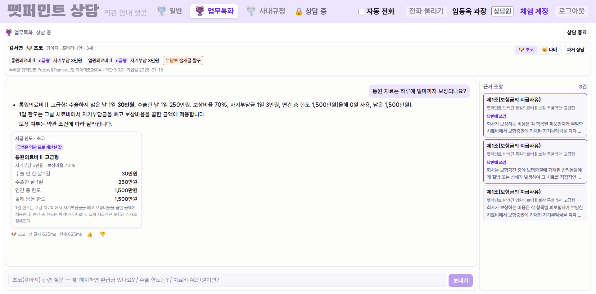
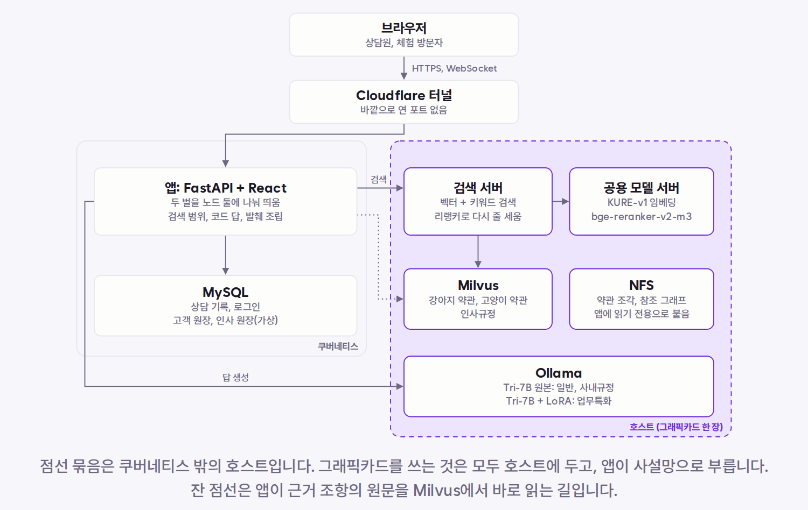

<!--
다루는 곳: README.md, docs/requirements.md, docs/pipeline.md, web/src/pages/ModeSelect.tsx, web/src/components/ArchDiagram.tsx
읽은 커밋: 077fb87
-->
# 한눈에 보는 펫퍼민트

> 이 글은 펫퍼민트 상담 챗봇이 무엇이고 어떤 화면으로 이루어져 있는지, 그 뒤에서 무엇이 도는지를 한자리에 모아 보여 드립니다.

**펫퍼민트 상담 챗봇은 보험사 상담원이 고객 전화를 받으며 반려동물 보험 약관을 물어보는 사내 챗봇입니다. 상담원이 고객을 고르면 그 고객이 가입한 특약 안에서만 조항을 찾아 답하고, 답에 쓴 근거 조항을 옆에 함께 보여 드립니다.** [docs:requirements.md:9] [code:web/src/pages/ModeSelect.tsx:138]

## 무엇을 만들었나

보험사 상담원은 고객 전화를 받으면서 복잡한 약관 조항을 매번 PDF에서 찾아봐야 합니다. 이 챗봇에 물으면 근거 조항과 함께 답을 바로 받습니다. [docs:requirements.md:9] 보험 챗봇이 "보장된다"고 잘못 안내하면 단순한 정보 오류로 끝나지 않고 보험금 지급 분쟁으로 이어질 수 있습니다. 그래서 대충 맞는 답이 아니라 근거를 댈 수 있는 답을 목표로 삼았습니다. [docs:pipeline.md:118]

같은 질문이라도 고객마다 답이 다릅니다. 가입한 특약과 등급, 반려동물이 강아지인지 고양이인지에 따라 읽어야 할 조항이 달라지기 때문입니다. 그래서 목표를 "상담원이 마주치는 변수 조합마다, 그 고객에게 맞는 답을 근거와 함께 준다"로 정했습니다. [docs:requirements.md:15]

약관은 메리츠화재 홈페이지에 공개된 반려동물 보험 「펫퍼민트」의 강아지 약관과 고양이 약관을 그대로 썼습니다. [docs:requirements.md:9] 화면에 나오는 고객 10명과 직원 11명은 모두 시연을 위해 만든 가상 인물입니다. [docs:02_pipeline/09_ui_design.md:768] [docs:02_pipeline/12_data_storage.md:134] 언어 모델과 데이터는 모두 사내 서버에 두고, 바깥의 AI 서비스는 부르지 않습니다. [docs:requirements.md:25]

## 화면 차례

이 포트폴리오는 화면 하나를 한 편씩 다룹니다. 편마다 화면을 먼저 보여 드리고, 그 화면이 무엇을 해 주는지 설명합니다. 상담원 화면 뒤에는 운영하는 쪽에서 보는 모니터링 화면을 한 편 두었습니다.

| 화면 | 하는 일 | 편 |
| --- | --- | --- |
| 전체 | 무엇을 왜 만들었는지와 뒤에서 도는 것 | 이 글 |
| 로그인 | 사번으로 들어오거나, 체험 카드 한 장으로 가상 직원이 되어 들어옵니다 | → 「로그인과 체험 계정」 |
| 홈 | 캐릭터 카드 셋 가운데 모드를 고르고, 걸려 오는 전화를 받습니다 | → 「모드 고르기」 |
| 고객 조회 | 고객 카드에서 가입 등급과 부담보를 훑고 상담을 엽니다 | → 「고객 조회」 |
| 업무특화 상담 | 약관을 묻고, 근거 조항과 계산 카드를 함께 받습니다 | → 「업무특화 상담」 |
| 일반 모드 | 검색 없이 원본 언어 모델과 이야기합니다 | → 「일반 모드」 |
| 사내규정 | 가상 회사의 인사규정과 내 연차를 묻습니다 | → 「사내규정」 |
| 관리자 화면 | 상담원별 상담 기록과 직원 명단을 읽습니다 | → 「관리자 화면」 |
| 운영과 모니터링 | 사이트가 어떻게 떠 있고, 잘 도는지를 대시보드 한 장으로 지켜봅니다 | → 「운영과 모니터링」 |
| 알려진 한계 | 여러 화면에 걸친 한계를 결정별로 모았습니다 | → 「알려진 한계」 |

세 모드는 모두 같은 언어 모델 Tri-7B에서 나옵니다. 일반 모드는 원본 모델 그대로이고, 사내규정 모드는 원본 모델이 인사규정을 찾아 읽고 답하며, 업무특화 모드는 약관으로 따로 학습시킨 모델이 약관을 찾아 읽고 답합니다. [docs:requirements.md:39-43]

## 뒤에서 도는 것

이 그림은 홈 화면 아래 소개에 실린 구성도입니다. [code:web/src/components/ArchDiagram.tsx:55-65] 화면은 React, 서버는 FastAPI로 만들었고, 둘은 한 이미지로 묶여 쿠버네티스 클러스터에서 두 벌이 서로 다른 노드에 떠 있습니다. 상담 기록과 로그인, 가상 고객 원장과 인사 원장은 MySQL에 있습니다. [code:web/src/components/ArchDiagram.tsx:58-59] 그래픽카드를 쓰는 것은 모두 클러스터 밖의 호스트에 둡니다. 답을 쓰는 Ollama, 약관 조각을 담은 검색 데이터베이스 Milvus, 검색 서버, 그리고 문장을 벡터로 바꾸는 임베딩 모델과 후보를 다시 줄 세우는 리랭커가 그렇습니다. 앱은 이것들을 사설망으로 부릅니다. [code:web/src/components/ArchDiagram.tsx:60-64] [code:web/src/pages/ModeSelect.tsx:230-231]

서버는 바깥으로 포트를 하나도 열지 않습니다. 클러스터 안의 Cloudflare 터널이 먼저 바깥으로 연결을 걸어 두고, 바깥 요청은 그 연결을 타고 들어옵니다. 그래서 휴대폰에서도 같은 주소로 들어올 수 있습니다. [docs:02_pipeline/13_access_and_tunnel.md:34] [docs:requirements.md:26] 코드를 저장소에 올리면 Jenkins가 이미지를 만들고, ArgoCD가 그것을 클러스터에 반영합니다. [docs:02_pipeline/14_deployment.md:91-97] 사이트가 어떻게 떠 있고 무엇으로 지켜보는지는 → 「운영과 모니터링」에 있습니다. 자세한 것은 기술문서 [「전체 그림」](../notion/00_overview.md)과 [「배포」](../notion/08_deploy.md)에 있습니다.

## 무엇이 어려웠나

약관으로 학습시킨 모델이 정답 조항을 받아 놓고도 "확인되지 않는다"며 거절하는 일이 잦았습니다. 재어 보니 모델은 답의 내용이 아니라 질문의 겉모양, 곧 발췌와 낱말이 얼마나 겹치는지와 길이, 등급을 말하는 어구를 보고 거절을 정하고 있었습니다. [docs:next_rebuild.md:7] 학습 데이터를 바꿔 여러 번 다시 학습했지만 거절이 줄어든 만큼 틀린 답이 늘었습니다. 그래서 거절 하나만 목표로 삼지 않고, 틀림과 거절을 함께 보고 가장 나은 판을 운영에 두었습니다. [docs:02_pipeline/07_finetuning.md:417]

작은 모델은 계산도 틀렸습니다. 학습 데이터를 만들 때 계산형 질문 74건 가운데 26건(35%, 2026-10-12)이 틀렸습니다. [code:KNOWN_ISSUES.md:149] 그래서 보험금 계산과 부담보처럼 규칙으로 답이 정해지는 질문은 모델에게 넘기지 않고 코드가 답하게 했습니다(→ 「업무특화 상담」). [docs:02_pipeline/16_code_answers.md:27]

여러 화면에 걸친 한계는 → 「알려진 한계」에 모았습니다. 왜 이렇게 만들었고 무엇이 어려웠는지는 기술문서 [「파인튜닝과 거절 문제」](../notion/03_model/04_finetuning.md)와 [「코드가 답하는 질문」](../notion/04_code_answers.md)에 있습니다.
