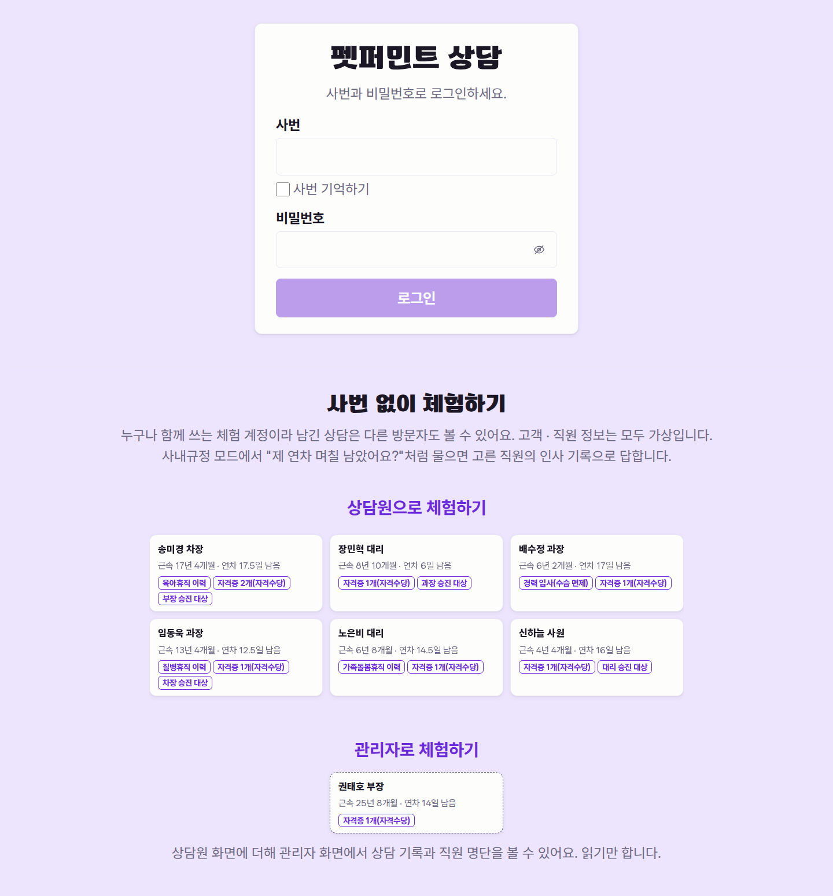
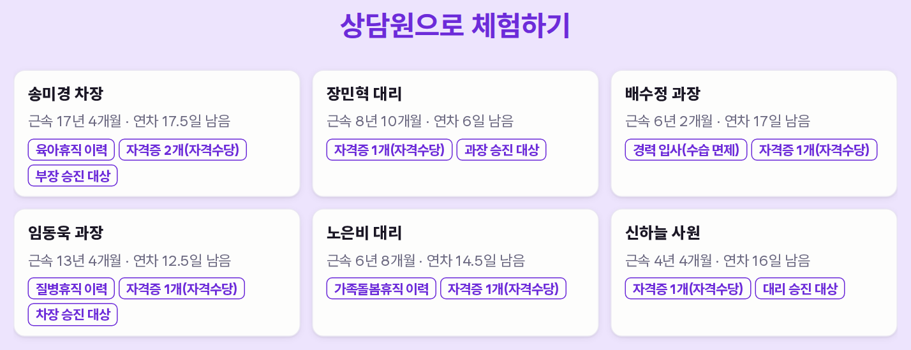

<!--
다루는 곳: web/src/auth/Login.tsx, web/src/auth/DemoCards.tsx, web/src/components/FlowCarousel.tsx, app/services/auth.py, app/services/demo.py
읽은 커밋: 077fb87
-->
# 로그인과 체험 계정

> 이 글은 사번과 비밀번호로 들어오는 로그인 화면과, 사번이 없는 분이 카드 한 장을 눌러 가상 직원으로 들어오는 체험 계정을 보여 드립니다.

**펫퍼민트 상담 챗봇은 가입이 없는 사내 도구라 사번과 비밀번호로 들어옵니다. 처음 오신 분은 사번이 없으니, 로그인 카드 아래의 체험 카드를 누르면 비밀번호 없이 그 가상 직원으로 바로 들어오실 수 있습니다.** [docs:02_pipeline/13_access_and_tunnel.md:107] [docs:02_pipeline/13_access_and_tunnel.md:129]

## 사번으로 들어옵니다

로그인 카드에는 사번과 비밀번호 두 칸만 있습니다. "사번 기억하기"를 켜면 사번만 그 브라우저에 남고 비밀번호는 남기지 않으며, 비밀번호 칸 오른쪽 눈 모양 단추로 친 글자를 잠깐 볼 수 있습니다. [code:web/src/auth/Login.tsx:12] [code:web/src/auth/Login.tsx:168] 계정은 직원이 스스로 만들지 않고 관리자가 만들어 줍니다. 관리자가 준 임시 비밀번호로 처음 들어오면 10자 이상의 새 비밀번호로 바꾸라는 화면이 먼저 뜹니다. [docs:02_pipeline/13_access_and_tunnel.md:107] [docs:02_pipeline/13_access_and_tunnel.md:98]

비밀번호를 거듭 틀리면 막습니다. 5번 틀리면 15분 동안 잠기고, 틀렸을 때 문구는 "사번 또는 비밀번호가 올바르지 않습니다" 하나뿐입니다. 없는 사번을 넣어도 같은 문구가 같은 시간 뒤에 떠서, 어떤 사번이 있는지 떠볼 수 없습니다. [docs:02_pipeline/13_access_and_tunnel.md:100] 들어온 뒤 2시간 동안 아무것도 하지 않거나 12시간이 지나면 로그인이 풀립니다. [docs:02_pipeline/13_access_and_tunnel.md:99]

## 체험 카드로 들어옵니다

"사번 없이 체험하기" 아래에는 체험 카드가 "상담원으로 체험하기"와 "관리자로 체험하기"로 나뉘어 놓여 있습니다. 카드를 누르면 비밀번호 없이 그 가상 직원으로 들어가고, 비밀번호는 화면에도 요청에도 코드에도 없습니다. [docs:02_pipeline/13_access_and_tunnel.md:134] [docs:02_pipeline/13_access_and_tunnel.md:138] 상담원 카드는 화면에 다 들어가면 사진처럼 가운데 서 있고, 폭이 좁아 다 들어가지 않으면 두 줄로 천천히 옆으로 흐릅니다. 흐르는 동안 마우스를 올리면 멈추고 끌면 따라옵니다. [code:web/src/components/FlowCarousel.tsx:3-5] [docs:02_pipeline/13_access_and_tunnel.md:135]

카드에는 이름과 직급, 근속, 남은 연차와 함께 그 계정으로 볼 수 있는 특징이 칩으로 붙습니다. 휴직 이력, 자격증, 승진 대상, 경력 입사 같은 것입니다. 카드의 연차는 사내규정 모드가 "제 연차 며칠 남았어요?"에 답할 때와 같은 계산에서 나오므로 둘이 어긋나지 않고, 급여와 평가 등급은 싣지 않습니다(→ 「사내규정」). [docs:02_pipeline/13_access_and_tunnel.md:136] 직원마다 인사 자료가 달라 누구를 고르느냐가 곧 체험이라, 체험만을 위한 직원을 따로 만들지 않았습니다. [docs:02_pipeline/13_access_and_tunnel.md:133]

맨 아래 점선 카드는 관리자 체험 계정입니다. 그 아래 안내대로 상담원 화면에 더해 관리자 화면에서 상담 기록과 직원 명단을 볼 수 있고, 관리자 화면에는 쓰는 기능이 없어 읽기만 합니다(→ 「관리자 화면」). [code:web/src/auth/Login.tsx:159] [docs:02_pipeline/13_access_and_tunnel.md:156]

## 여럿이 함께 쓰는 계정

체험 카드의 계정은 방문자 모두가 함께 씁니다. 그래서 지난 대화와 최근 상담이 방문자끼리 서로 보이고, 화면에 "누구나 함께 쓰는 체험 계정이라 남긴 상담은 다른 방문자도 볼 수 있어요"라고 적어 두었습니다. 고객과 직원 정보가 모두 가상이라는 것도 같은 자리에 밝힙니다. [code:web/src/auth/Login.tsx:144] [docs:02_pipeline/13_access_and_tunnel.md:144] 체험으로 들어오면 화면 위에 "체험 계정"이 뜨고, 비밀번호를 바꿀 수 없습니다. [docs:02_pipeline/13_access_and_tunnel.md:140]

그래픽카드가 한 장이라 한 방문자가 질문을 쏟아 내면 다른 사람의 답이 늦어집니다. 그래서 체험 계정의 질문은 방문자마다 1분에 10번까지 받고, 넘으면 안내만 보냅니다. 같은 곳에서 체험 로그인을 15분에 30번 넘게 하는 것도 막습니다. [docs:02_pipeline/13_access_and_tunnel.md:143] [docs:02_pipeline/13_access_and_tunnel.md:142]

## 무엇이 어려웠나

처음에는 앱에 로그인을 만들지 않고, 앞단의 사내 계정 로그인이 신원을 넘겨주는 설계로 시작했습니다. 그런데 데모를 보는 사람에게는 사내 계정이 없고, 사내규정 모드가 연차나 퇴직금을 본인 기준으로 계산하려면 로그인한 사람이 누구인지 사번 단위로 알아야 했습니다. 그래서 앱이 직원 원장을 보고 직접 로그인을 받는 쪽으로 바꿨습니다. [docs:02_pipeline/13_access_and_tunnel.md:87-91]

체험 카드에는 처음에 누를 때 계정이 생기게 했습니다. 그러자 체험할수록 관리자 화면 직원 목록의 "앱 계정 없음"이 줄어, 누가 계정을 가졌는지가 방문자 손에 달렸습니다. 그래서 가상 직원의 계정은 미리 만들어 두고, 체험 로그인은 있는 계정만 쓰게 했습니다. 카드에는 계정이 있는 7명(관리자 1, 상담원 6)만 나옵니다. 누를 수는 있는데 들어갈 수 없는 카드를 두는 것보다 처음부터 없는 편이 헷갈리지 않기 때문입니다. [docs:02_pipeline/13_access_and_tunnel.md:139] [docs:02_pipeline/13_access_and_tunnel.md:133]

체험 계정을 함께 쓰며 생기는 일과 여러 화면에 걸친 한계는 → 「알려진 한계」에 모았습니다. 로그인과 체험 계정, 터널을 어떻게 만들었는지는 기술문서 [「로그인, 체험 계정, 터널」](../notion/07_auth.md)에 있습니다.
