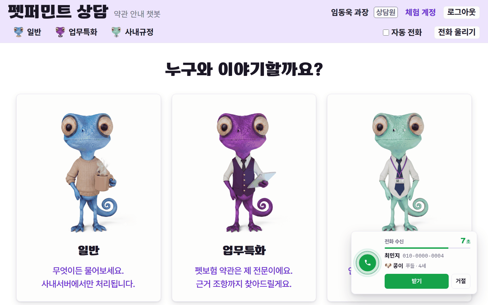
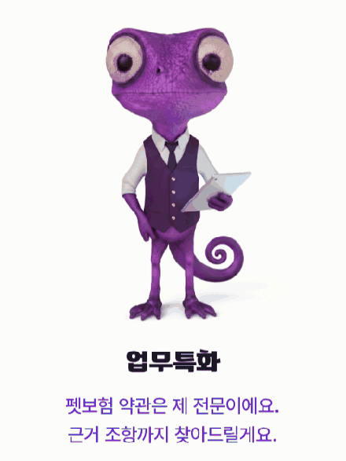
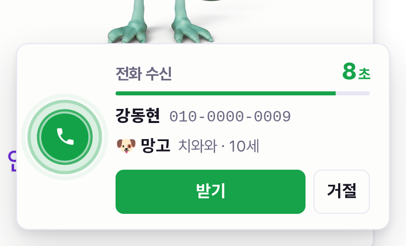
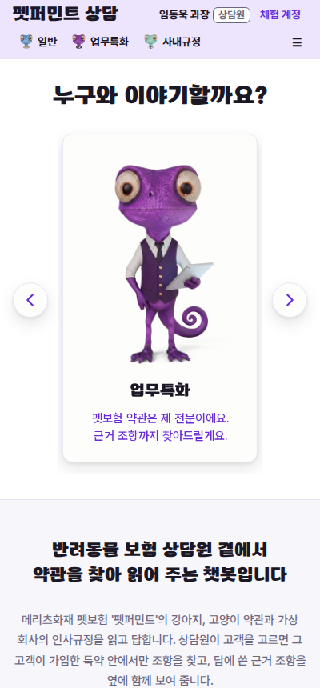

<!--
다루는 곳: web/src/pages/ModeSelect.tsx, web/src/components/CallAlert.tsx, web/src/hooks/useCallSimulator.ts, web/src/components/TopBar.tsx, web/src/components/ArchDiagram.tsx
읽은 커밋: 077fb87
-->
# 모드 고르기

> 이 글은 로그인하면 처음 나오는 홈 화면, 캐릭터 카드 셋 가운데 모드를 고르는 곳과 그 위로 떠오르는 전화 수신 카드, 아래에 이어지는 소개를 보여 드립니다.

**홈에서는 일반, 업무특화, 사내규정 세 모드를 설명문 대신 캐릭터 셋의 소개로 고릅니다. 상담원은 다른 일을 하다가도 전화를 받으니, 어느 화면에 있든 전화 수신 카드가 떠오르고 받기를 누르면 곧바로 그 고객의 상담이 열립니다.** [docs:02_pipeline/09_ui_design.md:60] [docs:02_pipeline/10_consultation_flow.md:22] [docs:02_pipeline/10_consultation_flow.md:30]

## 캐릭터 카드 셋

카드는 일반, 업무특화, 사내규정 차례로 놓이고, 캐릭터마다 자기 모드를 한두 줄로 소개합니다. 일반은 무엇이든 물어보라고 하고, 업무특화는 펫보험 약관이 자기 전문이라 근거 조항까지 찾아 준다고 하며, 사내규정은 인사와 복무 규정을 안다고 말합니다. [code:web/src/pages/ModeSelect.tsx:23-27] 세 캐릭터는 같은 도마뱀이고 옷과 소품으로 역할을 나눴습니다. 업무특화가 셋 가운데 가장 갖춰 입은 베테랑 실무자입니다. [docs:02_pipeline/11_design_system.md:198] [docs:02_pipeline/11_design_system.md:208]

평소 카드는 멈춘 그림이고, 마우스를 올리면 캐릭터 영상이 돌다가 떼면 멈춘 그림으로 돌아옵니다. 상담원이 고객 전화를 받으며 쓰는 도구라 평소에 움직이면 산만하기 때문입니다. 움직임 줄이기 설정을 켠 화면에서는 영상이 돌지 않습니다. [docs:02_pipeline/11_design_system.md:216] [docs:02_pipeline/11_design_system.md:284] 캐릭터는 이 화면에서만 크게 나오고, 상담 중에는 지금 모드를 알리는 작은 아이콘으로만 남습니다. [docs:02_pipeline/09_ui_design.md:70]

업무특화를 누르면 상담할 고객을 고르는 고객 조회로 가고(→ 「고객 조회」), 일반과 사내규정은 고객 없이 그 모드의 대화창으로 갑니다(→ 「일반 모드」, → 「사내규정」). [docs:02_pipeline/10_consultation_flow.md:81] [docs:02_pipeline/10_consultation_flow.md:40-44]

## 전화 수신 카드

이 서비스에는 실제 전화 교환 장치가 없어 전화를 앱 안에서 가상으로 울립니다. 화면 위의 "자동 전화"를 켜 두면 2~3분마다 한 번씩 울리고, 시연할 때는 "전화 울리기"로 바로 울립니다. 전화를 건 고객은 가상 고객 가운데 무작위로 정해집니다. [docs:02_pipeline/10_consultation_flow.md:22] [docs:02_pipeline/10_consultation_flow.md:26-27] [code:web/src/hooks/useCallSimulator.ts:29]

카드에는 고객 이름과 전화번호, 반려동물의 이름과 품종, 나이가 함께 보여 받기 전에 누구 전화인지 알 수 있습니다. [docs:02_pipeline/11_design_system.md:193] 카드는 10초 동안 떠 있고, 그동안 초록 원 둘레로 고리가 파장처럼 퍼집니다. 남은 초는 숫자와 막대로 줄어듭니다. [docs:02_pipeline/11_design_system.md:177] [docs:02_pipeline/11_design_system.md:5] 받기를 누르면 업무특화 모드로 바뀌며 그 고객의 상담 화면이 열리고, 거절하거나 10초 안에 받지 않으면 "다른 상담원에게 연결됨"이 잠깐 뜹니다. [docs:02_pipeline/10_consultation_flow.md:28-30] 상담이 진행 중일 때는 울리지 않습니다. 실제 상담에서도 통화 중에는 다른 전화가 들어오지 않기 때문입니다. [docs:02_pipeline/10_consultation_flow.md:32]

## 휴대폰에서, 그리고 아래 소개

화면이 좁으면 카드를 한 장씩 넘겨 봅니다. 처음에는 업무특화 한 장이 보이고, 양옆 화살표를 누르거나 손으로 끌어 다른 카드로 넘깁니다. [docs:02_pipeline/11_design_system.md:149]

카드 아래로 내리면 서비스 소개가 이어집니다. 맨 위 한 단락이 무엇을 하는 서비스인지 말하고, 세 모드를 차례로 소개하는 칸에서는 캐릭터 영상이 저절로 반복해 돕니다. 읽는 자리라 이곳의 움직임은 시선을 끄는 편이 낫다고 봤습니다. [code:web/src/pages/ModeSelect.tsx:135-140] [docs:02_pipeline/11_design_system.md:218] 그 뒤로 기술 구성 카드 여덟 장과 서비스 구성도, 쓴 기술 표가 놓입니다(→ 「한눈에 보는 펫퍼민트」). [code:web/src/pages/ModeSelect.tsx:216-246] 이 소개 글과 구성도는 운영 코드와 운영 설정을 보고 쓴 것이고, 공개 화면이라 서버 주소와 실제 사람 이름은 넣지 않았습니다. [c:678f185] [docs:02_pipeline/11_design_system.md:262]

## 무엇이 어려웠나

전화 수신 카드의 퍼지는 고리는 처음에 흰 바탕에서 보이지 않았습니다. 반투명 테두리만으로는 흰색 위에서 눈에 띄지 않아, 진한 초록 테두리에 옅은 초록 채움을 더한 원반이 퍼지게 바꿨습니다. [docs:02_pipeline/11_design_system.md:183] 원 안의 수화기도 처음에는 이모지라 글꼴의 빨간 수화기가 초록 원 위에 얹혀 나왔고, 이모지는 글자색으로 바꿀 수 없어 흰 아이콘 그림으로 바꿨습니다. [docs:02_pipeline/11_design_system.md:181]

홈 첫 화면은 처음에 창 높이를 꽉 채웠습니다. 그래서 창이 커도 소개는 늘 스크롤해야 나왔고, 세로로 긴 창에서는 캐릭터 위가 하얗게 비었습니다. 첫 화면을 카드 높이만큼만 두고, 캐릭터 칸 높이를 그림 크기에 맞춰 직접 계산하는 것으로 풀었습니다. [docs:02_pipeline/11_design_system.md:148] 아래 소개 글은 처음 만든 때의 구조로 남아 검색 서버를 아직 배포 전으로 그리고 있었습니다. 어디가 낡았는지 하나씩 찾기보다 통째로 지우고 지금 구조대로 새로 썼습니다. [c:678f185]

전화가 가상이라는 것과 여러 화면에 걸친 한계는 → 「알려진 한계」에 모았습니다. 화면의 흐름과 생김새를 어떻게 정했는지는 기술문서 [「상담 한 건의 흐름」](../notion/05_screens/01_flow.md)과 [「디자인」](../notion/05_screens/04_design.md)에 있습니다.
