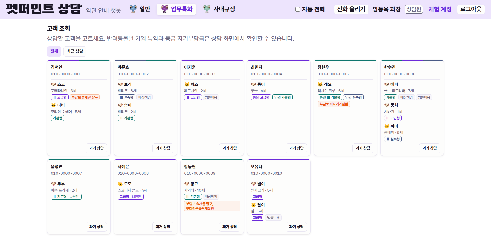
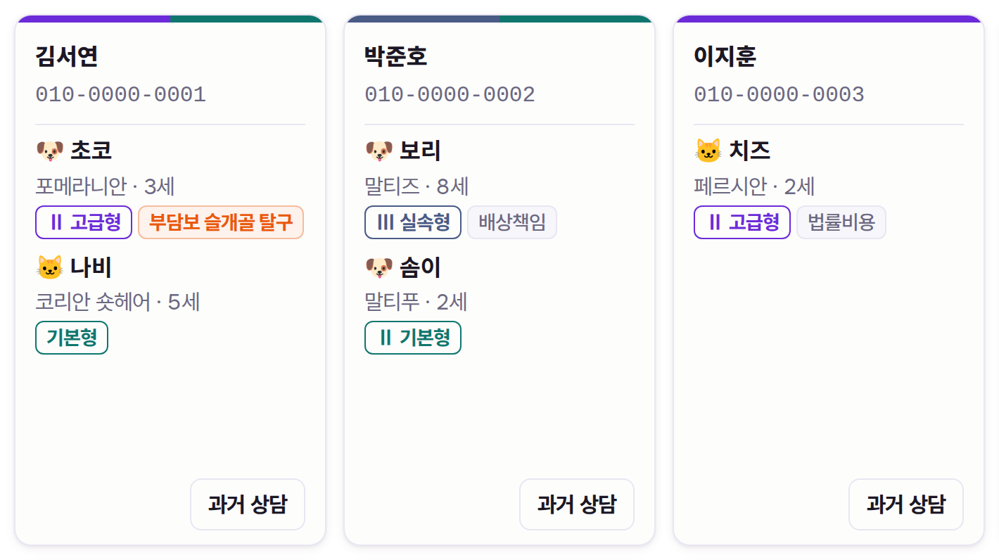

<!--
다루는 곳: web/src/pages/CustomerSelect.tsx, web/src/pages/CustomerSelect.module.css, web/src/policySummary.ts, web/src/components/PastConsultations.tsx, app/services/customers.py
읽은 커밋: 077fb87
-->
# 고객 조회

> 이 글은 홈에서 업무특화를 누르면 나오는 고객 조회 화면, 고객 카드 한 장으로 가입 등급과 부담보를 훑고 상담을 여는 곳을 보여 드립니다.

**고객 조회는 전화 없이 상담을 시작하는 두 번째 입구입니다. 고객마다 카드 한 장이 놓이고, 카드 위쪽 색 띠와 칩만 보고도 반려동물이 몇 마리인지, 어떤 등급에 가입했는지, 보장에서 뺀 질병이 있는지를 상담 화면에 들어가기 전에 알 수 있습니다.** [docs:02_pipeline/10_consultation_flow.md:79] [docs:02_pipeline/11_design_system.md:160]

## 고객 카드 한 장

상담원이 먼저 고객에게 걸어야 할 때나 시연에서 특정 고객을 고를 때 이 화면을 씁니다. 홈에서 업무특화를 누르면 나오고, 카드를 누르면 그 고객의 상담이 열립니다(→ 「업무특화 상담」). [docs:02_pipeline/10_consultation_flow.md:79-81] [code:web/src/pages/CustomerSelect.tsx:73] 전화를 받아 여는 것과 고객을 골라 여는 것은 결국 같은 곳으로 모입니다. 시스템이 고객을 고르느냐, 상담원이 고르느냐만 다릅니다(→ 「모드 고르기」). [docs:02_pipeline/10_consultation_flow.md:74]

카드 위쪽은 고객 이름과 전화번호이고, 실선 아래로 반려동물이 한 마리씩 이름, 품종과 나이, 칩 줄 차례로 놓입니다. 넓은 화면에서는 고객 10명이 한 화면에 다 들어오도록 촘촘하게 깔았습니다. [docs:02_pipeline/11_design_system.md:160] 상담한 적이 있는 고객은 이름 옆에 언제 상담했는지가 붙고, 그 자리가 비어 있으면 아직 상담한 적이 없다는 뜻입니다. [code:web/src/pages/CustomerSelect.tsx:81-86]

화면의 고객 10명은 실제 고객이 아닙니다. 한 종만 기르는 고객, 강아지와 고양이를 함께 기르는 고객, 같은 종을 여러 마리 기르는 고객, 통원과 입원 등급이 다른 고객, 부담보가 있는 고객처럼 여러 경우를 덮도록 만든 가상 자료입니다. [docs:02_pipeline/09_ui_design.md:768] 사진 속 전화번호는 공개용으로 010-0000-00xx 꼴로 바꾼 번호라, 운영 사이트의 같은 고객 번호와 다릅니다(2026-11-20). 앱은 이 정보를 따로 들고 있지 않고, 보험사의 고객 원장을 읽기만 하는 계정으로 요청마다 읽어 옵니다. [code:app/services/customers.py:5-6]

## 등급 띠와 칩

카드 위쪽 띠는 반려동물 수만큼 칸으로 나뉘고, 칸마다 그 반려동물이 가입한 가장 높은 등급의 색이 칠해집니다. 고급형은 보라, 기본형은 청록, 실속형은 남회색입니다. 띠만 봐도 몇 마리이고 어떤 등급인지 보입니다. [docs:02_pipeline/11_design_system.md:44-46] [code:web/src/pages/CustomerSelect.tsx:75-78]

칩 줄에는 반려동물마다 등급 칩이 테두리만 있는 꼴로 붙습니다. 통원과 입원 등급이 같으면 "Ⅱ 고급형"처럼 하나로, 다르면 "통원 고급형", "입원 기본형" 둘로 적고, 한쪽만 가입했으면 "통원만"을 덧붙입니다. 배상책임과 법률비용 같은 다른 특약은 회색 칩입니다. [docs:02_pipeline/11_design_system.md:160] 부담보(가입할 때 보장에서 빼기로 한 부위나 질병)는 채운 주황 칩으로 그 반려동물의 줄에 붙습니다. [docs:02_pipeline/11_design_system.md:160] 등급 색은 이 주황과 헷갈리지 않도록 따뜻한 색을 피해 골랐습니다. [docs:02_pipeline/11_design_system.md:50]

## 최근 상담과 과거 상담

탭은 전체와 최근 상담 둘입니다. 전화는 무작위로 오기 때문에, 방금 통화한 고객이 다시 전화하면 전체 목록 어딘가에 묻힌 "아까 그 고객"을 찾기 어렵습니다. 최근 상담 탭은 상담한 순서대로 고객을 보여 줍니다. [docs:02_pipeline/09_ui_design.md:79-81] 이 탭은 상담원으로 거르지 않습니다. 다른 상담원이 받았던 고객도 다시 전화할 수 있기 때문입니다. [docs:02_pipeline/10_consultation_flow.md:85]

카드 아래 "과거 상담"을 누르면 그 고객의 지난 상담 목록이 지금 화면 위에 겹쳐 뜨는 창으로 열립니다. 상담 화면 위쪽 고객 정보에서도 같은 창이 열립니다. [docs:02_pipeline/09_ui_design.md:89] [docs:02_pipeline/09_ui_design.md:93-96] 지난 상담은 그때의 등급과 근거 조항 그대로 보이는 읽기 전용이고, 거기서 이어 질문할 수는 없습니다. 상담 한 건의 기록이 그 통화 하나로 묶여 있어야 누가 언제 무엇을 안내했는지 따라갈 수 있기 때문입니다. [docs:02_pipeline/09_ui_design.md:100] [docs:02_pipeline/09_ui_design.md:104] 다른 상담원이 받은 상담도 열어 볼 수 있고, 그 상담을 누가 맡았는지 함께 보입니다. [docs:02_pipeline/09_ui_design.md:488-494]

## 무엇이 어려웠나

처음에는 고객 카드를 반려동물의 종 조합에 따라 세 가지(둘 다 기르는 고객, 강아지만, 고양이만)로 나눴습니다. 그런데 셋의 차이는 상담 화면에서 종을 바꾸는 단추를 띄우느냐 하나뿐이었고, 그 단추가 반려동물 한 마리씩 이름으로 고르는 단추로 바뀌자 나눌 까닭이 없어졌습니다. 강아지를 두 마리 기르는 고객이 세 분류 어디에도 맞지 않았던 것도 같은 까닭이라 세 종류 카드는 걷어 냈습니다. [docs:02_pipeline/09_ui_design.md:765]

부담보 칩은 처음에 카드 맨 아래 한 줄에 모아 두었습니다. 그러자 반려동물이 여럿인 고객에서 초코의 슬개골 탈구가 다른 반려동물의 것처럼 보였습니다. 부담보는 반려동물마다 따로 맺는 약정이라, 칩을 그 반려동물의 줄로 옮겼습니다. [docs:02_pipeline/11_design_system.md:160] [code:web/src/pages/CustomerSelect.tsx:92-93]

여러 화면에 걸친 한계는 → 「알려진 한계」에 모았습니다. 고객 조회와 지난 상담을 어떻게 정했는지는 기술문서 [「상담 한 건의 흐름」](../notion/05_screens/01_flow.md)에 있습니다.
