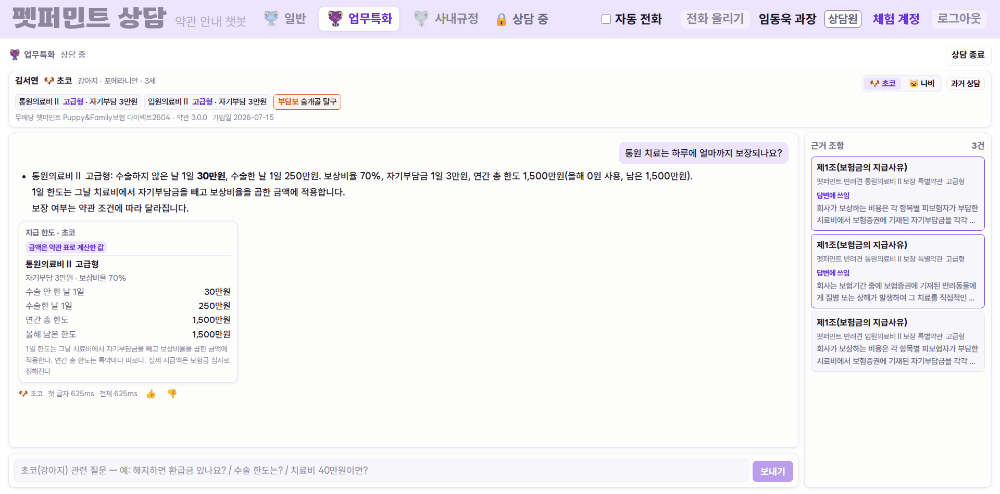
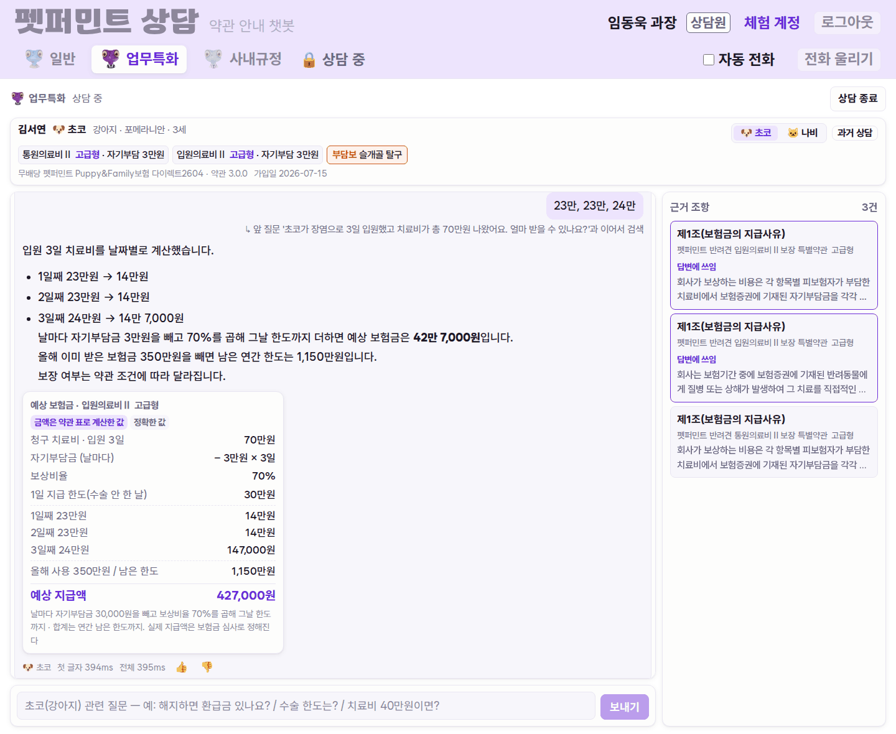
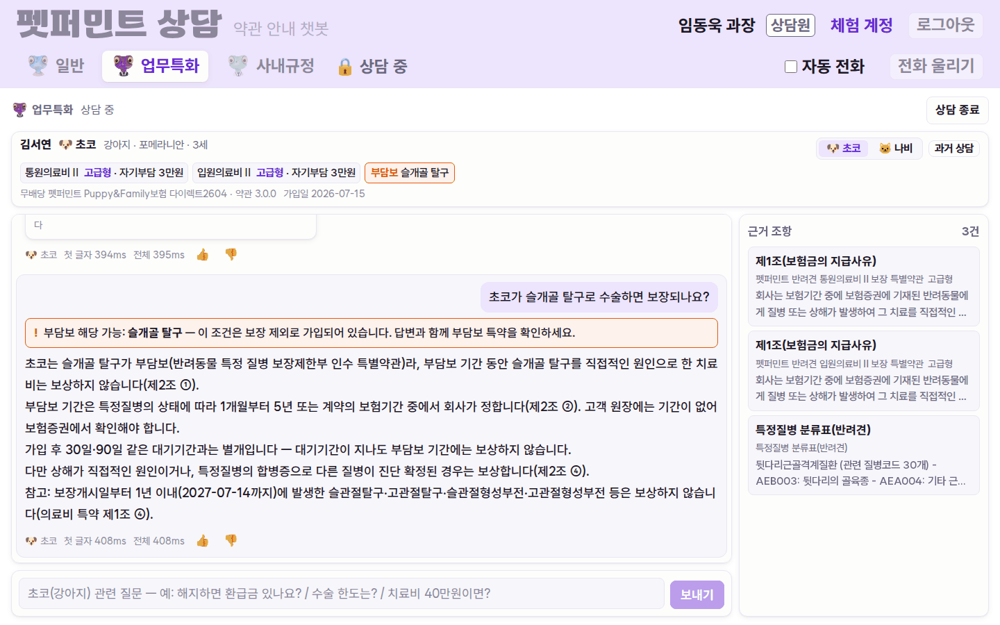
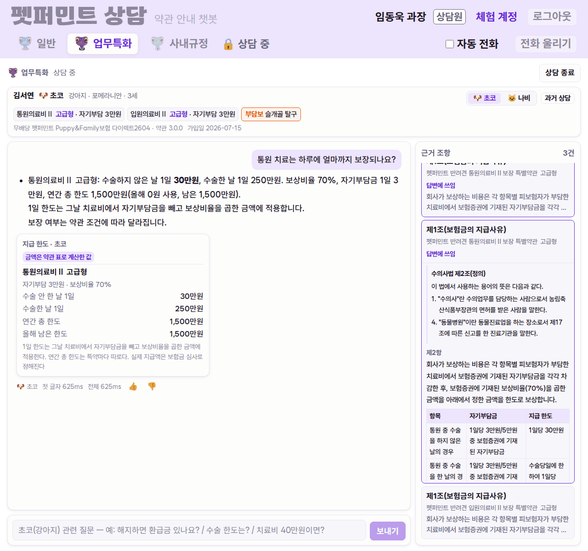
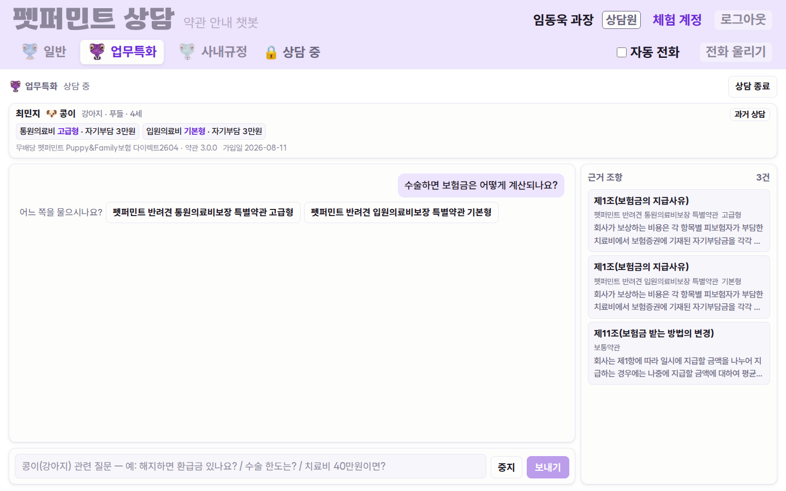
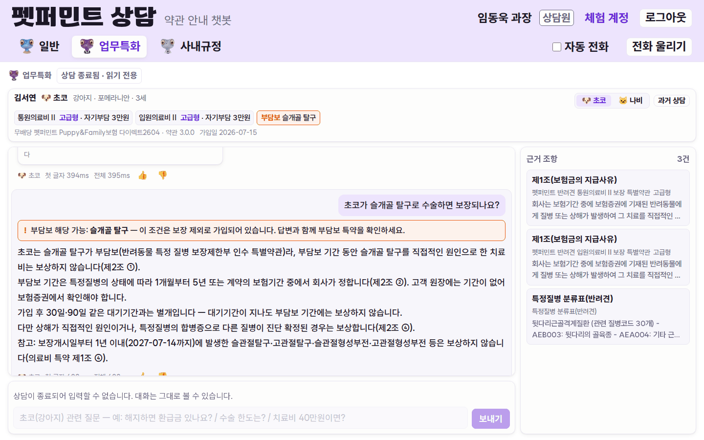

<!--
다루는 곳: web/src/pages/Consultation.tsx, web/src/components/SourcePanel.tsx, web/src/components/CalcCard.tsx, web/src/components/ExclusionBanner.tsx, app/services/code_rules.py
읽은 커밋: 077fb87
-->
# 업무특화 상담

> 이 글은 고객 한 명과의 통화 한 건을 처리하는 업무특화 상담 화면을 보여 드립니다. 고객 정보와 대화, 근거 조항 패널, 코드가 계산한 카드와 경고, 되묻기, 상담 종료까지입니다.

**업무특화 상담 화면은 위에 고객과 반려동물의 가입 정보, 가운데 대화, 오른쪽에 근거 조항 패널이 놓인 곳입니다. 상담원이 약관을 물으면 그 반려동물이 가입한 특약 안에서 조항을 찾아 답하고, 보험금 계산이나 부담보처럼 틀리면 안 되는 답은 언어 모델이 아니라 코드가 냅니다.** [docs:02_pipeline/09_ui_design.md:48-52] [docs:02_pipeline/16_code_answers.md:27]

## 고객 정보가 검색 범위를 정합니다

맨 위 고객 정보는 전화를 받자마자 훑어보는 곳이라, 이름과 반려동물을 크게, 가입 특약과 등급, 자기부담금을 그다음으로, 상품명과 가입일을 작게 두었습니다. 부담보는 있을 때만 주황으로 보입니다. [docs:02_pipeline/10_consultation_flow.md:131-138] 반려동물이 둘 이상이면 이름으로 한 마리씩 고르고, 고른 반려동물의 종과 특약, 등급이 곧 검색 범위가 됩니다. 그래서 질문에 등급을 쓰지 않아도 가입하지 않은 등급의 조항은 처음부터 찾지 않습니다. [docs:02_pipeline/09_ui_design.md:119]

## 코드가 내는 답

이 서비스의 언어 모델은 70억 매개변수짜리 작은 모델이라, 고객 사실을 넣은 계산을 틀리거나 거절했습니다. 그래서 업무특화 모드는 "모델은 새 숫자를 계산하지 않는다"를 원칙으로 삼고, 규칙으로 답이 정해지는 질문은 모델에 넘기기 전에 코드가 답하고 끝냅니다. [docs:02_pipeline/16_code_answers.md:98] [docs:02_pipeline/16_code_answers.md:27] 위 사진처럼 한도를 물으면 가입한 특약의 한도표와 올해 남은 한도가 카드로 뜹니다. [docs:02_pipeline/16_code_answers.md:44]

치료비를 말하면 예상 보험금을 계산한 카드가 뜨고, 답 글도 카드 값으로 코드가 씁니다. [docs:02_pipeline/09_ui_design.md:129] 약관의 자기부담금과 한도가 모두 하루 단위라, 카드는 날마다 치료비에서 자기부담금을 빼고 보상비율을 곱해 그날 한도까지 낸 뒤, 그 합에 올해 남은 연간 한도를 겁니다. [docs:02_pipeline/09_ui_design.md:123] 2~5일이면 날짜 수만큼 금액 칸을 띄우고, 사진처럼 날짜별 금액을 이어 보내도 정확한 값을 냅니다. [docs:02_pipeline/09_ui_design.md:204-206] 카드에는 "금액은 약관 표로 계산한 값"이 붙고, 답 끝에는 "보장 여부는 약관 조건에 따라 달라집니다"가 늘 붙습니다. 이 계산이 선천성 질환 같은 면책은 판단하지 않기 때문입니다. [docs:02_pipeline/11_design_system.md:163] [docs:02_pipeline/09_ui_design.md:238-242]

질문이 그 반려동물의 부담보에 걸리면 답 위에 주황 경고 배너가 뜹니다. 같은 부위의 다른 이름까지 대조해 "무릎"으로 물어도 "슬개골" 부담보를 잡고, 보장을 묻는 질문이면 답도 코드가 냅니다. [docs:02_pipeline/09_ui_design.md:133] [docs:02_pipeline/16_code_answers.md:46] "감기도 돼요?"처럼 병명으로 보장을 물으면 약관의 면책 항목과 맞춰 코드가 답합니다. [docs:02_pipeline/16_code_answers.md:48]

## 근거 패널과 "답변에 쓰임"

오른쪽 패널에는 답을 내려고 찾아 읽은 조항이 모이고, 그 가운데 답이 실제로 쓴 조항은 보라 테두리에 "답변에 쓰임"이 붙습니다. 어느 조항을 썼는지는 모델에게 묻지 않고, 답 글과 조항 본문을 맞대어 코드가 정합니다. [code:web/src/components/SourcePanel.tsx:47] [code:web/src/components/SourcePanel.tsx:53] [code:data/rag_context.py:507-512] 찾은 조항은 답을 쓰기 전에 먼저 와서 패널부터 채우고, 답에 쓴 표시는 답이 끝난 뒤에 붙습니다. [docs:02_pipeline/09_ui_design.md:523]

조항을 누르면 원문이 창을 띄우지 않고 패널 안에서 펼쳐집니다. 창은 대화를 가리고 원문은 길 수 있기 때문입니다. 가입한 등급이 먼저 펼쳐지고, 다른 법률을 옮긴 상자와 한도표도 읽히는 모양으로 보입니다. [docs:02_pipeline/10_consultation_flow.md:148-150] [docs:02_pipeline/10_consultation_flow.md:154-155] 휴대폰처럼 좁은 화면에서는 오른쪽 칸 대신 답마다 아래에 접힌 근거 칸을 두고 누르면 펼칩니다. [docs:02_pipeline/09_ui_design.md:110-115]

## 되묻기

통원은 고급형, 입원은 기본형처럼 두 특약의 등급이 다른 반려동물에게 금액을 물으면 어느 쪽 답인지 정할 수 없습니다. 이때만 특약 이름이 적힌 단추를 띄워 고르게 하고, 고른 특약으로 답을 잇습니다. [docs:02_pipeline/09_ui_design.md:183-185] [docs:02_pipeline/16_code_answers.md:36] 보험금을 묻는데 치료비가 없으면 치료비 총액과 일수를 되묻고, 병명 없이 보장을 물으면 어떤 질병이나 상해인지 되묻습니다. [docs:02_pipeline/09_ui_design.md:196] [docs:02_pipeline/16_code_answers.md:50] "그럼 입원은요?"처럼 앞 질문에 기댄 질문은 앞 질문과 이어 검색하고, 질문 아래 작은 줄에 어느 질문과 이었는지 적어 상담원이 해석을 확인할 수 있게 합니다. [docs:02_pipeline/09_ui_design.md:283]

## 상담을 끝내면

"상담 종료"를 눌러도 화면을 떠나지 않고 대화가 읽기 전용으로 남습니다. 통화를 끊자마자 화면이 바뀌면 방금 무엇이라고 안내했는지 확인할 틈이 없기 때문입니다. 종료된 화면에서는 입력창이 막히고, 전화가 다시 울릴 수 있으며, 모드도 바꿀 수 있습니다. [docs:02_pipeline/10_consultation_flow.md:116-122]

## 무엇이 어려웠나

처음에는 모델이 보험금을 계산하게 해 보았습니다. 치료비를 알려 준 다섯 사례를 일곱 가지 방식으로 10번씩 물었는데, 맞힌 것은 한 사례의 2~4번뿐이고 나머지는 약관의 예시 숫자를 옮기거나 거절했습니다(2026-10-21). [docs:02_pipeline/09_ui_design.md:236] 코드로 옮긴 뒤에도 처음에는 총액을 하루치로 계산해 입원은 적게, 통원은 많게 안내했고, 날마다 계산하는 것으로 고쳤습니다. [docs:02_pipeline/09_ui_design.md:123]

등급을 단추로 고르게 한 데도 까닭이 있습니다. 질문에 "고급형" 같은 등급 어구가 들어가면 모델이 거절을 크게 늘렸고(등급을 말한 문항 19개 가운데 15개, 2026-10-14), 뒤에서 고치려던 두 실험은 모두 풀지 못해 등급이 질문에 들어가지 않게 화면에서 막았습니다. [docs:02_pipeline/09_ui_design.md:706]

같은 뜻을 다른 말로 한 질문이 코드 규칙을 비껴가는 일과 여러 화면에 걸친 한계는 → 「알려진 한계」에 모았습니다. 자세한 것은 기술문서 [「코드가 답하는 질문」](../notion/04_code_answers.md), [「근거를 보여 주는 법」](../notion/05_screens/02_evidence.md), [「되묻기와 이어지는 질문」](../notion/05_screens/03_clarify.md)에 있습니다.
