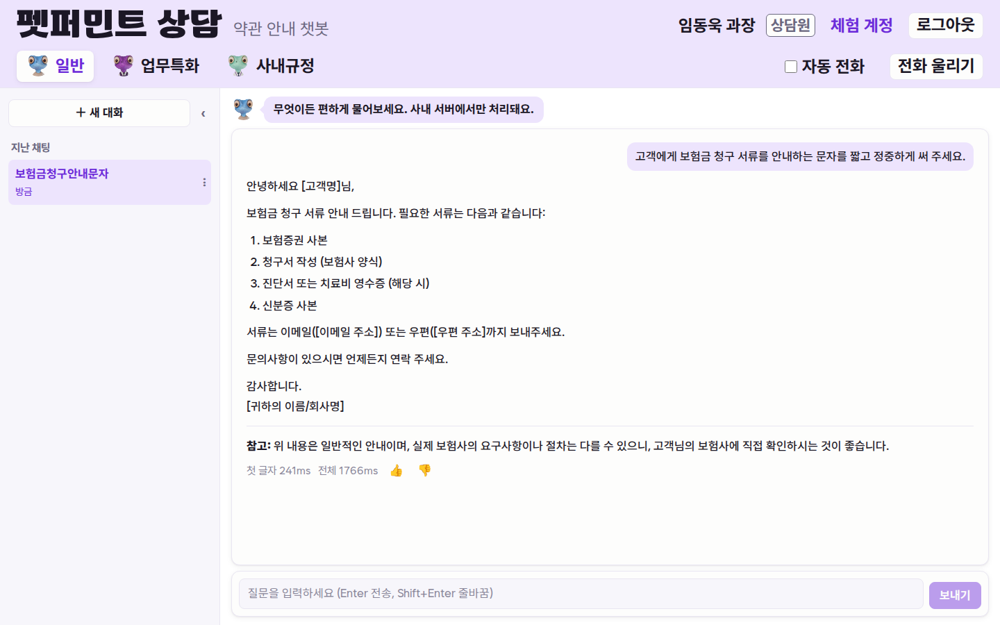

<!--
다루는 곳: web/src/pages/Chat.tsx, web/src/components/TurnView.tsx, web/src/components/ChatHistory.tsx, app/services/answer.py, app/services/context.py, app/services/followup.py, app/services/admin.py
읽은 커밋: 077fb87
-->
# 일반 모드

> 이 글은 약관도 규정도 찾지 않고 원본 언어 모델과 바로 나누는 대화 화면, 일반 모드를 보여 드립니다.

**일반 모드는 상담원이 무엇이든 편하게 묻는 곳입니다. 따로 가르치지 않은 원본 언어 모델이 문서를 찾아 읽지 않고 바로 답하고, 그 모델은 사내 서버 안에서만 돕니다. 여기서 나눈 대화는 관리자 화면에도 보이지 않습니다.** [docs:requirements.md:39] [docs:requirements.md:25] [docs:02_pipeline/13_access_and_tunnel.md:161]

## 원본 모델과 바로 나누는 대화

세 모드는 모두 한 언어 모델(글을 읽고 이어지는 글을 지어내는 AI) Tri-7B에서 나옵니다. 일반 모드는 그 모델을 따로 가르치지 않은 원본 그대로 쓰고, 약관이나 규정을 찾아 읽는 검색도 붙이지 않습니다. [docs:requirements.md:39] [docs:requirements.md:43] 그래서 다른 두 모드와 달리 근거 조항을 보여 주는 칸이 없고, 대화 기록에도 찾아 읽은 조문이 남지 않습니다. [code:web/src/pages/Chat.tsx:154] [docs:02_pipeline/12_data_storage.md:82]

원본 모델은 한국어를 잘 쓰지만 펫퍼민트 약관의 세부는 모릅니다. 보험금을 언제 받을 수 있는지 물으면 약관에 적힌 지급 기일이 아니라 흔한 보험 상식으로 답합니다. [docs:02_pipeline/00_model_setup.md:112] 사진의 답도 어느 보험사에나 맞을 법한 일반적인 문자 초안입니다. 약관을 근거로 답해야 하는 질문은 업무특화 모드가 맡습니다(→ 「업무특화 상담」).

답은 다 만들어질 때까지 기다리지 않고 한 글자씩 흘려 보입니다. 모델이 긴 답을 쓰는 데 몇 초가 걸려, 통째로 기다리면 그동안 화면이 비어 있기 때문입니다. [docs:02_pipeline/09_ui_design.md:527] 답 아래에는 첫 글자가 나오기까지 걸린 시간과 다 쓰기까지 걸린 시간, 그리고 답을 평가하는 좋아요와 싫어요 단추가 붙습니다. [code:web/src/components/TurnView.tsx:89-90] [code:web/src/components/TurnView.tsx:100]

## 앞 대화를 이어 듣기

"그럼 그건요?"처럼 앞 대화에 기대는 질문이면, 최근 3턴(질문 하나와 답 하나가 한 턴)의 질문과 답을 함께 모델에 넘깁니다. [docs:02_pipeline/09_ui_design.md:272] [code:app/services/context.py:33] 이어지는 질문인지는 모델이 아니라 정해 둔 규칙이 가립니다. "그럼", "아까"처럼 앞을 가리키는 말로 시작하거나, "…은요?"처럼 끝을 줄였거나, 아주 짧은 질문입니다. 판별은 빠르고 예측할 수 있어야 해서 모델을 쓰지 않았습니다. [docs:02_pipeline/09_ui_design.md:257-264]

이어지는 질문으로 보았으면 질문 말풍선 바로 아래에 "↳ 앞 대화 1턴 참고"처럼 몇 턴을 참고했는지 작은 줄이 붙습니다. 상담원이 챗봇이 어떻게 알아들었는지 보고, 틀렸으면 바로 고쳐 물을 수 있게 한 것입니다. [docs:02_pipeline/09_ui_design.md:283] [docs:02_pipeline/09_ui_design.md:289]

## 사내 서버 안에서만

이 서비스는 바깥 클라우드의 언어 모델을 쓰면 데이터가 새어 나갈 수 있다는 우려에서, 사내에 직접 세우는 것을 요구로 받았습니다. 일반 모드가 그 요구에 답하는 화면이고, 바깥 언어 모델 서비스는 부르지 않습니다. [docs:requirements.md:25] [docs:requirements.md:39] 첫 말풍선의 "사내 서버에서만 처리돼요."가 그 뜻입니다. [code:web/src/pages/Chat.tsx:28]

## 지난 채팅과 관리자에게 보이지 않는 대화

왼쪽에는 지난 채팅 목록이 붙습니다. 제목은 첫 질문이 들어올 때 원본 모델이 요약해 한 번 지어 주고, 목록에는 일반 모드의 대화만 보입니다. 대화는 닫히지 않아 언제든 다시 열어 이어 쓸 수 있습니다. [docs:02_pipeline/10_consultation_flow.md:59] [docs:02_pipeline/10_consultation_flow.md:62-63] 고정, 이름 변경, 목록에서 제거는 사내규정 모드와 같습니다(→ 「사내규정」).

일반 모드의 대화도 다른 모드처럼 데이터베이스에 기록으로 남습니다. 다만 개인적인 질문이라 관리자도 보지 않기로 해서, 관리자 화면의 목록에서 빠지고 대화 번호를 직접 넣어도 찾을 수 없다고 답합니다(→ 「관리자 화면」). [docs:02_pipeline/10_consultation_flow.md:48] [docs:02_pipeline/13_access_and_tunnel.md:161]

## 무엇이 어려웠나

원본 모델을 처음 띄웠을 때 한국어 답은 매끄러웠지만 약관의 지급 기일 같은 세부는 맞히지 못했습니다. 모델의 말솜씨가 아니라 이 분야의 지식이 모자란 것이어서, 약관을 찾아 읽히고 따로 가르치는 업무특화 모드가 필요하다는 근거가 되었습니다. 일반 모드는 그 원본을 그대로 보여 주는 자리로 남았습니다. [docs:02_pipeline/00_model_setup.md:112-114] [docs:requirements.md:39-41]

이어지는 질문을 규칙으로만 가리니 놓치는 질문이 생겼습니다. 혼자서 읽히는 질문을 이어지는 질문으로 잘못 잡은 일은 없었지만, 이어지는 질문 14개 가운데 2개를 놓쳤습니다(2026-10-21). "신청은 언제까지 해야 돼요?"처럼 주어만 빠진 질문입니다. 놓친 질문은 앞 대화 없이 혼자 답하고, 말풍선 아래 줄이 붙지 않으니 상담원이 알아채고 다시 물을 수 있습니다. [docs:02_pipeline/09_ui_design.md:266]

이 화면에 걸친 한계는 → 「알려진 한계」에 모았습니다. 왜 이렇게 만들었고 무엇이 어려웠는지는 기술문서 [「상담 한 건의 흐름」](../notion/05_screens/01_flow.md)과 [「되묻기와 이어지는 질문」](../notion/05_screens/03_clarify.md)에 있습니다.
