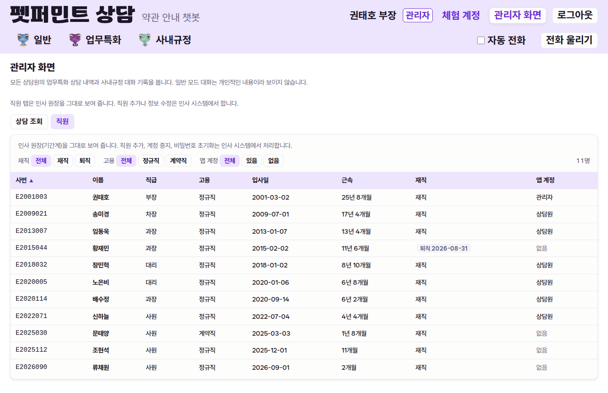

<!--
다루는 곳: web/src/pages/Admin.tsx, app/routers/admin.py, app/services/admin.py, db/migrations/petmint/0011_admin_views.sql
읽은 커밋: 077fb87
-->
# 관리자 화면

> 이 글은 관리자가 상담원별 상담을 열어 보고 직원 목록을 읽는 관리자 화면을, 상담 조회와 직원 두 갈래로 보여 드립니다.

**관리자 화면은 상담 한 건 한 건을 열어 실제로 무엇을 묻고 무엇을 답했는지 확인하는 곳입니다. 읽기만 하는 화면이라 고치는 단추가 없고, 관리자가 남의 상담을 열 때마다 열람 기록을 남깁니다.** [docs:02_pipeline/13_access_and_tunnel.md:152] [docs:02_pipeline/13_access_and_tunnel.md:156] [docs:02_pipeline/13_access_and_tunnel.md:168]

## 들어오는 사람

관리자 계정으로 들어오면 헤더의 이름 옆에 "관리자 화면" 단추가 생깁니다. [docs:02_pipeline/13_access_and_tunnel.md:152] 들어올 수 있는지는 직급이 아니라 앱 계정의 권한 칸 하나로 정합니다. 부장이라서 관리자인 것이 아니고, 그래서 화면에도 이름 뒤에 직급을, 그 옆에 권한 배지를 따로 붙입니다. [docs:02_pipeline/13_access_and_tunnel.md:166] 상담원이 이 화면의 주소를 직접 열면 "권한 없음"이 아니라 "없는 주소"로 답합니다. 권한 없음으로 답하면 그런 화면이 있다는 것을 알려 주기 때문입니다. [docs:02_pipeline/13_access_and_tunnel.md:165]

처음 보는 분은 로그인 화면의 관리자 체험 카드로 비밀번호 없이 들어와 같은 화면을 쓸 수 있습니다(→ 「로그인과 체험 계정」). [docs:02_pipeline/13_access_and_tunnel.md:134] 체험 관리자에게는 다른 방문자가 체험 계정으로 남긴 대화도 보입니다. 체험 계정은 이미 누구나 함께 쓰는 계정이라고 안내하므로 새로 생기는 노출이 아니고, 가리면 상담이 하나도 없어 화면을 보여 줄 수 없기 때문입니다. [docs:02_pipeline/13_access_and_tunnel.md:167]

## 상담 조회

상담원 목록에는 고른 기간의 상담 건수와 업무특화 고객 수가 나옵니다. 한 사람을 누르면 그 사람의 상담 목록이, 한 건을 펼치면 대화가 나옵니다. 대화에는 질문과 답, 근거 조항, 계산 카드, 상담원이 남긴 평가와 의견, 턴마다 붙는 거절 표시가 있고, 모양은 상담원이 지난 상담을 다시 열 때와 같은 읽기 전용입니다. [docs:02_pipeline/13_access_and_tunnel.md:160] 기간은 오늘이 기본이고 최대 31일까지 고를 수 있으며, 상담 목록은 200건씩 끊어 보입니다. [docs:02_pipeline/13_access_and_tunnel.md:162]

보이는 것은 업무특화 상담과 사내규정 대화입니다. 일반 모드 대화는 개인적인 질문이라 관리자도 보지 않아, 목록에서 빠지고 대화 번호를 직접 넣어도 찾을 수 없다고 답합니다(→ 「일반 모드」). [docs:02_pipeline/13_access_and_tunnel.md:161] [code:web/src/pages/Admin.tsx:41] 상담원이 지난 채팅 목록에서 제거한 대화는 기록이 남아 있으므로 보이되 "목록에서 지움" 표시가 붙습니다. [docs:02_pipeline/13_access_and_tunnel.md:163]

상담 조회가 비어 보이지 않게, 계정이 있는 가상 상담원들에게 상담을 넣어 두었습니다. [docs:archive/13_access_and_tunnel_log.md:45] 질문은 상담원이 물을 법한 것으로 새로 지었고, 답은 운영 챗봇에 실제로 물어 받은 것을 고르거나 고치지 않고 두었습니다. 엇나간 답도 남겨 두었는데, 이 화면이 바로 그런 건을 찾는 곳이기 때문입니다. [docs:archive/13_access_and_tunnel_log.md:48] 처음 넣은 묶음은 26건, 36턴입니다(2026-11-12). [docs:02_pipeline/13_access_and_tunnel.md:233] 지금 운영에서 계정이 있는 7명의 상담은 사람마다 일반 1~6건, 사내규정 3~11건, 업무특화 4~30건입니다(2026-11-19). [docs:02_pipeline/13_access_and_tunnel.md:234]

## 직원 표

직원 탭은 사번, 이름, 직급, 고용형태, 입사일, 휴직을 뺀 근속, 재직 여부, 앱 계정 역할을 보여 줍니다. 표 머리를 누르면 정렬되고, 재직, 고용형태, 앱 계정으로 거를 수 있습니다. 직원 11명은 모두 가상 인물입니다. [docs:02_pipeline/13_access_and_tunnel.md:164] [docs:02_pipeline/12_data_storage.md:134] 급여, 평가, 휴가 표는 화면에 띄우지 않는 데서 그치지 않고 불러오는 질의에도 넣지 않습니다. [docs:02_pipeline/13_access_and_tunnel.md:164]

이 화면에서 직원을 추가하거나 계정을 멈추거나 비밀번호를 바꿀 수는 없습니다. 인사 원장은 회사의 원래 인사 시스템이 가진 것이라 앱은 읽기만 하고, 그런 일은 운영자가 따로 합니다. 화면에는 "인사 시스템에서 처리합니다"라고만 적습니다. [docs:02_pipeline/13_access_and_tunnel.md:156]

## 열람 기록

관리자 화면은 다른 사람의 상담을 여는 곳이라, 상담 목록이나 대화를 열 때마다 한 줄을 남깁니다. 누가 열었는지, 체험 로그인으로 열었는지, 누구의 무엇을 열었는지, 접속 주소와 시각입니다. 목록에도 첫 질문을 줄인 제목이 보이므로 목록을 연 것도 남깁니다. [docs:02_pipeline/13_access_and_tunnel.md:168] 이 화면이 데이터베이스에 쓰는 것은 이 열람 기록 하나뿐입니다. [docs:02_pipeline/13_access_and_tunnel.md:156] 열람 기록을 보는 화면은 따로 없어, 누가 무엇을 봤는지는 데이터베이스를 직접 조회해 확인합니다. [docs:02_pipeline/12_data_storage.md:217]

## 무엇이 어려웠나

운영 대시보드와 무엇을 나눌지가 먼저였습니다. 대시보드는 모드별 질문 수, 거절률, 응답 시간 같은 전체 추세를 봅니다. 이 화면까지 숫자와 그래프를 그리면 따로 만들 까닭이 없어서, 이 화면은 개별 건만 보게 했습니다. 대시보드에서 거절률이 오른 것을 보고 여기서 그 상담을 찾아 읽는 흐름입니다. 숫자는 상담원 목록의 건수뿐이고, 거절도 비율이 아니라 턴마다 붙는 표시로 보입니다. 표시가 없으면 답을 하나하나 읽어야 거절을 찾을 수 있기 때문입니다. [docs:02_pipeline/13_access_and_tunnel.md:154]

상담원 목록에 누구를 둘지도 정해야 했습니다. 앱 계정이 없는 직원은 상담이 생길 수 없어 늘 0건으로만 남으니 목록에서 뺐습니다. 평가 스크립트가 남긴 기록은 개발 데이터베이스에만 19,667건(2026-11-19)이라, 섞이면 진짜 상담이 묻혀서 직원 원장 밖의 계정도 뺐습니다. [docs:02_pipeline/13_access_and_tunnel.md:163]

이 화면에 걸친 한계는 → 「알려진 한계」에 모았습니다. 왜 이렇게 만들었고 무엇이 어려웠는지는 기술문서 [「대화 기록과 관리자 화면」](../notion/06_records_admin.md)에 있습니다.
